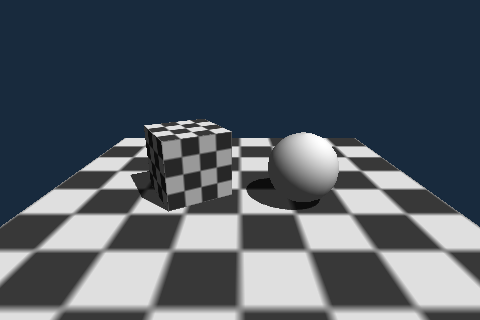

# 3D scenes (`#import "scene3d"`, the package `fire-scene3d`)

A small 3D engine for programs: a **scene** is a space that holds objects, cameras, lights and textures; a **camera** is the link between the scene and a framebuffer - `camera.Render()` draws what
the camera sees into it. The renderer is a **software renderer** written in C (`packages/scene3d/native/s3d_engine.h`), so it runs everywhere fire runs - on a PC, in a native build, on an ESP32,
in the browser (WebAssembly) - and **the picture is the same pixel for pixel** in the virtual machine and in a native build. Where there is a GPU, a scene can be drawn by it instead (`scene.Renderer =
RenderMode.Hardware`, Vulkan; see *Hardware*). Like every bridge it is a package (`ember`, [Packages and ember](../packages/README.md)): a prelude in fire (`scene3d.fire`: the scene, the units, the objects) plus the C of the
renderer (`"language": "c"`, [Writing the natives of a package (C or C++) and connecting them to the prelude](../packages/natives.md)). It needs `graphics`.

```
program         #import "scene3d"          Scene, Camera, Object, Light, Texture, Material, Model, Template   (fire, package fire-scene3d)
bridge          fire_bridge_scene3d.h      meshes, textures and depth buffers by handle                         (C99, the same code in the VM and in a native build)
renderer        s3d_engine.h               triangles in, RGBA pixels out; knows nothing of fire                 (plain C99: the software renderer)
hardware        s3d_gpu_vk.h               the same queue drawn by the GPU                                      (C99 + Vulkan 1.0, loaded at run time; optional)
```

## Quick start



```fire
#import "windows"
#import "scene3d"

var fb = new Framebuffer(480, 320)
var win = new Window(fb, "Scene3D")
var scene = new Scene()

var box = new Object(Template.Box, 0m, 0.5m, 0m, 1m, 1m, 1m)   // x, y, z of the position, then width, height, depth
box.Texture = Texture.Checker(32, 4)
scene.Add(box, "crate")                                         // the optional key: scene.Get("crate")
scene.Add(Light.Directional(-0.5, -1.0, -0.4))

var cam = new Camera(fb)                                        // the camera draws into this framebuffer
cam.SetPosition(0m, 2m, 4m)
cam.RotationX = -20deg                                          // or cam.LookAt(0m, 0.5m, 0m)
scene.Add(cam)

while (win.Tick()) {
    box.Rotate(0deg, 1deg, 0deg)
    cam.Render()
}
```

The sample **Scene3D** (Help > Samples > Graphics and UI) is a bigger scene.

## Units

Space is metric. A length is a number **with a unit** (`1m`, `20cm`, `3mm`, `2.5m`), an angle is `deg` or `rad`. A plain number where a length or an angle belongs is an error
(`Scene3DException`: *A length needs a unit of length*) - a unit is never guessed. The properties give back lengths in meters (`box.X` is `0m`) and angles in degrees (`box.RotationY` is `30deg`);
`ball.Height / 1cm` is the number of centimetres. Colours are integers `0xAABBGGRR` like everywhere in fire (`S3D.Rgb(r, g, b)` makes one from 0..255 parts). Vectors without a unit
(the direction of a light) are plain numbers.

The space is right handed, **Y is up**; a camera without rotation looks along **-Z**. Rotations are applied in the order Z, X, Y (yaw, pitch, roll as you would expect for a turned head
or a turned object).

## Scene

```
var scene = new Scene()
scene.Add(item)               // object, camera, light or texture; returns the item
scene.Add(item, "key")        // the same, and the item can be fetched with the key (a key is used once)
scene.Get("key")              // the item, or undefined
scene.Remove(item)
scene.Objects  scene.Cameras  scene.Lights  scene.Textures        // the lists (List)
scene.AmbientColor  scene.AmbientIntensity                         // the light that is everywhere (default white, 0.25)
```

The scene owns what it holds (ownership like everywhere in fire: `Add` takes the item, destroying the scene destroys its objects, cameras, lights and textures).
`Add` keeps an item only when it is handed over (`try item.TakeTo(scene)`, SPEC 2.2): a fresh one (`scene.Add(new Object(...))`) or one passed with `take`. An item in a variable of
the caller stays the caller's - at the top level that is fine (it lives as long as the program), but in a loop or a function it dies with that scope and the scene is left with a
destroyed object (`DestroyedException`). Hand it over: `var b = new Object(...); b.Color = ...; scene.Add(take b)`.

## Objects

```
new Object(Template.Box, x, y, z, width, height, depth)     // from a template; Box, Sphere, Cylinder, Cone, Plane (lies in XZ, no height), Quad (standing, facing +Z, no depth: pass 0m)
new Object(model)                                           // from a Model (or the text of a Wavefront OBJ file), shared triangles
new Object()                                                // empty: add triangles with AddTriangle(x1, y1, z1, x2, y2, z2, x3, y3, z3)
```

| Property | |
|---|---|
| `X`, `Y`, `Z` | position of the **anchor** (lengths) |
| `AnchorX`, `AnchorY`, `AnchorZ` | the point of the object that sits at the position, as a fraction of its width, height and depth. `0.5, 0.5, 0.5` (default) is the centre, `0.5, 0, 0.5` the middle of the bottom |
| `RotationX`, `RotationY`, `RotationZ` | angles; the object turns around its anchor |
| `Width`, `Height`, `Depth` | the **outer dimensions**; setting one scales the object on that axis (`box.Height = 2m`) |
| `ScaleX`, `ScaleY`, `ScaleZ` | the scale factors themselves (1 = the size of the mesh) |
| `Color` | the colour when there is no texture (default light grey) |
| `Texture`, `Material` | the look (below) |
| `Visible` | `false`: not drawn |
| `Opacity` | 1 = solid, less is see-through (see *Transparency*) |
| `AlphaCutoff` | above 0: texture pixels that are more transparent than this are left out, the rest is solid |
| `Lit` | `false`: no lighting, the colour as it is |
| `CastShadows`, `ReceiveShadows` | whether the object throws shadows / shows the shadows of others (both default `true`) |
| `Layers` | a number whose bits are layers (default all); only lights that share a layer with the object light it |
| `Billboard` | `BillboardMode.Facing` (always faces the camera) or `BillboardMode.Vertical` (turns around the vertical axis only), default `Off` |
| `Triangles` | the number of triangles |

`SetPosition(x, y, z)`, `SetRotation(x, y, z)`, `SetAnchor(x, y, z)`, `SetSize(w, h, d)`, `Move(dx, dy, dz)` and `Rotate(rx, ry, rz)` set or change several at once.

A **Model** holds triangles that several objects can share: `Model.FromTemplate(Template.Sphere, 32)`, `Model.FromObj(text)` (`v`, `vt` and `f` lines; polygons are cut into triangles; the normals are
computed; the unit of the coordinates is the meter), `Model.FromArrays(positions, uvs, indices)`.

## Textures and materials

A **Texture** is an RGBA picture: `new Texture(framebuffer)` (a framebuffer in the colour mode Rgba; the pixels are copied - load a PNG into a framebuffer with the graphics package),
`new Texture(width, height, bytes)` or `Texture.Checker(size, cells, colorA, colorB)`. Assign it to an object (`obj.Texture = t`) or put it into the scene (`scene.Add(t, "wall")`) to keep it with a key.

A texture has a position, a size and a rotation of its own on the object: `TextureWidth` and `TextureHeight` are the part of the object that one copy of the picture covers (the default is the whole
object once; a smaller size repeats the picture, `50cm` on a 1 m box is a 2x2 pattern), `TextureX` and `TextureY` move it, `TextureRotation` turns it.

**Bump maps.** `texture.AddBumpmap()` makes a bump map from the brightness of the texture itself (bright is high, a little smoothed); `texture.AddBumpmap(framebuffer)` takes a picture (a framebuffer
in the colour mode Rgba; its brightness is the height; another size is scaled to the texture) and `texture.AddBumpmap(width, height, bytes)` bytes (`width * height` heights, or `width * height * 4`
bytes R, G, B, A). The lighting then tilts the surface normal against the slope of the heights, so the surface looks rough or carved although its triangles are flat. `texture.BumpStrength` (default 1)
says how much, `texture.RemoveBumpmap()` takes it away.

A **Material** says how a surface answers to light: `Specular` (strength of the highlights, 0 = matt), `Shininess` (how small they are), `Smooth` (shade with the interpolated normals; `false`: every
triangle flat), `TwoSided` and `Emissive` (a colour the surface gives off by itself). `Material.Matte()`, `Material.Plastic()` and `Material.Metal()` are ready made.

## Lights

```
Light.Ambient(color, intensity)                              // everywhere
Light.Directional(dx, dy, dz, color, intensity)              // parallel rays (the sun) travelling in the direction (dx, dy, dz)
Light.Point(x, y, z, color, intensity)                       // from a place; weaker with the distance (Range: where it has half of its strength)
```

The lighting is computed per pixel (Blinn-Phong). Without a light an object is black except for the ambient light of the scene.

**Switching light off and limiting it.** `light.Enabled = false` turns a light off. `light.CastShadows` (default `true`) says whether what it hits throws shadows; the scene can switch all shadows
off (`scene.Shadows = false`, much faster) and sets their sharpness (`scene.ShadowResolution`, 64..4096 pixels per shadow map, default 1024). Objects choose too: `obj.CastShadows`, `obj.ReceiveShadows`,
`obj.Lit`. To *limit* a light to some objects give both **layers**: `light.Layers` and `obj.Layers` are numbers whose bits (1, 2, 4, ... up to 8388608) are layers, and a light only lights the objects
that share a layer with it (the default is all of them). The ambient light of the scene is not limited.

**Shadows** are shadow maps: the casters are drawn as seen from the light (one orthographic map for a directional light, six for a point light) and a pixel is dark when something is nearer to the
light. The edge is soft (bilinear filtering of the comparison). Transparent objects throw no shadow, and a cut-out (`AlphaCutoff`) throws the shadow of its whole mesh (set `CastShadows = false`
for sprites).

## Cameras

```
var cam = new Camera(framebuffer)         // the framebuffer is the one the camera draws into (the camera takes it)
cam.X  cam.Y  cam.Z                       // position
cam.RotationX  cam.RotationY  cam.RotationZ
cam.LookAt(x, y, z)                       // turns it (pitch and yaw) towards a point
cam.FieldOfView = 60deg                   // vertical angle of view
cam.Near  cam.Far                         // what is nearer or farther is not drawn
cam.Background                            // the colour of the empty space
scene.Add(cam)
cam.Render()                              // draws every object of the scene into the framebuffer
```

A scene can have several cameras with different framebuffers (a second view, a mirror, a texture: `new Texture(cameraFramebuffer)` after `Render()`). The framebuffer has to be in the colour mode
`Rgba` (the default). Its size can change between two `Render` calls.

## Transparency and billboards

An object with `Opacity < 1`, or a texture with transparent pixels (a PNG with an alpha channel), is **blended** with what is behind it. Solid objects are drawn first, then the transparent ones from the
far to the near (by the distance of their centres; objects that interpenetrate or are very long can show sorting errors, as in every renderer that sorts objects). A transparent object that is
`TwoSided` shows its far side through the near one. For hard edges (leaves, fences, sprites with a clear outline) use `AlphaCutoff = 0.5`: the pixels are either there or not, and no sorting is needed.

A **billboard** is an object that turns to the camera: `var tree = new Object(Template.Quad, x, y, z, 2m, 3m, 0m); tree.Texture = ...; tree.Billboard = BillboardMode.Vertical` (the quad turns around the
vertical axis only, so it stays upright) or `BillboardMode.Facing` (always faces the camera: particles, labels). The anchor of the object is the point it turns around.

## Speed

A picture is **queued, then drawn**: `camera.Render()` hands every object to the renderer, which sets up the triangles and then fills the rows of the picture in bands of 16 rows that are shared between
threads (`scene.Threads`: 0 = as many as the machine has, up to 8; 1 = one thread). Every pixel belongs to one band and gets its triangles in the order they were queued, so **the picture is the same
for every number of threads** and in a native build. WebAssembly and the ESP32 draw with one thread. What costs time is the pixels, not the triangles: the lighting is computed per pixel and per light,
so the time follows the size of the picture and the number of lights; copying the finished picture (800 x 600 x 4 bytes) takes about 0.3 ms. On the development machine a picture of 800 x 600 with
four objects and three lights takes about 20 ms on one thread and 6 ms on four; shadows add about 40 ms on one thread, 10 ms on four. Ways to go faster: a smaller framebuffer (stretch it with
the window), fewer lights, `scene.Shadows = false`, a smaller `ShadowResolution` - or the GPU (`scene.Renderer = RenderMode.Hardware`). There is no anti-aliasing yet.

## What the renderer does

Perspective projection, clipping against the near plane, back-face culling (`TwoSided` turns it off), a depth buffer, perspective-correct texture coordinates, bilinear texture filtering with
repeat, Blinn-Phong lighting per pixel with an ambient, directional and point lights, flat or smooth shading. Shadows (shadow maps, soft edge), transparency (opacity, alpha textures, cut-outs), billboards, bump maps, lights and surfaces that can be switched off or limited to layers. There is no
anti-aliasing. All numbers are `float`; the VM and a native build run the same C and give the same pixels (the tests compare them; the C is a port of the former C++ renderer and gives the same
pixels as it did).

## Hardware

The software renderer needs no GPU and no driver, which is what makes the same program run on a microcontroller and in the browser. On a PC the GPU can draw the same scene:

```
scene.Renderer = RenderMode.Hardware     // the GPU, where there is one (default: RenderMode.Software)
cam.Render()
print(cam.LastRenderer)                  // who drew the last picture: RenderMode.Hardware, or RenderMode.Software when there is no GPU
print(S3D.HardwareName())                // the GPU ("" when there is none)
print(S3D.HardwareError())               // why there is none ("" when there is one)
```

* **Vulkan 1.0**, the API that drivers of Windows, Linux and Android have, and macOS through MoltenVK (the Vulkan SDK or `brew install molten-vk`). It is **loaded when the hardware renderer is first
  asked for** (`vulkan-1.dll`, `libvulkan.so.1`, `libvulkan.1.dylib`/`libMoltenVK.dylib`); nothing is linked, and building fire or a program needs no Vulkan SDK - the declarations come with the
  package (`s3d_vk.h`, made from the Khronos header) and the shaders are compiled to SPIR-V already (`s3d_shaders.h`).
* **Optional at every level.** No Vulkan, no driver, no GPU, a device that is lost: the software renderer draws, and the program goes on. `LastRenderer` and `HardwareError` say what happened.
  Targets without a GPU (the ESP32, FreeRTOS, the browser) have no hardware renderer at all (`RenderMode.Hardware` draws in software there).
* **The same scene, the same look.** Everything in this document works on the GPU too: the per pixel lighting (the fragment shader is the software renderer's code in GLSL), textures with their
  mapping, bump maps, cut-outs, transparency (opaque first, then the transparent objects from far to near), two sided surfaces, billboards, layers and shadow maps (drawn by the GPU, compared and
  filtered like the software ones). The pictures are close to the software ones but not the same pixel for pixel (the GPU rasterises and filters by its own rules); the software renderer stays the
  reference, and only it gives the same pixels everywhere.
* **How.** A picture is drawn into an image on the GPU and read back into the camera's framebuffer, so everything else stays as it is (a window shows it, `new Texture(cameraFramebuffer)` takes it).
  Meshes and textures are copied to the GPU when they are first drawn, and again when a texture gets another bump map. One picture at a time: `Render` waits for the GPU. With
  `DirectDrawing` (below) the picture is not read back.
* **No limits** on lights and shadows (as in the software renderer): the lights and the shadow maps are storage buffers of any length, and the shadow maps are packed into an atlas
  (an array of layers, several maps per layer). The shadow maps may take a quarter of the GPU's memory (64 MB to 1 GB): when a scene has more of them than fit, all of them are made
  smaller (half the size, again if needed) - a light never loses its shadow for that; it gets softer. Checked with 250 lights and 1250 shadow maps.
* **Switches** (environment variables): `FIRE_S3D_GPU=0` never uses the GPU; `FIRE_S3D_GPU=cpu` also takes a Vulkan device that is a CPU (Mesa's lavapipe, SwiftShader) - slower than the
  software renderer, but it lets a machine without a GPU test the hardware renderer (the tests of fire do so).
* **For the developers of the package**: `native/shaders/` holds the GLSL (`build.sh` compiles it with `glslangValidator` into `s3d_shaders.h`), `native/tools/make_s3d_vk.py` makes `s3d_vk.h`
  from the Vulkan header (only what the backend uses) and `native/tools/check_s3d_vk.sh` checks every struct and value of it against the real header. The backend is checked with the Khronos
  validation layers (`VK_INSTANCE_LAYERS=VK_LAYER_KHRONOS_validation`, also with synchronization validation).

### DirectDrawing

```
scene.Renderer = RenderMode.Hardware
cam.DirectDrawing = true                 // the camera's pictures go straight from the GPU into the window that shows its framebuffer
while (win.Tick()) {
    cam.Render()                         // draws on the GPU; the framebuffer becomes transparent
    hud.FillText(10, 10, "Score 42", ...) // what is drawn into the framebuffer now lies over the picture
}
print(cam.DrewDirectly)                  // the last picture went straight into the window
```

Without DirectDrawing a picture of the GPU travels back to the CPU, into the framebuffer, and from there into the window (another copy, and another way to the GPU of the window). With it,
the window shows the picture from the GPU itself: the camera's renderer draws into the window through a swap chain (Vulkan's `VK_KHR_swapchain` on a surface of the window system: Win32,
X11, Wayland, or a `CAMetalLayer` on macOS), and `Render` does not wait for the GPU - the program goes on (the next `Render` waits for the picture before).

* **The framebuffer is the overlay.** `Render` clears the framebuffer to transparent; what the program draws into it afterwards (a HUD, text, a UI) is laid over the picture where its
  alpha is not 0, stretched to the window like the picture. So a program that draws a HUD after `Render` looks the same with and without DirectDrawing. The framebuffer does not hold the
  picture then: `new Texture(cameraFramebuffer)` or a screenshot of the framebuffer see only the overlay.
* **When it works**: the scene's `Renderer` is `RenderMode.Hardware`, there is a GPU with swap chains, and a `Window` shows the camera's framebuffer (also one of a started
  `WindowManager`, which presents on its own thread). The window gives itself to the camera at its next frame: its usual way of showing the framebuffer (SDL's renderer) is put away
  and comes back when `DirectDrawing` is switched off, the camera goes, or the GPU cannot show the window. The first picture after switching it on is also read back (the window may not
  take it); a camera whose window cannot take it works as without (`DrewDirectly` stays false). One window per camera: a second window of the same framebuffer shows the framebuffer.
* **Is it faster?** It saves reading the picture back (on a GPU of its own a wait for the GPU and a copy over the bus), the copy into the framebuffer and the copy into the window's
  texture, and the CPU and the GPU work at the same time; it costs the copy of the overlay to the GPU (skipped when nothing is drawn into the framebuffer). The sample
  **Scene3D Benchmark** (Help > Samples) measures the three ways on a machine: software, hardware with the picture read back, and DirectDrawing.
* **In the VM** the windows are those of the C library of graphics and windows ([Eigene Plattformschicht statt SDL, Effekte und ein modernerer Stil](../spec/UI_PLATFORM.md)): the package library gets them through `fire_host.win_attach` (native/abi/fire_pkg_abi.h, `fire_present_fn`); in a
  native build the windows bridge does the same through the graphics bridge (`fire_gfx_attachPresenter`; the display layer gives the native handles: `fire_display_native`, with SDL2
  and with SDL3).

Why Vulkan: it is the GPU API with a future on all desktop systems and Android, has a C interface (it fits a C package) and a loader on every machine with a GPU driver; OpenGL is frozen and
deprecated on macOS, Direct3D is Windows only. Further backends can sit behind the same queue (`s3d_gpu_flush`): WebGPU for the browser (through `webgpu.h`) or Metal directly are the candidates.

## Errors

`Scene3DException`: a bump map with the wrong number of bytes, a length or an angle without a unit, a key used twice, an item that is not an object, camera, light or texture, a camera that is not in a scene (`scene.Add(cam)` first), a
framebuffer that is not `Rgba`, a model that has no triangles, a texture with the wrong number of bytes.
