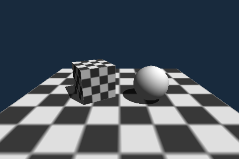

# 3D scenes (`#import "scene3d"`, the package `fire-scene3d`)

A small 3D engine for programs: a **scene** is a space that holds objects, cameras, lights and textures; a **camera** is the link between the scene and a framebuffer - `camera.Render()` draws what
the camera sees into it. The renderer is a **software renderer** written in C (`packages/scene3d/native/s3d_engine.h`), so it runs everywhere fire runs - on a PC, in a native build, on an ESP32,
in the browser (WebAssembly) - and **the picture is the same pixel for pixel** in the virtual machine and in a native build. Where there is a GPU, a scene can be drawn by it instead (`scene.Renderer =
RenderMode.Hardware`, Vulkan; see *Hardware*). Like every bridge it is a package (`ember`, [Packages and ember](../packages/README.md)): a prelude in fire (`scene3d.fire`: the scene, the units, the objects) plus the C of the
renderer (`"language": "c"`, [Writing the natives of a package (C or C++) and connecting them to the prelude](../packages/natives.md)). It needs `graphics`.

```
program         #import "scene3d"          Scene, Camera, Object, Light, Texture, Material, Model, Template   (fire, package fire-scene3d)
bridge          fire_bridge_scene3d.h      meshes, textures and depth buffers by handle                         (C99, the same code in the VM and in a native build)
renderer        s3d_engine.h               triangles in, RGBA pixels out; knows nothing of fire                 (plain C99: the software renderer)
hardware        s3d_gpu_vk.h               the same queue drawn by the GPU                                      (C99 + Vulkan 1.0, loaded at run time; optional)
```

## Quick start



```fire
#import "windows"
#import "scene3d"

var fb = new Framebuffer(480, 320)
var win = new Window(fb, "Scene3D")
var scene = new Scene()

var box = new Object(Template.Box, 0m, 0.5m, 0m, 1m, 1m, 1m)   // x, y, z of the position, then width, height, depth
box.Texture = Texture.Checker(32, 4)
scene.Add(box, "crate")                                         // the optional key: scene.Get("crate")
scene.Add(Light.Directional(-0.5, -1.0, -0.4))

var cam = new Camera(fb)                                        // the camera draws into this framebuffer
cam.SetPosition(0m, 2m, 4m)
cam.RotationX = -20deg                                          // or cam.LookAt(0m, 0.5m, 0m)
scene.Add(cam)

while (win.Tick()) {
    box.Rotate(0deg, 1deg, 0deg)
    cam.Render()
}
```

The sample **Scene3D** (Help > Samples > Graphics and UI) is a bigger scene.

## Units

Space is metric. A length is a number **with a unit** (`1m`, `20cm`, `3mm`, `2.5m`), an angle is `deg` or `rad`. A plain number where a length or an angle belongs is an error
(`Scene3DException`: *A length needs a unit of length*) - a unit is never guessed. The properties give back lengths in meters (`box.X` is `0m`) and angles in degrees (`box.RotationY` is `30deg`);
`ball.Height / 1cm` is the number of centimetres. Colours are integers `0xAABBGGRR` like everywhere in fire (`S3D.Rgb(r, g, b)` makes one from 0..255 parts). Vectors without a unit
(the direction of a light) are plain numbers.

The space is right handed, **Y is up**; a camera without rotation looks along **-Z**. Rotations are applied in the order Z, X, Y (yaw, pitch, roll as you would expect for a turned head
or a turned object).

## Scene

```
var scene = new Scene()
scene.Add(item)               // object, camera, light or texture; returns the item
scene.Add(item, "key")        // the same, and the item can be fetched with the key (a key is used once)
scene.Get("key")              // the item, or undefined
scene.Remove(item)
scene.Objects  scene.Cameras  scene.Lights  scene.Textures        // the lists (List)
scene.AmbientColor  scene.AmbientIntensity                         // the light that is everywhere (default white, 0.25)
```

The scene owns what it holds (ownership like everywhere in fire: `Add` takes the item, destroying the scene destroys its objects, cameras, lights and textures).
`Add` keeps an item only when it is handed over (`try item.TakeTo(scene)`, SPEC 2.2): a fresh one (`scene.Add(new Object(...))`) or one passed with `take`. An item in a variable of
the caller stays the caller's - at the top level that is fine (it lives as long as the program), but in a loop or a function it dies with that scope and the scene is left with a
destroyed object (it is no longer drawn; using it is a `DestroyedException`). Hand it over: `var b = new Object(...); b.Color = ...; scene.Add(take b)`.

The scene itself lives in the renderer: objects, lights, cameras, materials and scenes are kept there, their properties read and write it directly, and `camera.Render()` draws
the scene in one call - nothing is put together in fire for every picture (small and fast, also on 16-bit targets). So objects and lights reach the picture through `scene.Add`
and leave it through `scene.Remove`; the lists `scene.Objects`, `scene.Lights`, ... are for reading (an object added to the list directly is not drawn).

## Objects

```
new Object(Template.Box, x, y, z, width, height, depth)     // from a template; Box, Sphere, Cylinder, Cone, Plane (lies in XZ, no height), Quad (standing, facing +Z, no depth: pass 0m)
new Object(model)                                           // from a Model (or the text of a Wavefront OBJ file), shared triangles
new Object()                                                // empty: add triangles with AddTriangle(x1, y1, z1, x2, y2, z2, x3, y3, z3)
```

| Property | |
|---|---|
| `X`, `Y`, `Z` | position of the **anchor** (lengths) |
| `AnchorX`, `AnchorY`, `AnchorZ` | the point of the object that sits at the position, as a fraction of its width, height and depth. `0.5, 0.5, 0.5` (default) is the centre, `0.5, 0, 0.5` the middle of the bottom |
| `KeepMeshCoordinates` | `true`: the origin of the mesh (0, 0, 0 of `Model.FromArrays`, of a model file, of `AddTriangle`) sits at the position instead of the anchor - at position 0, 0, 0 the mesh is where its own coordinates say (world coordinates; the anchor does not count while it is on). `false` (default): the anchor |
| `RotationX`, `RotationY`, `RotationZ` | angles; the object turns around its anchor |
| `Width`, `Height`, `Depth` | the **outer dimensions**; setting one scales the object on that axis (`box.Height = 2m`) |
| `ScaleX`, `ScaleY`, `ScaleZ` | the scale factors themselves (1 = the size of the mesh) |
| `Color` | the colour when there is no texture (default light grey) |
| `Texture`, `Material` | the look (below) |
| `EmissiveTexture`, `EmissiveStrength` | an emission map: a texture whose colours the surface gives off itself (lit windows at night; below) |
| `Reflectivity` | 0 .. 1: how much the surface mirrors what is above it (wet streets; software and hardware renderer; below) |
| `Visible` | `false`: not drawn |
| `Opacity` | 1 = solid, less is see-through (see *Transparency*) |
| `AlphaCutoff` | above 0: texture pixels that are more transparent than this are left out, the rest is solid |
| `Lit` | `false`: no lighting, the colour as it is |
| `CastShadows`, `ReceiveShadows` | whether the object throws shadows / shows the shadows of others (both default `true`) |
| `Layers` | a number whose bits are layers (default all); only lights that share a layer with the object light it |
| `Billboard` | `BillboardMode.Facing` (always faces the camera) or `BillboardMode.Vertical` (turns around the vertical axis only), default `Off` |
| `Background` | `true`: the object is part of the backdrop - a sky (below, *Sky: background objects*); default `false` |
| `Triangles` | the number of triangles |

`SetPosition(x, y, z)`, `SetRotation(x, y, z)`, `SetAnchor(x, y, z)`, `SetSize(w, h, d)`, `Move(dx, dy, dz)` and `Rotate(rx, ry, rz)` set or change several at once.

A **Model** holds triangles that several objects can share: `Model.FromTemplate(Template.Sphere, 32)`, `Model.FromObj(text)` (`v`, `vt` and `f` lines; polygons are cut into triangles; the normals are
computed; the unit of the coordinates is the meter), `Model.FromArrays(positions, uvs, indices)` - x, y, z per vertex, u, v per vertex (or an empty array), three
indices per triangle. Each one is an array of numbers (a typed one, `float[32] p[]`, is read as it is, nothing is converted) or a byte buffer of float32 numbers -
the indices uint32 - in little endian, as a glTF file holds them (`IO.File.ReadAllBytes`, `buffer.Slice`).

## Textures and materials

A **Texture** is an RGBA picture: `new Texture(framebuffer)` (a framebuffer in the colour mode Rgba; the pixels are copied - load a PNG into a framebuffer with the graphics package),
`new Texture(width, height, bytes)` or `Texture.Checker(size, cells, colorA, colorB)`. Assign it to an object (`obj.Texture = t`) or put it into the scene (`scene.Add(t, "wall")`) to keep it with a key.

A texture has a position, a size and a rotation of its own on the object: `TextureWidth` and `TextureHeight` are the part of the object that one copy of the picture covers (the default is the whole
object once; a smaller size repeats the picture, `50cm` on a 1 m box is a 2x2 pattern), `TextureX` and `TextureY` move it, `TextureRotation` turns it.

**Bump maps.** `texture.AddBumpmap()` makes a bump map from the brightness of the texture itself (bright is high, a little smoothed); `texture.AddBumpmap(framebuffer)` takes a picture (a framebuffer
in the colour mode Rgba; its brightness is the height; another size is scaled to the texture) and `texture.AddBumpmap(width, height, bytes)` bytes (`width * height` heights, or `width * height * 4`
bytes R, G, B, A). The lighting then tilts the surface normal against the slope of the heights, so the surface looks rough or carved although its triangles are flat. `texture.BumpStrength` (default 1)
says how much, `texture.RemoveBumpmap()` takes it away.

**Filter.** `texture.Filter` says how the colours are read between the texels: `TextureFilter.Bilinear` (the default: smooth), `TextureFilter.Nearest` (the nearest texel: hard pixels, for pixel art)
or `TextureFilter.Sharp` (sharp bilinear: hard pixels as with Nearest, but at the edge between two texels the colours blend over one screen pixel, so texels that are not a whole number of pixels wide
do not shimmer or come out unevenly wide when the object moves). When a texel is smaller than a pixel, Sharp is the same as Bilinear. The software and the hardware renderer know all three; the bump
map is always read bilinear, and `RenderMode.Fast` always reads the nearest texel.

```fire
var t = Texture.Checker(16, 16)
t.Filter = TextureFilter.Sharp
sprite.Texture = t
```

**Emission maps.** `obj.EmissiveTexture` is a second texture on the same texture coordinates (and the same mapping: `TextureWidth`, `TextureX`, ...) whose colours the
surface gives off by itself: they are added to the lit colour - also at night and in the shadow - times their alpha and `obj.EmissiveStrength` (default 1). Black
adds nothing, so a house can have its night picture as an emission map: the lit windows bright, everything else black - the windows glow while the walls stay lit
by the lights of the scene. `EmissiveStrength = 0` switches it off (the day), above 1 it shines brighter; the map has its own `Filter`. The software and the
hardware renderer draw it (`RenderMode.Fast` does not).

```fire
house.Texture = facade                       // the atlas of the walls and windows
house.EmissiveTexture = facadeNight          // the same atlas: lit windows in colour, the rest black
house.EmissiveStrength = 1.0                // at night (0 by day: the windows are dark)
```

**Reflections.** `obj.Reflectivity` (0 .. 1, default 0) makes a surface mirror what is above it: a wet street, puddles, water, a polished floor. It is a
reflection *in the picture* (screen space): after the solid objects are drawn, the ray from the eye to each pixel of the surface is mirrored at its normal (the bump
map counts: ripples) and followed through the depth of the picture; what it meets there is mixed in by `Reflectivity` times a fresnel - a grazing view (a street seen from
a car) shows the whole `Reflectivity`, a view straight down a fifth of it. What the camera does not see cannot be mirrored: a ray that leaves the picture or finds nothing
shows the background (with fog: the fog colour), and near the edges of the picture the found colours fade into it. Only the parts that face up (more than 30 degrees) and
solid objects reflect; transparent objects are drawn afterwards and are not in the reflections.

```fire
street.Reflectivity = 0.6         // rain: the lamps and the lit windows shine in the street
puddle.Reflectivity = 0.9
puddle.Texture.AddBumpmap()       // (ripples: the reflection follows the bump map)
```

The software renderer and the GPU draw reflections (`RenderMode.Fast` draws the surface without them). A picture without a reflecting surface costs nothing more;
one with them costs a pass over the reflecting pixels - with a wet street on most of a picture of 960 x 600 about 45 ms on one thread, 25 ms on four. The GPU follows the
same rays the same way (its shader is the software renderer's pass in GLSL; see *Hardware*).

A **Material** says how a surface answers to light: `Specular` (strength of the highlights, 0 = matt), `Shininess` (how small they are), `Smooth` (shade with the interpolated normals; `false`: every
triangle flat), `TwoSided` and `Emissive` (a colour the surface gives off by itself). `Material.Matte()`, `Material.Plastic()` and `Material.Metal()` are ready made.

## Lights

```
Light.Ambient(color, intensity)                              // everywhere
Light.Directional(dx, dy, dz, color, intensity)              // parallel rays (the sun) travelling in the direction (dx, dy, dz)
Light.Point(x, y, z, color, intensity)                       // from a place; weaker with the distance (Range: where it has half of its strength)
```

The lighting is computed per pixel (Blinn-Phong). Without a light an object is black except for the ambient light of the scene.

**The end of a point light.** A point light gets weaker with the distance (`light.Range` is where it has half of its strength), but it never quite stops: every pixel
of the picture looks at it. `light.Cutoff` gives it an end - from that distance on it lights nothing, and its light fades smoothly to exactly 0 there (the attenuation is
multiplied by `(1 - (d / Cutoff)^4)^2`: no edge, not even in its slope). `0m` (the default) is no end, as before.

```fire
foreach (lamp in lamps) {
    var l = Light.Point(lamp.X, 5m, lamp.Z, S3D.Rgb(255, 210, 150), 1.5)
    l.Range = 4m
    l.Cutoff = 8m                 // a street lamp lights a circle of 8 m, nothing beyond
    l.CastShadows = false         // (six shadow maps per point light: leave them to a few)
    scene.Add(take l)
}
```

A light with an end costs only where it can reach: the software renderer splits the picture into tiles of 16 x 16 pixels and lists for each tile the lights whose
sphere (position, `Cutoff`) covers part of it on the screen; a pixel looks only at the lights of its tile (and at every light without an end). So hundreds of street
lamps cost hardly more than a few: 300 lamps with `Cutoff = 8m` over a ground of 500 m x 500 m (960 x 600 pixels, one thread) take 14 ms instead of 790 ms without an end
(on four threads 8 ms instead of 430 ms). The picture is the same as without the tiles - a pixel sums the same lights in the same order; `scene.LightCulling = false` makes
every pixel look at every light (slower, for comparisons). The GPU culls with the same tiles (a pixel of the GPU looks at the lights of its tile, the same lists in the
same order); `RenderMode.Fast` knows the end, too, but without the tiles (each pixel looks at all lights).

**Switching light off and limiting it.** `light.Enabled = false` turns a light off. `light.CastShadows` (default `true`) says whether what it hits throws shadows; the scene can switch all shadows
off (`scene.Shadows = false`, much faster) and sets their sharpness (`scene.ShadowResolution`, 64..4096 pixels per shadow map, default 1024). Objects choose too: `obj.CastShadows`, `obj.ReceiveShadows`,
`obj.Lit`. To *limit* a light to some objects give both **layers**: `light.Layers` and `obj.Layers` are numbers whose bits (1, 2, 4, ... up to 8388608) are layers, and a light only lights the objects
that share a layer with it (the default is all of them). The ambient light of the scene is not limited.

**Shadows** are shadow maps: the casters are drawn as seen from the light (one orthographic map for a directional light, six for a point light) and a pixel is dark when something is nearer to the
light. The edge is soft (bilinear filtering of the comparison). Transparent objects throw no shadow, and a cut-out (`AlphaCutoff`) throws the shadow of its whole mesh (set `CastShadows = false`
for sprites).

## Cameras

```
var cam = new Camera(framebuffer)         // the framebuffer is the one the camera draws into (the camera takes it)
cam.X  cam.Y  cam.Z                       // position
cam.RotationX  cam.RotationY  cam.RotationZ
cam.LookAt(x, y, z)                       // turns it (pitch and yaw) towards a point
cam.FieldOfView = 60deg                   // vertical angle of view
cam.Near  cam.Far                         // what is nearer or farther is not drawn
cam.Background                            // the colour of the empty space
scene.Add(cam)
cam.Render()                              // draws every object of the scene into the framebuffer
```

A scene can have several cameras with different framebuffers (a second view, a mirror, a texture: `new Texture(cameraFramebuffer)` after `Render()`). The framebuffer has to be in the colour mode
`Rgba` (the default). Its size can change between two `Render` calls.

### Drawing in the background: RenderAsync

```
while (win.Tick()) {                      // the window shows the framebuffer: the picture before, with the HUD over it
    ...                                   // the game: input, cars, the camera - meanwhile scene3d draws the last state
    cam.WaitRender()                      // the picture of RenderAsync (done by now, or waited for) goes into the framebuffer
    cam.RenderAsync()                     // the next picture begins - with the scene as it is now - and is drawn in scene3d's thread
    hud.FillText(10, 10, "km/h 42", ...)  // over the picture that WaitRender put there
}
cam.WaitRender()                          // (the last one, before the end)
```

`cam.RenderAsync()` takes a **snapshot** of the scene and returns at once; scene3d draws the picture in a **render thread of its own** (one for all cameras), while
the program goes on - with the next frame, its physics, its loading. The snapshot is what `Render` would draw now: the places, turns, sizes, visibility and looks of
the objects (their animation as it stands), the camera, the lights, the fog, the tint and the particles. **What the program changes afterwards shows in the next
picture**: a moved object, a light switched off, a camera turned, an object removed from the scene - even one that goes altogether (its model and texture with it:
the snapshot holds them until it is drawn). `cam.WaitRender()` waits for the picture (when it is not done yet) and puts it into the framebuffer; `cam.Rendering` says
whether one is pending. The picture is **the same, pixel for pixel, as the one of `Render`** at the moment `RenderAsync` was called (the same snapshot is what `Render`
draws, too - in the caller's thread).

* **The framebuffer is the program's** until `WaitRender`: the render thread draws into memory of its own, never into the framebuffer, and only `WaitRender` (in
  the program's thread) writes it. So the window can show the framebuffer and a HUD can be drawn into it meanwhile - but what is drawn into it **before**
  `WaitRender` is drawn over by the picture: draw the HUD after `WaitRender` (as above: the HUD is one frame newer than the picture - one frame of latency, the
  price of drawing side by side).
* One picture per camera at a time: `RenderAsync` while one is pending puts that one into the framebuffer first, `Render` too (then draws its own over it).
* A camera that goes while its picture is drawn: the picture is drawn to its end and dropped.
* **Who draws at once**: `RenderMode.Fast` (the lean renderer writes straight into the framebuffer), the targets with the lean renderer only (dos16, bios16), and
  targets without threads (the browser, the ESP32): there `RenderAsync` draws at once and returns with the picture in the framebuffer, `WaitRender` has nothing to
  do - the same pictures, only not side by side.
* **The GPU**: the render thread draws with it as `Render` does (with DirectDrawing the picture goes into the window when it is drawn; `WaitRender` makes the
  framebuffer transparent). Meshes and textures go to the GPU when a picture first shows them - in the thread that draws it.
* **In the VM** it is the same (the render thread is one of the package's library); the calls of the program into the library are one at a time there (see
  *Threads*), so a `WaitRender` in one fire thread holds up the calls of the others.

### Threads

scene3d is **thread safe** (`"threadSafe": true`): fire threads may build models, textures and objects and change scenes side by side - the typical case is a
worker that builds the models of a world (`Model.FromArrays`, `Model.FromBytes`, `new Texture`, `Terrain`) while the main program draws. Building a model, a texture
or a terrain holds **nobody** up (it is nobody's yet: it is made without any lock and only put into the table of handles at the end). Everything that names an item -
the properties of objects, lights, cameras, materials and scenes, `scene.Add` / `Remove`, `Advance`, the bodies and rays of the physics - goes through **one short
lock** (a few instructions for a property; a scene's `Advance` or a `Raycast` for their time), and a picture holds it only for its **snapshot** (the queue of the
objects: their matrices and looks, no triangle is transformed): the drawing itself - `Render` in the caller's thread as `RenderAsync` in the render thread - runs with
no lock of the package, so the other threads change the scene meanwhile (for the next picture). The hardware renderer has a lock of its own (the GPU's queue), and
what goes on another thread does not wait for the GPU (its copy on the GPU is freed with the next picture). The texels of a texture (`SetBump`) change after the
pictures that are drawn with it.

* The same item from two threads at once is allowed (each call is whole), but the order is the program's: a thread that moves an object while another draws gets
  the move into this picture or the next.
* **In the VM** the calls into the package's library are one at a time (the library's lock of the VM), and in a debug build (the GIL) the natives are: a worker
  thread's `Model.FromArrays` holds the calls of the main program up until it is done there. A native build in release calls them side by side
  ([Writing the natives of a package](../packages/natives.md), `threadSafe`). The render thread of `RenderAsync` draws beside the program everywhere (it only
  computes: it calls nothing of fire).

## Sky: background objects

`obj.Background = true` makes an object part of the **backdrop** of the scene: a sky dome, stars, the sun and the moon (billboards), clouds. The backdrops are
drawn **first**, before all other objects, **in the order they were added to the scene**, without the depth test and without writing the depth: each one is laid
over the ones before it by its alpha (texture alpha, `Opacity`; an `AlphaCutoff` makes it a solid cut-out) - so add them from far to near (dome, stars, sun and
moon, clouds). Everything else is drawn over them as usual: solid objects, transparent ones (glass) and particles (rain in front of the sky). Lighting works on them
as on any object (a sky is usually `Lit = false`).

* **No fog on the sky.** Once a picture has a backdrop, what no other object covers is not fog: `scene.Fog` fogs the world, and the sky stays as it is (without a
  backdrop, what no object covers is all fog, as before). The same in the software renderer, the lean one (Fast) and on the GPU.
* No shadows (a backdrop casts none and receives none), no reflection (`Reflectivity` does not make it a mirror, and the reflections of the world do not find it -
  where they find nothing, they show the colour of the sky they show anyway: the background or the fog).
* It is an object like any other in every other respect: keep it **inside `Camera.Far`** (a dome of a radius of 1000 m wants a `Far` above that) and move it with the
  camera (`dome.SetPosition(cam.X, cam.Y, cam.Z)` every frame), so it never comes nearer. `Camera.Background` still clears the picture: it shows only where no
  backdrop covers.
* The pixels where a backdrop is drawn get its alpha (a + (1 - a) times what was there), the others keep the alpha of `Camera.Background`.

```
var twoSided = new Material(0.0, 32.0, true, true)   // (seen from inside / from below)
var dome = new Object(Template.Sphere, 0m, 0m, 0m, 1600m, 1600m, 1600m)
dome.Texture = skyGradient           // a texture from the zenith to the horizon
dome.Lit = false
dome.Material = twoSided
dome.Background = true
scene.Add(dome)
var sun = new Object(Template.Quad, 300m, 400m, -500m, 80m, 80m, 0m)
sun.Texture = sunDisc                // a soft disc with alpha
sun.Lit = false
sun.Billboard = BillboardMode.Facing
sun.Background = true
scene.Add(sun)
var clouds = new Object(Template.Plane, 0m, 300m, 0m, 1500m, 0m, 1500m)
clouds.Texture = cloudLayer          // white with alpha
clouds.Lit = false
clouds.Material = twoSided
clouds.TextureScrollX = 2m/s         // drifting
clouds.Background = true
scene.Add(clouds)
cam.Far = 3000m
scene.Fog(S3D.Rgb(150, 160, 175), 50m, 900m)   // fogs the world, not the sky
// every frame: the sky goes with the camera
dome.SetPosition(cam.X, cam.Y, cam.Z)
sun.SetPosition(cam.X + 300m, cam.Y + 400m, cam.Z - 500m)
clouds.SetPosition(cam.X, cam.Y + 300m, cam.Z)
```

## Transparency and billboards

An object with `Opacity < 1`, or one whose texture coordinates reach transparent pixels of its texture (a PNG with an alpha channel), is **blended** with what is behind it. Solid objects are drawn first, then the transparent ones from the
far to the near (by the distance of their centres; objects that interpenetrate or are very long can show sorting errors, as in every renderer that sorts objects). A transparent object that is
`TwoSided` shows its far side through the near one. For hard edges (leaves, fences, sprites with a clear outline) use `AlphaCutoff = 0.5`: the pixels are either there or not, and no sorting is needed.

Which objects are transparent is decided per object and texture: only the texels its mesh can read count - the range of its texture coordinates (with the mapping `TextureWidth`, `TextureX`, ...,
and the neighbouring texels the filter mixes in). So an atlas with a few panes of glass makes only the objects transparent that use the glass; the rest stays solid (it casts shadows, it is
drawn with the solid objects). The opaque pixels of a transparent object (alpha 255, `Opacity` 1) hide what is behind them like a solid object - they also write the depth -, the others are
mixed in. With fog (`scene.Fog`) the fog goes over the solid objects first; a transparent object is then fogged by its own distance as it is drawn (glass in front of the sky is not swallowed
by the fog of the sky behind it). The software renderer and the GPU draw this the same way.

A **billboard** is an object that turns to the camera: `var tree = new Object(Template.Quad, x, y, z, 2m, 3m, 0m); tree.Texture = ...; tree.Billboard = BillboardMode.Vertical` (the quad turns around the
vertical axis only, so it stays upright) or `BillboardMode.Facing` (always faces the camera: particles, labels). The anchor of the object is the point it turns around.

## Speed

A picture is **queued, then drawn**: `camera.Render()` (and `RenderAsync`, which draws in a thread of its own - *Cameras*) hands every object to the renderer, which sets up the triangles and then fills the rows of the picture in bands of 16 rows that are shared between
threads (`scene.Threads`: 0 = as many as the machine has, up to 8; 1 = one thread). Every pixel belongs to one band and gets its triangles in the order they were queued, so **the picture is the same
for every number of threads** and in a native build. WebAssembly and the ESP32 draw with one thread. What costs time is the pixels, not the triangles: the lighting is computed per pixel and per light,
so the time follows the size of the picture and the number of lights (of the lights that reach a part of the picture: point lights with a `Cutoff` count only where
they reach, see *Lights*); copying the finished picture (800 x 600 x 4 bytes) takes about 0.3 ms. On the development machine a picture of 800 x 600 with
four objects and three lights takes about 20 ms on one thread and 6 ms on four; shadows add about 40 ms on one thread, 10 ms on four. Ways to go faster: a smaller framebuffer (stretch it with
the window), fewer lights, `scene.Shadows = false`, a smaller `ShadowResolution`, the lean renderer (`scene.Renderer = RenderMode.Fast`, below) - or the GPU (`scene.Renderer = RenderMode.Hardware`). There is no anti-aliasing yet.

## What the renderer does

Perspective projection, clipping against the near plane, back-face culling (`TwoSided` turns it off), a depth buffer, perspective-correct texture coordinates, bilinear texture filtering with
repeat, Blinn-Phong lighting per pixel with an ambient, directional and point lights, flat or smooth shading. Shadows (shadow maps, soft edge), transparency (opacity, alpha textures, cut-outs), billboards, bump maps, emission maps, reflections in screen space, point lights with an end culled per tile, lights and surfaces that can be switched off or limited to layers. There is no
anti-aliasing. **Meshes are kept compact**: positions as 16-bit numbers in the box of the mesh, normals in two bytes, texture coordinates as 16-bit numbers, indices of
16 bits below 65536 corners - 12 bytes a corner (8 without texture coordinates) and 2 an index instead of 32 and 4 (a sphere of 24 segments 7 KB instead of 17, a
smooth terrain of 64 x 64 heights 97 KB instead of 226); the pictures differ from float meshes by at most 2 of 255 in a few pixels. All numbers are `float`; the VM and a native build run the same C and give the same pixels (the tests compare them; the C is a port of the former C++ renderer and gives the same
pixels as it did).

## Models and animations

Models with parts and animations come from fire's model file `.f3d`, which forge makes from glTF 2.0 (`Model.FromResource(new Resource("x.glb"))`,
`obj.Play("walk")`, `obj.Advance(16ms)`): see [Models and animations](models.md).

## Terrains

Landscapes from a grid of heights - smooth hills or blocks with steps, and the height of the ground at a point - come with `#import "scene3d.terrain"`: see
[Terrains](terrain.md).

## Particles and effects

Fire, smoke, sparks, rain, snow and explosions (`#import "scene3d.effects"`), fog and a tint over the whole picture (`scene.Fog`, `scene.Tint`), objects
that spin and textures that run (`obj.SpinY = 90deg`, `obj.TextureScrollX = 30cm / 1s`), all moved on by `scene.Advance(dt)`: see
[Particles and effects](effects.md).

## Physics

Bodies that fall, bounce, stack and are pushed, static ground from the objects' own triangles or a terrain's heights, a character that walks, climbs
stairs and jumps, triggers and rays (`#import "scene3d.physics"`, `Body.Static(ground)`, `Body.Ball(ball).Bouncy()`, `new Character(hero)`): see
[Physics](physics.md).

## Fast: the lean renderer

`scene.Renderer = RenderMode.Fast` draws with a second, small software renderer - for old and small machines (DOS on 16 bit), and for anyone who wants speed more than the full
picture. It needs little memory: the picture is drawn in **bands of rows**, the depth buffer (16 bits per pixel) and the colours exist for one band only, and a finished band goes
straight into the framebuffer (in a native build the camera keeps no picture of its own at all; in the VM it goes through one). Its memory follows the width of the picture, not its size.

| | Software | Fast |
| --- | --- | --- |
| light | per pixel (Blinn-Phong, highlights) | per corner (diffuse), interpolated |
| textures | bilinear | nearest, perspective correct every 16 pixels |
| shadows | every light that casts them, soft edge | the first directional light that casts them; a 16-bit shadow map (`ShadowResolution`, at most 128 on 16 bit), hard edge |
| transparency | blended, far to near | a dither (pixels left out by a 4x4 pattern), no sorting |
| bump maps, highlights | yes | no |
| palette framebuffers | no | yes: drawn in the palette (32 shades of each colour, the closest colour from a table) |
| memory | 12 bytes per pixel | one band (24 KB on 16 bit) and the shadow map |

The VM and a native build give the same pixels, and the size of the bands does not change them. On DOS in real mode (`dos16`, `bios16`) Fast is the only renderer in the program:
every scene draws with it, whatever `Renderer` says (the full renderer is not built in - the program is smaller).

## Hardware

The software renderer needs no GPU and no driver, which is what makes the same program run on a microcontroller and in the browser. On a PC the GPU can draw the same scene:

```
scene.Renderer = RenderMode.Hardware     // the GPU, where there is one (default: RenderMode.Software)
cam.Render()
print(cam.LastRenderer)                  // who drew the last picture: RenderMode.Hardware, or RenderMode.Software when there is no GPU
print(S3D.HardwareName())                // the GPU ("" when there is none)
print(S3D.HardwareError())               // why there is none ("" when there is one)
```

* **Vulkan 1.0**, the API that drivers of Windows, Linux and Android have, and macOS through MoltenVK (the Vulkan SDK or `brew install molten-vk`). It is **loaded when the hardware renderer is first
  asked for** (`vulkan-1.dll`, `libvulkan.so.1`, `libvulkan.1.dylib`/`libMoltenVK.dylib`); nothing is linked, and building fire or a program needs no Vulkan SDK - the declarations come with the
  package (`s3d_vk.h`, made from the Khronos header) and the shaders are compiled to SPIR-V already (`s3d_shaders.h`).
* **Optional at every level.** No Vulkan, no driver, no GPU, a device that is lost: the software renderer draws, and the program goes on. `LastRenderer` and `HardwareError` say what happened.
  Targets without a GPU (the ESP32, FreeRTOS, the browser, Windows 3.x and DOS) have no hardware renderer at all (`RenderMode.Hardware` draws in software there).
  On the 16-bit targets the software renderer works too (its buffers may pass 64 KB); on DOS in real mode scenes draw with the lean renderer (Fast, see above): besides
  the framebuffer itself it needs one band and the shadow map.
* **The same scene, the same look.** Everything in this document works on the GPU too: the per pixel lighting (the fragment shader is the software renderer's code in GLSL;
  point lights with a `Cutoff` end there as well, culled per tile with `LightCulling` - the lists of the tiles are the software renderer's, the shader loops over the lights of
  the pixel's tile), textures with their mapping, bump maps, emission maps, cut-outs, transparency (opaque first, then the transparent objects from far to near), two sided surfaces, billboards, layers and shadow maps (drawn by the GPU, compared and
  filtered like the software ones), the reflections (`Reflectivity`: after the opaque objects a reflecting object is drawn once more, its shader follows the mirrored ray
  through the depth of the picture and reads what it meets in a copy of the picture - the software renderer's pass in GLSL) and the fog (`scene.Fog`: a last pass over the
  picture reads its depth before the transparent objects are drawn, as the software renderer's fog does; the shader of a transparent object fogs it by its own distance, and its
opaque texels write the depth in a pass of their own). Particles and the tint are laid over the picture by the CPU (not with DirectDrawing).

  | | Software | Fast | Hardware |
  | --- | --- | --- | --- |
  | fog (`scene.Fog`) | yes | yes (16 steps) | yes (a pass over the depth) |
  | point lights with an end culled per tile (`LightCulling`) | yes | the end, without the tiles | yes (the same tiles) |
  | reflections (`Reflectivity`) | yes | no | yes (the same rays) |
  | emission maps, bump maps, highlights | yes | no | yes |
  | particles, tint | yes | yes | over the picture (not with DirectDrawing) |
  | backdrops (`Object.Background`) | yes | yes (transparency as a dither) | yes (a pipeline without depth) |
 The pictures are close to the software ones but not the same pixel for pixel (the GPU rasterises and filters by its own rules); the software renderer stays the
  reference, and only it gives the same pixels everywhere.
* **How.** A picture is drawn into an image on the GPU and read back into the camera's framebuffer, so everything else stays as it is (a window shows it, `new Texture(cameraFramebuffer)` takes it).
  Meshes and textures are copied to the GPU when they are first drawn, and again when a texture gets another bump map. One picture at a time: `Render` waits for the GPU. With
  `DirectDrawing` (below) the picture is not read back.
* **No limits** on lights and shadows (as in the software renderer): the lights and the shadow maps are storage buffers of any length, and the shadow maps are packed into an atlas
  (an array of layers, several maps per layer). The shadow maps may take a quarter of the GPU's memory (64 MB to 1 GB): when a scene has more of them than fit, all of them are made
  smaller (half the size, again if needed) - a light never loses its shadow for that; it gets softer. Checked with 250 lights and 1250 shadow maps.
* **Switches** (environment variables): `FIRE_S3D_GPU=0` never uses the GPU; `FIRE_S3D_GPU=cpu` also takes a Vulkan device that is a CPU (Mesa's lavapipe, SwiftShader) - slower than the
  software renderer, but it lets a machine without a GPU test the hardware renderer (the tests of fire do so).
* **For the developers of the package**: `native/shaders/` holds the GLSL (`build.sh` compiles it with `glslangValidator` into `s3d_shaders.h`), `native/tools/make_s3d_vk.py` makes `s3d_vk.h`
  from the Vulkan header (only what the backend uses) and `native/tools/check_s3d_vk.sh` checks every struct and value of it against the real header. The backend is checked with the Khronos
  validation layers (`VK_INSTANCE_LAYERS=VK_LAYER_KHRONOS_validation`, also with synchronization validation).

### DirectDrawing

```
scene.Renderer = RenderMode.Hardware
cam.DirectDrawing = true                 // the camera's pictures go straight from the GPU into the window that shows its framebuffer
while (win.Tick()) {
    cam.Render()                         // draws on the GPU; the framebuffer becomes transparent
    hud.FillText(10, 10, "Score 42", ...) // what is drawn into the framebuffer now lies over the picture
}
print(cam.DrewDirectly)                  // the last picture went straight into the window
```

Without DirectDrawing a picture of the GPU travels back to the CPU, into the framebuffer, and from there into the window (another copy, and another way to the GPU of the window). With it,
the window shows the picture from the GPU itself: the camera's renderer draws into the window through a swap chain (Vulkan's `VK_KHR_swapchain` on a surface of the window system: Win32,
X11, Wayland, or a `CAMetalLayer` on macOS; on Windows 8 and later the windows show their frames through DirectComposition: there the camera draws into a picture of its
own and copies it into the window's texture of D3D11, which Vulkan imports - `VK_KHR_external_memory_win32`, the GPU of the window's D3D11), and `Render` does not wait for the GPU -
the program goes on (the next `Render` waits for the picture before).

* **The framebuffer is the overlay.** `Render` clears the framebuffer to transparent; what the program draws into it afterwards (a HUD, text, a UI) is laid over the picture where its
  alpha is not 0, stretched to the window like the picture. So a program that draws a HUD after `Render` looks the same with and without DirectDrawing. The framebuffer does not hold the
  picture then: `new Texture(cameraFramebuffer)` or a screenshot of the framebuffer see only the overlay.
* **When it works**: the scene's `Renderer` is `RenderMode.Hardware`, there is a GPU with swap chains, and a `Window` shows the camera's framebuffer (also one of a started
  `WindowManager`, which presents on its own thread). The window gives itself to the camera at its next frame: its usual way of showing the framebuffer (the display's) is put away
  and comes back when `DirectDrawing` is switched off, the camera goes, or the GPU cannot show the window. The first picture after switching it on is also read back (the window may not
  take it); a camera whose window cannot take it works as without (`DrewDirectly` stays false). One window per camera: a second window of the same framebuffer shows the framebuffer.
* **Is it faster?** It saves reading the picture back (on a GPU of its own a wait for the GPU and a copy over the bus), the copy into the framebuffer and the copy into the window's
  texture, and the CPU and the GPU work at the same time; it costs the copy of the overlay to the GPU (skipped when nothing is drawn into the framebuffer). The sample
  **Scene3D Benchmark** (Help > Samples) measures the three ways on a machine: software, hardware with the picture read back, and DirectDrawing.
* **In the VM** the windows are those of the C library of graphics and windows ([Eigene Plattformschicht, Effekte und ein modernerer Stil](../spec/UI_PLATFORM.md)): the package library gets them through `fire_host.win_attach` (native/abi/fire_pkg_abi.h, `fire_present_fn`); in a
  native build the windows bridge does the same through the graphics bridge (`fire_gfx_attachPresenter`; fire's own display layer gives the native handles: `fire_display_native`).

Why Vulkan: it is the GPU API with a future on all desktop systems and Android, has a C interface (it fits a C package) and a loader on every machine with a GPU driver; OpenGL is frozen and
deprecated on macOS, Direct3D is Windows only. Further backends can sit behind the same queue (`s3d_gpu_flush`): WebGPU for the browser (through `webgpu.h`) or Metal directly are the candidates.

## Errors

`Scene3DException`: a bump map with the wrong number of bytes, a length or an angle without a unit, a key used twice, an item that is not an object, camera, light or texture, a camera that is not in a scene (`scene.Add(cam)` first), a
framebuffer that is not `Rgba`, a model that has no triangles, a texture with the wrong number of bytes.
