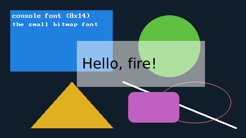

# Graphics 2D: framebuffers, renderers, windows

Drawing in fire happens in a **framebuffer** - a picture in memory. A **renderer** draws into it with **brushes** (areas) and **pens** (lines), a
**window** shows it. The three are separate: a framebuffer can live without a window (a picture to save, a display on a board), several renderers can
draw into one framebuffer, and one framebuffer can be shown by a window.

| Import | Brings |
| --- | --- |
| `#import "graphics"` | `Framebuffer`, `Renderer`, `SolidBrush`, `Pen`, `Fonts`, `Slicer` - no window, works everywhere (also on a board) |
| `#import "windows"` | `Window`, `WindowManager`, `EventType`, `Clipboard`, `SystemTheme`, `Backdrop`; brings `graphics` with it |
| `#import "ui"` | the [user interface library](../ui/README.md), on top of both |



```fire
#import "windows"

var fb = new Framebuffer(480, 270)
var win = new Window(fb, "Graphics")
var r = new Renderer(fb)

r.ClearTo(0xFF2B1E10)                                        // opaque dark blue (0xAABBGGRR)
r.FillRect(20, 20, 200, 120, new SolidBrush(0xFFE08020))
r.FillCircle(330, 90, 60, new SolidBrush(0xFF40C060))
r.FillTriangle(60, 250, 140, 160, 220, 250, new SolidBrush(0xFF20B0E0))
r.DrawLine(240, 160, 460, 250, new Pen(0xFFFFFFFF, 3))
r.DrawEllipse(380, 200, 70, 40, new Pen(0xFF8080FF))
r.FillRoundRect(250, 180, 100, 60, 12, new SolidBrush(0xFFC060C0))
r.FillRect(150, 80, 250, 90, new SolidBrush(0x80FFFFFF))     // translucent: blends with what is below

var ink = new SolidBrush(0xFFFFFFFF)
r.DrawText(24, 24, "console font (8x14)", ink)
r.DrawText(24, 44, "the small bitmap font", ink, undefined, Fonts.Get("8x8"))
r.DrawText(160, 108, "Hello, fire!", new SolidBrush(0xFF000000), undefined, Fonts.Get("DejaVu Sans"), 28)

while (win.Tick()) { }                                       // show it until the window is closed
```

## Colours

A colour is an `int`. **0 to 255 is an index into the framebuffer's palette**, any other number a direct colour `r + g*256 + b*65536 + a*16777216`
(written in hex: `0xAABBGGRR`; alpha 255 = opaque, 0 = invisible). So `0xFF0000FF` is opaque red, and `0` is palette entry 0 (black), not "transparent".
`UI.Color.Rgb(r, g, b)` (with `ui`) builds an opaque colour.

The default palette is in the style of xterm-256: 0-15 the 16 classic CGA colours, 16-231 a 6x6x6 colour cube, 232-255 a grey ramp. It can be
changed: `fb.SetPaletteColor(i, color)`, `SetPaletteRgb(i, r, g, b)`, `GetPaletteColor(i)`, `ReadPalette(withAlpha)` / `WritePalette(bytes)`.

## Framebuffer

| Member | Meaning |
| --- | --- |
| `new Framebuffer(width, height, mode = ColorMode.Rgba)` | a new picture; `ColorMode.Palette`: one byte per pixel, an index into the palette (changing a palette entry recolours every pixel with that index - palette animation) |
| `Framebuffer.FromFile(path)`, `FromImage(bytes)`, `FromResource(resource)` | a picture from a PNG, BMP or GIF (the format is recognised by its first bytes; GIF: the first frame). An indexed picture becomes a palette framebuffer with the file's palette, everything else RGBA; a `mode` forces one |
| `Framebuffer.FromPixels(width, height, bytes, mode, palette)` | from raw pixels (RGBA: 4 bytes per pixel, palette: 1) |
| `Width()`, `Height()`, `Mode()`, `Resize(w, h)` | size and mode |
| `ToPng()` | the picture as the bytes of a PNG file - `IO.File.WriteAllBytes("x.png", fb.ToPng())` ([files](../stdlib/filesystem.md)) |
| `ReadBytes()`, `WriteBytes(bytes)`, `ReadByte(i)`, `WriteByte(i, v)`, `ByteCount()` | raw access, row by row from the top |
| `ToMask(threshold, darkIsRemoved, alphaThreshold)` | a black/white mask (for the [slicer](#slicer-pictures-to-tool-paths)) |
| `TransparentIndex` | the transparent palette index of a loaded picture (-1: none) |
| `Accelerated` | true when the framebuffer lives on the GPU (below) |

Errors are a `GraphicsException`; a picture that cannot be read is an `ImageException`. `FromFile` reads only what the host allows (in spark and
`forge` everything, an embedding host can restrict it).

## Renderer

`new Renderer(framebuffer)` draws into one framebuffer. Areas take a **brush**, lines and outlines a **pen**:

| Group | Methods |
| --- | --- |
| clear | `Clear()`, `ClearTo(color)` |
| pixels | `SetPixel(x, y, color)`, `GetPixel(x, y)`, `GetPixelIndex(x, y)` |
| areas (brush) | `FillRect`, `Fill(brush)` (everything), `FillCircle(cx, cy, r, b)`, `FillEllipse(cx, cy, rx, ry, b)`, `FillTriangle`, `FillPolygon(points, b)`, `FloodFill(x, y, b)`, `FloodFillBorder(x, y, b, borderColor)`, `FillRoundRect(x, y, w, h, radius, b)` |
| lines (pen) | `DrawPoint`, `DrawLine(x0, y0, x1, y1, p)`, `DrawPath(points, p, closed)`, `DrawRect`, `DrawCircle`, `DrawEllipse`, `DrawTriangle`, `DrawPolygon(points, p, closed)`, `DrawRoundRect(x, y, w, h, radius, p)` |
| text | `DrawText(x, y, text, brush, background, font, size)`, `TextWidth(text, font, size)`, `TextHeight(font, size)`, `TextAscent(font, size)` - see [fonts](fonts.md) |
| pictures | `Blit(source, x, y, mode, key)`, `BlitRegion(source, sx, sy, sw, sh, dx, dy, mode, key)`, `BlitScaled(source, sx, sy, sw, sh, dx, dy, dw, dh, mode, key)` (a negative width or height mirrors) |
| effects | `DrawShadow`, `Blur`, `DrawMaterial` (below) |
| clipping | `SetClip(x, y, w, h)`, `ResetClip()` - every drawing call stays inside |
| a text console | `Print(text)`, `Locate(row, column)`, `SetColor(foreground, background)`, `CellWidth()`, `CellHeight()` - the framebuffer as a text screen with the console font |

`points` is a flat array `[x0, y0, x1, y1, ...]`; polygons are filled with the even-odd rule. `BlitMode`: `Copy` (everything), `Transparent` (leave out
transparent source pixels - alpha 0, or the colour key / transparent index of a palette picture), `Blend` (mix by alpha).

**Brushes and pens:** `new SolidBrush(color)` (`Color` can be changed), `new Pen(color, width = 1, shape = PenShape.Round)` (`Color`, `Width` 1..512,
`Shape`: `Round` or `Square`). A translucent pen blends the whole line once (overlaps are not blended twice).

**Alpha blending** (`renderer.AlphaBlending`, on by default) mixes translucent colours with what is below - in an RGBA framebuffer. In a palette
framebuffer an alpha from 128 is opaque, below it nothing is drawn. `Clear` and `ClearTo` always set the pixels as they are.

**Scale:** `renderer.scale` (1.0) draws everything larger - the UI uses it for the display scaling; coordinates stay logical.

### Rounded shapes, shadows and materials

The modern look of the UI is drawn by these calls, which any program can use:

| Call | Meaning |
| --- | --- |
| `FillRoundRect(x, y, w, h, radius, brush)`, `DrawRoundRect(x, y, w, h, radius, pen)` | rounded rectangles, anti-aliased corners |
| `DrawShadow(x, y, w, h, radius, softness, color, offsetY)` | a soft shadow around a rectangle |
| `Blur(x, y, w, h, radius, cornerRadius)` | blurs an area of the framebuffer |
| `DrawMaterial(kind, x, y, w, h, radius, tint, baseColor, options)` | `MaterialKind.Tint`, `Glass` or `Acrylic`: blur, tint and noise like the materials of Windows 11; `options` from `MaterialOptions.Blur`, `Transparency`, `Dark` |

### On the GPU

Where a GPU with Vulkan is there, an RGBA framebuffer can live on it: shapes, text, blits, shadows, blur and materials are then drawn by the GPU, and
the pixels come back only when something reads them (`GetPixel`, `ToPng`) - a window shows the GPU's picture directly. `FIRE_GFX_GPU=1` in the
environment puts every RGBA framebuffer there; `fb.Accelerated` tells whether it worked, `Framebuffer.GpuError()` why not. Without a GPU, for palette
framebuffers and on boards, the software renderer draws the same picture.

## Windows

```fire
#import "windows"

var fb = new Framebuffer(320, 200)
var win = new Window(fb, "Events")
var r = new Renderer(fb)
var dot = new SolidBrush(0xFF0080FF)
r.ClearTo(0xFFFFFFFF)
win.EnableEvents()
while (win.Tick()) {                       // shows the frame, fetches the events; false when closed
    var e = win.NextEvent()
    while (e != undefined) {
        if (e[0] == EventType.MouseDown) { r.FillCircle(e[2], e[3], 6, dot) }
        if (e[0] == EventType.KeyDown) { print("key " + e[1]) }
        e = win.NextEvent()
    }
}
```

| Member | Meaning |
| --- | --- |
| `new Window(framebuffer, title, manager = WindowManager.Default)` | a window that shows the framebuffer (it is not owned by the window - keep it) |
| `Tick()` | one cycle: show the frame, collect the events; `false` once the window is closed (waits for the display's refresh with `VSync`, on by default) |
| `Show(modal)`, `Run()` | on the window manager (below) |
| `Close()`, `IsClosed`, `AutoClose` | closing; with `AutoClose = false` a click on the close button only reports `CloseRequest` and the program decides |
| `AutoResize` | the framebuffer follows the window's size (when the user resizes it); off: the picture is stretched |
| `SetSize(w, h)`, `Scale` | the window's size; the display scale |
| `Cursor` | the mouse pointer (0 arrow, 1 text, 2 wait, 3 cross, 4 progress, 5-9 sizes and move, 10 not allowed, 11 hand) |
| `Backdrop` | what the desktop shows behind the window: `Backdrop.None`, `Transparent`, `Blur`, `Acrylic`, `Mica` (what was given) |
| `PresentArea(x, y, w, h)` | show only this area at the next tick (the UI uses it) |
| `TouchMouse` | touches also arrive as mouse events (default on) |
| `SetTextInputArea(x, y, w, h)` | where the input method (IME) shows its candidates |
| `StartDrag(text, files)`, `CanStartDrag()` | drag text or files into another program |

### Events

`EnableEvents()` switches a queue on; after every tick `NextEvent()` returns one event after the other (`undefined` when none is left). The event is an
array - `e[0]` is the `EventType`, the rest depends on it; positions are pixels of the framebuffer:

| Event | Array |
| --- | --- |
| `MouseDown`, `MouseUp` | `[type, button, x, y]` |
| `MouseMove` | `[type, x, y, buttons]` |
| `MouseScroll` | `[type, scrollX, scrollY, x, y]` |
| `KeyDown`, `KeyUp` | `[type, keycode, scancode, modifiers, repeated]` |
| `TextInput` | `[type, text]` (typed text, after the keyboard layout) |
| `TextEditing` | `[type, text, cursor, marked]` (an input method composing) |
| `Resize` | `[type, width, height]` |
| `Close`, `CloseRequest`, `MouseEnter`, `MouseLeave`, `FocusGained`, `FocusLost` | `[type]` |
| `ScaleChanged` | `[type, scale]` |
| `TouchDown`, `TouchMove`, `TouchUp` | `[type, finger, x, y, pressure]` |
| `JoystickAxis` | `[type, joystick, axis, position]` (-1 to 1) |
| `JoystickButtonDown`, `JoystickButtonUp` | `[type, joystick, button]` |
| `JoystickHat` | `[type, joystick, hat, directions]` (bits: 1 up, 2 right, 4 down, 8 left) |
| `JoystickAdded`, `JoystickRemoved` | `[type, joystick]` |
| `DropFiles`, `DropText` | `[type, paths, x, y]`, `[type, text, x, y]` - dropped from another program |
| `DragHover`, `DragLeave` | `[type, x, y]`, `[type]` - something is dragged over the window |

Polling keeps the handling in the main program with its real variables. There are also callbacks (`RegisterMouseDown(func (int b, float x, float y) => ...)`,
`RegisterKeyDown`, ... one per event type), but a callback runs on an isolated copy of the global variables - prefer the queue.

### Windows and the window manager

Windows run on a **window manager** that shows their frames and collects their events. `WindowManager.Default` is the one every window uses unless
it is given another.

| Call | Meaning |
| --- | --- |
| `win.Tick()` in a loop of your own | one cycle of this window |
| `win.Run()` / `manager.Run()` | the manager's loop on this thread until its windows are closed; `win.onCycle` (a lambda) runs in every cycle |
| `win.Show()` | shows the window and goes on: the manager gets a thread of its own, the program handles events at its safe points and waits at its end until the window is closed |
| `win.Show(true)` | modal: returns when the window is closed; the manager's other windows take no input meanwhile (`IsBlocked`) |

On macOS windows may only live on the main thread: there the manager's thread only gives the beat and the program shows the windows at its safe points.

## Clipboard

`Clipboard` (with `windows`) is the clipboard of the desktop:

| Member | Meaning |
| --- | --- |
| `GetText()`, `SetText(text)`, `HasText` | text |
| `GetImage()`, `SetImage(framebuffer)`, `HasImage` | a picture |
| `GetFiles()`, `SetFiles(paths)`, `HasFiles` | files (for a file manager) |

It holds one thing at a time. Without a desktop (a board, a test) the program has a clipboard of its own.

## The system theme

`SystemTheme.Current()` tells the look of the desktop: `scale`, `dark`, `accent` (`0xRRGGBB`), `font`, `fontSize`, `transparency`, `embedded` (a
board without a desktop). The UI uses it; details in [windows and appearance](../ui/windows.md#the-look-of-the-system).

## Slicer: pictures to tool paths

`Slicer` turns a black/white mask into tool paths in millimetres - for a laser, a plotter or a CNC mill:

```fire
#import "graphics"

var picture = new Framebuffer(100, 100)
var r = new Renderer(picture)
r.ClearTo(0xFFFFFFFF)
r.FillCircle(50, 50, 30, new SolidBrush(0xFF000000))
var mask = picture.ToMask()                    // dark pixels become the area to work
var slicer = new Slicer(0.4, 25.4 / 100)       // line width 0.4 mm, a pixel is 1/100 inch
slicer.strategy = FillStrategy.Contour         // or ZigZag, OutlineOnly
var paths = slicer.Slice(mask)
print(paths.Count > 0)                         // True
var first = paths[0]
print(first.kind == PathKind.Outline || first.kind == PathKind.Fill)   // True
```

`Slicer(lineWidth, pixelSize)` with `overlap` (0.5), `strategy`, `simplifyTolerance`, `flipY` (true: Y points up, like machine coordinates). Each
`ToolPath` has `kind` (`PathKind.Fill` or `Outline`), `closed`, `points` (`[x0, y0, x1, y1, ...]`), `Count()`, `X(i)`, `Y(i)`.

## See also

* [Fonts](fonts.md) - bitmap and TrueType text
* [Resources](../stdlib/resources.md) - pictures and fonts inside the program
* [3D scenes](3d.md)
* For contributors: [the graphics layer](../spec/GRAPHICS_LAYER.md), [the display layer](../spec/UI_PLATFORM.md)
