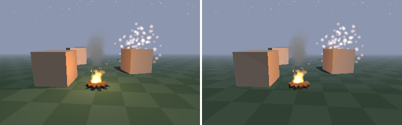

# Particles and effects (`#import "scene3d.effects"`, the package `fire-scene3d.effects`)

Fire, smoke, sparks, rain, snow and explosions for a [3D scene](3d.md) - and effects on the whole picture: **fog** and a **tint**. Everything is drawn by the
renderer itself, in C, by both software renderers (Software and Fast, also into a palette picture on DOS); fire only sets numbers.



```fire
#import "scene3d"
#import "scene3d.effects"

scene.Add(Emitter.Fire(0m, 0m, 0m))                  // flames at the origin
scene.Add(Emitter.Smoke(0m, 1m, 0m))                 // smoke above them
scene.Add(Emitter.Snow(0m, 8m, 0m, 20m))             // snow over a square of 20 m
scene.Fog(S3D.Rgb(140, 150, 175), 5m, 25m)           // fog from 5 m on, all fog from 25 m

while (running) {
    scene.Advance(33ms)                              // the time goes on: particles, animations, spin
    cam.Render()
}
```

## Emitters

An `Emitter` is an `Object` of the scene without triangles: its position is where the particles come from. Each particle is a **soft disc that faces the
camera**; over its life it goes from `StartColor` to `EndColor` and from `StartSize` to `EndSize`. Particles live in the world: an emitter that moves
leaves a trail.

| | |
| --- | --- |
| `Rate` | particles a second (while `Running`) |
| `MaxParticles` | how many can live at once (a pool of a fixed size: nothing is allocated per particle; up to 16000) |
| `Lifetime`, `LifetimeVariation` | how long one lives (`0.8s`) and how much that varies (`0.3`: 30 % more or less) |
| `Speed`, `SpeedVariation` | how fast one starts (`2m / 1s`) |
| `SetDirection(x, y, z)`, `Spread` | the direction (default: up) and the cone around it (`0deg` a ray, `180deg` all around) |
| `SetGravity(x, y, z)`, `Drag` | what pulls on them (`0m / 1s / 1s, -9.81m / 1s / 1s, 0m / 1s / 1s`) and how much the air slows them (0 none) |
| `SetArea(x, y, z)` | half the size of the box around the emitter where they start (rain over a square) |
| `StartSize`, `EndSize`, `StartColor`, `EndColor` | the look over a life (`S3D.Rgba(r, g, b, a)`: an end colour with alpha 0 fades them out) |
| `Additive` | `true`: the colour is added to the picture (fire, sparks, magic: it lights up); `false`: laid over it (smoke, rain, snow) |
| `Running` | `false`: no new ones (the living ones fly on and go) |
| `Burst(n)`, `Clear()`, `Count` | `n` at once (a hit, an explosion), all gone, how many live |
| `Seed` | the start of the emitter's own chance |

Particles are drawn **after** the triangles: what is nearer hides them (they are tested against the depth of the picture), but they do not hide each other
or write a depth themselves. Blended ones are drawn from far to near. The fog of the scene covers them like everything else.

**The same in the VM and in a native build:** every emitter has its own chance (a small generator, `Seed`); the same steps give exactly the same
particles - a replay or a test can count on it.

### Ready ones

| | |
| --- | --- |
| `Emitter.Fire(x, y, z)` | flames: yellow to dark red, added, rising |
| `Emitter.Smoke(x, y, z)` | grey, slow, growing, fading |
| `Emitter.Sparks(x, y, z)` | fast, bright, falling |
| `Emitter.Rain(x, y, z, size)` | rain over a square of `size` (the emitter is the sky: put it high) |
| `Emitter.Snow(x, y, z, size)` | snow over a square of `size` |
| `Emitter.Explosion(x, y, z, count)` | `count` particles at once in all directions, then nothing more (`Burst(count)` for the next one) |

Each is an ordinary `Emitter`: change what you like afterwards (`var f = Emitter.Fire(...); f.StartSize = 60cm`). Their settings are a small table in the
renderer, so the package stays small (on DOS 16 bit about 13 KB).

## The time: `Advance`

`scene.Advance(dt)` moves everything of the scene on by `dt` - once a frame, with the time that passed. `obj.Advance(dt)` does it for one object. What moves:

* the **particles** of emitters;
* the **animation** of an object from a model (`Play`, see [Models and animations](models.md));
* the **spin** of an object: `obj.SpinY = 90deg` turns it a quarter turn a second (`SpinX`, `SpinY`, `SpinZ`, `SetSpin`) - coins, fans, planets;
* a **texture that runs** over an object: `water.TextureScrollX = 30cm / 1s` - water, lava, a conveyor belt (it moves `TextureX` / `TextureY` on).

Spin and texture scroll belong to every `Object` (they are part of `scene3d`); only the emitters need `#import "scene3d.effects"`.

## Fog and tint (the whole picture)

```fire
scene.Fog(S3D.Rgb(140, 150, 175), 5m, 25m)   // colour, start, end
scene.NoFog()
scene.Tint(S3D.Rgb(0, 0, 0), 0.5)            // half way to black (fading out: raise it to 1 over a second)
scene.Tint(S3D.Rgb(0, 40, 120), 0.3)         // under water
scene.TintAmount = 0                         // no tint
```

* **Fog:** from `start` on, the picture goes into the fog colour; from `end` on it is all fog - and so is the background (what no object covers). It hides
  the end of the world: objects farther than `end` can be left out of the scene. `FogColor`, `FogStart`, `FogEnd` can be set alone.
* **Tint:** every pixel towards a colour by `TintAmount` (0 .. 1): fading in and out, a red flash when hit, a blue look under water.

In the lean renderer (Fast) the fog goes in 16 steps and needs no division per pixel; on a palette picture each step is a table of 256 indices (the
colour that comes out is looked up in the palette - a palette with the fog colour and some shades towards it looks best). The software renderer
blends smoothly. The GPU renderer (`RenderMode.Hardware`) draws the particles and the tint over its picture, but no fog yet, and its particles are not
hidden by objects.

## Cost

| | |
| --- | --- |
| a particle | 32 bytes in the pool; drawn: its disc (radius² pixels) |
| fog | a pass over the picture (Fast: a few integer comparisons per pixel) |
| tint | a pass over the picture |

Nothing of it is done when it is not used (no emitter with living particles, no fog, tint 0).
