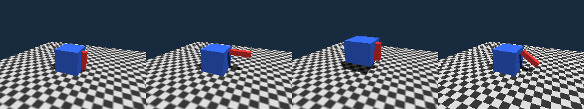
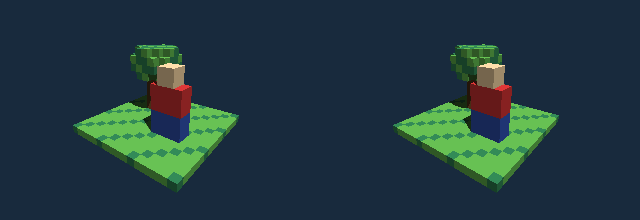
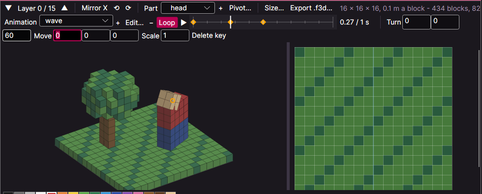

# Models and animations (`Model`, the file `.f3d`)

A **model** is what an object of a [3D scene](3d.md) shows. Besides the templates, OBJ text and arrays, a model can come from fire's own **model file** (`.f3d`):
a tree of **parts** with their colours, and **animations** that move the parts. forge makes `.f3d` from **glTF 2.0**, the open format that Blender and most
3D tools write - when the program is built, so the program carries only the small file.



```fire
#import "scene3d"

var robot = new Object(Model.FromResource(new Resource("robot.glb")))   // glTF: converted when the program is built
robot.AnchorY = 0.0                                                       // stand on the ground
scene.Add(robot)

robot.Play("walk")                  // an animation of the model, from its start (looping as the model says)
while (running) {
    robot.Advance(16ms)             // move it on by the time that passed
    cam.Render()
}
```

## Making a model file

* **A resource:** `new Resource("x.gltf")` or `new Resource("x.glb")` is converted to `.f3d` when the program is compiled (in the VM, a packed program and a
  native build alike); a file that is not glTF 2.0 is a compile error with the reason. `.gltf` may keep its buffers next to it or inside (data URIs).
* **By hand:** `forge model x.gltf [-o x.f3d] [--fps 30]` writes the file; `Model.FromBytes(bytes)` reads it (`IO.File.ReadAllBytes`).
* What is read from glTF: the nodes of the scene become the **parts** (a node's translation, rotation and scale - or its matrix - is the part's rest pose,
  its children are child parts); a node's mesh (all primitives of triangles; positions, normals, texture coordinates) is the part's mesh, the base colour of its
  first material the part's colour. **Animations** become clips: translation, rotation and scale of the nodes, sampled at 30 frames per second (linear, step
  and cubic spline keys). Skins (bones that bend a mesh), morph targets, textures and lights are not read.

## The block editor



spark builds models from **blocks** (*File > New > Block Model*, a `.fblocks` file; [spark](../tools/spark.md#the-block-editor)): a grid of cells (16 x 16 x 16 to start,
up to 256 on a side; *Size...* also sets the edge of a block in meters), each empty or a block of a colour of the **palette**.

| | |
| --- | --- |
| 3D view | a click puts a block on the face under the pointer (or on the floor), the right button takes it away, Shift + click takes its colour; the middle button or Ctrl + drag turns the view, the wheel zooms, the arrow keys turn it too |
| layer view | one layer from above (the one below shines through): the left button draws, the right one erases (a stroke is one step of undo), Shift takes the colour; Page Up / Page Down or the arrows of the tool bar change the layer |
| Mirror X | every block is put and taken away on the other side of the middle as well |
| palette | a click chooses a colour, a double click (or *Edit...*) changes it; *+ Colour*, *− Colour* (its blocks take the first colour) |
| parts | blocks belong to the part chosen; *+* adds a part under it, *Pivot...* sets where it turns - the parts are the parts of the model file that animations move (below) |
| tools of the layer view | *Draw* (left draws, right erases), *Fill* (a click fills the area of the same blocks - or of empty cells - in the layer with the colour), *Select* (a drag selects a box in the layer; *All layers*: through every layer) |
| selection | Ctrl+C, Ctrl+X, Ctrl+V (the copied blocks with their corner at the cell under the pointer, on the layer shown; they join the part chosen), Delete, *Fill box*, Ctrl+A, Esc; the box shows in the 3D view as well |
| Preview | scene3d itself draws the model as a program shows it - on a floor, in the sun, with an animation playing; the renderer (Software / Fast) and the side can be chosen |
| Export .f3d... | writes the model file; Undo / Redo with Ctrl+Z / Ctrl+Y |

### Animations



The second bar animates the parts: *Animation* chooses one (or the rest pose, where blocks are built), *+* adds one, *Edit...* sets its name and length,
*Loop* lets it start again at its end. The **timeline** shows the keys of the part chosen (diamonds) and of the others (marks); a click or a drag chooses the time
(on the frames of the model file, 1/30 s), ▶ plays it. **Turn** (degrees around x, y, z), **Move** (cells) and **Scale** show where the part is at that time; a change
makes a **key** of the part there, *Delete key* takes it away. Between two keys of a part the numbers go linearly; a part turns around its pivot and takes its
children with it. In the model file every animation becomes a clip that `obj.Play("name")` plays (a clip without Loop stops at its end).

The file is text (JSON, one block a line - it diffs well in git); a program takes it like a glTF file, as a resource: `Model.FromResource(new Resource("tree.fblocks"))`.
forge builds only what can be seen: no face between two blocks of the same part, and neighbouring faces of one colour in a plane become one rectangle - the garden
above has 434 blocks and 820 triangles. Each part becomes a part of the model file at its pivot, with one part under it for each colour it uses. The origin of the
model is the middle of the bottom of the grid.

## Playing

| | |
| --- | --- |
| `obj.Play("name")` / `obj.Play("name", loop)` | starts the animation at its beginning (loop as the model says - clips from glTF loop - or as given); `Play("")` shows the rest pose |
| `obj.Advance(time)` | moves it on (`16ms`, `0.5s`); a clip that does not loop stops at its end |
| `obj.AnimationTime` | the time in the clip (set it to show a moment) |
| `obj.Stop()` | stops where it is |
| `obj.Animation`, `obj.Playing` | the name of the clip ("" none), whether it runs |
| `model.Parts`, `model.Triangles`, `model.Animations`, `model.AnimationLength("name")` | what the model holds |

Times need a unit (`s`, `ms`). An object made from a model has everything an object has: position, rotation, size (the box of the model in its rest pose),
anchor, texture, material, shadows. A part with a colour of its own keeps it; `obj.Color` colours the parts without one.

## The file

Small on purpose (packages/scene3d/native/s3d_model.h describes it byte by byte): a corner takes **8 bytes** (positions as 16-bit numbers in the box of the
part, the normal in two bytes), 12 with texture coordinates; indices are 16 bit (at most 65535 corners a part); a part in a frame of a clip takes 26 bytes.
The robot of the tests - two parts, 24 triangles, two clips - is 3 KB (1.9 KB at 15 frames per second). Parts are **rigid**: an animation moves, turns and
scales whole parts - the way games of the 90s animated their figures, and cheap to compute on a small machine (also with the lean renderer, also on DOS).

Planned (ROADMAP §16): textures in the file,
blending from one clip into the next.
