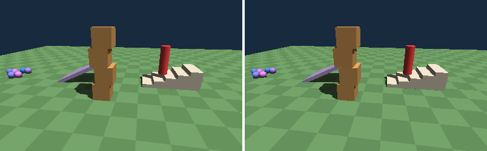

# Physics (`#import "scene3d.physics"`, the package `fire-scene3d.physics`)

Bodies make the objects of a [3D scene](3d.md) solid: they fall, bounce, tumble, roll, stack, are pushed, hang on ropes and springs, and a figure
walks over the ground, up stairs and jumps.
Simple, small and the same everywhere: the physics lives in the renderer (C, `s3d_physics.h`), fire only sets numbers - and the same steps give the same
positions in the VM and in a native build. A program that does not import the package carries none of it.



```fire
#import "scene3d"
#import "scene3d.physics"

Body.Static(ground)                          // the ground: its own triangles, it never moves
Body.Ball(ball, 1kg).Bouncy()                // a ball that bounces
Body.Dynamic(crate, 20kg)                    // a crate: a box that falls and can be pushed
var player = new Character(hero, 30cm, 1.8m) // a figure: an upright capsule that walks

while (running) {
    player.Walk(x * 1m / 1s, z * 1m / 1s)    // where it goes (0, 0: it stands)
    if (jumpPressed) { player.Jump(5m / 1s) }
    scene.Advance(dt)                        // everything moves on (in steps of 1/60 s)
    cam.Render()
}
```

## Bodies

A body belongs to its object: `Body.Static(obj)` gives the object one and returns a view of it (the object keeps the body - losing the `Body` changes
nothing; `body.Remove()` takes it away). The position of the object is the position of the body: the physics moves the object, and moving the object
moves the body.

| | |
| --- | --- |
| `Body.Static(obj)` | never moves: the ground, walls, houses. Its shape is the object's own triangles (also turned and scaled), a terrain its heights |
| `Body.Dynamic(obj, mass, shape)` | falls, bounces, tumbles, is pushed - a box fitted to the object (default), a sphere or a capsule |
| `Body.Ball(obj, mass)` | a dynamic sphere: it rolls |
| `Body.Kinematic(obj, shape)` | moved by the program (`SetVelocity`, or by moving the object): lifts, doors, platforms - it pushes dynamic bodies, and what stands on it goes along |
| `new Character(obj, radius, height)` | a figure (below) |

**Shapes** (`BodyShape`): `Mesh` - the triangles of the object (static and kinematic bodies; they are kept in a grid, only the near ones are tested);
`Box` - the object's own box (turned as the object is); `Sphere`; `Capsule` - always upright. The shape is fitted to what the object shows when the body is made
(and again when the program scales or turns the object); `SetBox`, `Radius` and `SetCenter` set it yourself.

**What it is made of:** `Mass` (kg), `Bounce` (0: it stops, 1: it comes back as fast), `Friction` (0: ice, 1: rubber; two bodies: the mean), `Damping`
(the air), `GravityScale` (0: it floats); ready mixes: `Bouncy()`, `Ice()`, `Sticky()`.

**Moving it:** `VelocityX/Y/Z` (m/s), `SetVelocity(x, y, z)`, `Push(x, y, z)` (adds to the velocity: a kick, a jump pad).

**What happened** (in the last step): `OnGround` (it stands on something), `Touches(obj)`, `TouchCount`, `TouchingIn(scene)` (the objects).

**Triggers:** `body.Trigger = true` - it is touched but pushes nothing: a goal, a door sensor, a coin (`player.Touches(coin)`).

### Turning

Dynamic boxes and spheres **turn**: a crate that falls on its corner tumbles and comes to lie flat, a ball rolls (it slides first and then rolls, as a real one),
boxes stack. The physics writes the turn into the object (`RotationX/Y/Z`). Contacts have points - a box lying on the ground on its four corners, a box on
a box on the corners of the face they share - and the pushes act at these points, so that they turn the bodies.

| | |
| --- | --- |
| `Rotates` | `false`: the body stays upright (it slides instead; a capsule and a character never turn) |
| `AngularVelocityX/Y/Z`, `SetAngularVelocity(x, y, z)` | how fast it turns about each axis of the world, an angle a second (`90deg`: a quarter turn a second) |
| `AngularDamping` | how much the air slows the turning (default 0.3) |

### Sleeping

A dynamic body that has rested for half a second **sleeps**: it costs nothing until something touches it, a joint pulls it, the program moves it or sets one of
its numbers. `Sleeping` tells it, `Wake()` and `Sleep()` do it. A scene full of crates that lie still is as cheap as a scene without them.

## A character

```fire
var player = new Character(hero, 30cm, 1.8m)   // radius, height: an upright capsule
player.Walk(2m / 1s, 0m / 1s)                   // it goes along x at 2 m/s (until Walk says otherwise)
player.Jump(5m / 1s)                            // only when it stands on the ground (false otherwise)
player.StepHeight = 30cm                        // a step up to this height is climbed by walking against it
player.MaxSlope = 45deg                         // steeper ground is a wall: it slides down
```

`Walk` sets its velocity along the ground directly (no sliding, no inertia - it feels like a game); gravity pulls on it, walls stop it, crates are
pushed when it is heavier (`Mass`). It stands still on slopes up to `MaxSlope`, and it follows the ground down stairs and hills without hopping.

## Joints

```fire
var rope = Joint.Rope(scene, lamp, 0m, 6m, 0m)          // the lamp hangs from a point of the world (the rope as long as they are apart now)
var chain = Joint.Rod(scene, wagon1, wagon2, 1.5m)        // always exactly 1.5 m apart
var spring = Joint.Spring(scene, platform, 0m, 3m, 0m, 80.0, 4.0)   // a platform on a spring: stiffness, damping
rope.Length = 3m                                          // let the rope down
rope.Remove()
```

A joint joins two objects with bodies at their middles (or one object and a point of the world). A **rope** keeps them at most its length apart (it hangs
loose when they come closer), a **rod** exactly, a **spring** pulls them towards its length (`Stiffness`: how hard, `Damping`: how fast it calms down).
`Distance` tells how far apart they are now. A body on a rope swings and turns about the rope's end. The scene keeps its joints.

## The world

```fire
scene.Gravity = 9.81m / 1s / 1s     // (the default) - 1.62 for the moon, 0 for space
scene.Advance(dt)                   // the time goes on: physics, animations, particles
```

The physics takes **fixed steps of 1/60 s**: `Advance` makes as many as the time that passed holds (at most 8 - after a long pause the world does not
race to catch up) and keeps the rest for the next call. Each step: the velocities (gravity, damping, the walk), the springs, then the pairs - found by
sorting the bodies' boxes along x, only those that overlap and where something is awake - are answered six times (at each point the velocity along the
contact reflected by the bounce, sideways slowed by the friction, the sum of the pushes along the contact never pulling, the friction never more than its
share of it; a little overlap of 5 mm stays, so that the contacts last), the ropes and rods; and only then the bodies move and turn.

## Rays

```fire
any hit = scene.Raycast(x, y, z, 0.0, -1.0, 0.0)          // straight down from (x, y, z); a maximum distance is optional (default 1000 m)
if (hit != undefined) {
    print(hit.Object.Key + " at " + hit.Distance)       // the object, how far, where (hit.X, Y, Z), the surface there (hit.NormalX, Y, Z)
}
```

A ray meets the bodies of the scene (not triggers, not objects without a body): shooting, picking with the mouse, the ground below the player, line of
sight.

## Cost

| | |
| --- | --- |
| a body | about 450 bytes; a static mesh body also its triangles in the world (12 bytes a corner, 12 a triangle) and its grid |
| a sleeping body | nothing in a step (only its box is sorted) |
| a terrain | nothing more: the triangles below a body are made from the heights when they are needed |
| a step | every dynamic body against every other body (a few dozen are fine), against static triangles only those in its cells |
| on DOS 16 bit | the physics C is about 55 KB, the package's fire code a few KB (only when it is used: the linker leaves out what nothing calls) |
