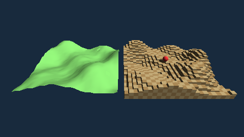

# Terrains (`#import "scene3d.terrain"`, the package `fire-scene3d.terrain`)

A **terrain** is a landscape for a [3D scene](3d.md), made from a grid of heights (a heightmap). It is an `Object` of the scene: it has a position, a size, a
colour, a texture, a material and everything else an object has, and it is added with `scene.Add`.



```fire
#import "scene3d"
#import "scene3d.terrain"

var heights = new byte[16 * 16]                       // 16 x 16 heights, 0..255
// ... fill them ...
var land = new Terrain(heights, 16, 16, 50cm, 5cm)    // a cell is 50 cm wide, a height of 1 is 5 cm
land.Color = S3D.Rgb(110, 190, 90)
scene.Add(land)

var steps = new Terrain(heights, 16, 16, 50cm, 5cm, TerrainMode.Hard)   // the same heights as blocks
steps.Texture = Texture.Checker(16, 2)
steps.TextureWidth = 1m                                                    // the texture tiles in meters on the ground
scene.Add(steps)

player.Y = steps.HeightAt(player.X, player.Z)         // stand on the ground
```

## Two modes

| | `TerrainMode.Smooth` (default) | `TerrainMode.Hard` |
| --- | --- | --- |
| a height is | a corner: the ground runs smoothly between the heights (hills) | a block of `cell` x `cell` with a flat top and upright walls (steps, terraces, a world of blocks) |
| size | (columns - 1) x (rows - 1) cells | columns x rows blocks |
| what is built | two triangles per cell, the corners shared (smooth light) | only what can be seen: neighbouring tops of the same height are one rectangle, walls only where a neighbour is lower, in a line one quad; the border goes down to 0 |
| `HeightAt` | on the triangles of the cell (exactly the surface you see) | the top of the block |

## Making one

* `new Terrain(heights, columns, rows, cell = 1m, step = 10cm, mode = TerrainMode.Smooth)` - `heights` is a **byte buffer** (`columns * rows` heights 0..255,
  or `columns * rows * 4` bytes R, G, B, A whose brightness is the height) or an **array of numbers** (any height, also negative or with fractions). A smooth terrain needs
  at least 2 x 2 heights. What does not fit is a `Scene3DException`.
* `Terrain.FromImage(framebuffer, cell, step, mode)` - one height per pixel of a picture (its brightness): a heightmap painted in an editor and loaded with
  `Framebuffer.FromFile`.
* `terrain.SetHeights(heights, columns, rows, cell, step)` - new heights (the mesh is made anew; the mode stays).
* `Columns`, `Rows`, `Mode`.

The terrain lies **centred** on its position in x and z, and its height 0 is at the position's y (`terrain.Y = 0m`: height 0 is the ground level of the world).
It can be moved, scaled (`ScaleY = 2` makes it twice as high) and turned like any object.

## The height of the ground

`terrain.HeightAt(x, z)` is the y of the ground (in meters, in the world) below the point (x, z) of the world, or `undefined` outside the terrain. It follows the
position, the scale and a turn around the vertical axis. It is what a figure needs to walk on the ground; physics (scene3d.physics, planned) will use it as well.

## Behind it

The mesh is made by the C of scene3d (`fire_bridge_scene3d.h`, `__S3DTerrain`): nothing of it is built in fire, and a program that does not import
`scene3d.terrain` carries only the small C part. Both renderers draw it (the software renderer and the lean one, `RenderMode.Fast`), also on DOS. The heights are
kept for `HeightAt` (4 bytes each). Texture coordinates follow the ground: across the width and the depth, so that `TextureWidth`/`TextureHeight` tile in meters.

Planned (ROADMAP §16): pieces of a large terrain that are left out when the camera does not see them, coarser pieces far away, colours by height.
