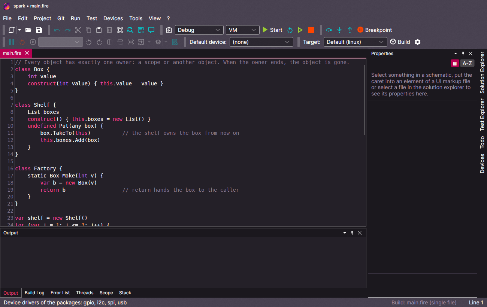

# spark, the editor

spark is the IDE of fire (C#, Avalonia - Windows, Linux, macOS). **First Steps** (*Help > First Steps*,
[source](../../src/fire.Editor/Help/First%20Steps.md)) walks through it; this page shows what is where.

**spark has no compiler** (milestone M3 of [ROADMAP_C_PORT.md](../ROADMAP_C_PORT.md)): forge (`native/forge`, a C program) compiles, builds and tests, and
answers the editor's questions (`forge serve`: completion, live errors, hover, signature, definition, the tests of a file - [FORGE_SERVE.md](../spec/FORGE_SERVE.md));
programs run in `fire` (`native/vm`); the Package Manager runs `ember` (`tools/ember`). They are next to spark - the build and the publish of spark put the
folder of `forge package-dist` there (forge, fire, `native/`, `Source/`, `Prebuilt/`) and ember (`src/ForgeDist.targets`); `FIRE_FORGE` names another forge,
and without one spark builds forge-c from `native/forge` of the repository it runs in. What spark keeps in C# without a compiler is `src/fire.Tooling`: the
way to these programs, the data of their reports, the debugger's client, the child processes of the previews, the models of the editors, the lexer of the
syntax colours.

- **Code editor:** completion (`Ctrl+Space`), go to definition (`F12`, also into the libraries), live errors while typing, the error list with codes
  ([error codes](errors.md)). In a lambda with an expression body (`q.Where(p => p.`) the parameter has the type the called method gives it
  (`bool lambda<T>`, `lambda expression<T>`, with `T` of the receiver); the mouse over the parameter shows its type, and for a parameter
  `lambda expression<T>` that the lambda becomes an [expression tree](../language/12-lambdas.md#expression-trees-lambda-expressiont).
  Completion offers only what the code at the cursor may use: `private` members inside their class, `protected` ones also in derived classes,
  nothing of either outside ([access](../language/08-classes.md#access-public-private-protected)); `Class.` shows the static members, an object the
  others. The type of `x.` comes from declarations, `var x = ...`, fields, return types, global variables (also in methods and lambdas) and the
  variables of the method around a lambda; the class of an `.fxml` (in the project or `#include`d) and the libraries it imports are known in the
  code-behind. The class's own members come first, then the inherited ones, the names that start with what was typed in the same case before the
  others, and the lower-case state of a library (`cw`, `styled` of `UI.Element`) last. When the type is unknown, the members of the program's own
  classes are offered (those of the libraries only after a first letter). All of it comes from `forge serve` (without a forge there is no completion and no
  live analysis - a build still reports the errors).
- **Run and debug:** `F5` starts (and continues to the next breakpoint), `Ctrl+F5` starts without debugging (breakpoints are ignored), `Ctrl+Shift+F5`
  compiles again and starts, `Shift+F5` stops; `F9` sets a breakpoint, `F10`/`F11` step; the panels *Threads*, *Scope* and *Stack* show the paused program.
  *Run > Run Engine* chooses *Virtual Machine* (the default) or *Native* (a native build that runs) - saved in the `engine` setting of the project that
  Start runs, for a single script in spark's settings; native programs are debugged the same way, an ESP32 over its serial port ([targets](../targets/README.md)).
  The virtual machine is the VM in C: forge compiles the program file (`forge bytecode --report json`), spark runs `fire run x.fbc` as a child process - its
  output in the *Output* panel, the line below it is its input, *Stop* ends it - and debugs it like a native program; a crash of the program does not take
  spark with it. (The C# VM, inside spark and as the project `fire.Runtime` with its graphics `fire.Terminal`, is gone with milestone M1,
  [VM_C.md](../spec/VM_C.md#spark-auf-der-c-vm-schritt-9).)
- **The start project:** *Start* runs the **start project** of the solution from every file that belongs to the solution - a file of any of its projects
  (also of a library), a project file, the solution file, the notes; without a solution the project itself. Only a script that belongs to no project runs
  on its own. The box next to the mode in the *Run* tool strip lists the programs of the solution and chooses the start project; so does *Set as Start
  Project* in the context menu of a project (and in the *Project* menu). The start project is shown in bold in the Solution Explorer and is saved in the
  solution file as `"startup": "Name"` ([projects](projects.md#the-files); a solution without it starts its first program). *Start Debugging* in the
  context menu of a project starts that project once, without changing the start project.
- **Build, Build Solution and Clean** (*Run* menu; the context menus of the solution and of a project have them too): *Build* (also the button of the
  *Build* tool strip) is always **native**: the project of the active file for the target of the tool strip, into `bin/<target>-<mode>/` (a library is
  packed). *Build virtual* makes a program that carries the virtual machine (`bin/vm-<mode>/`). *Build Solution* (`Ctrl+Shift+B`) builds every project
  of the solution natively, each library before the projects that reference it (a project whose library failed is skipped); its log is in the
  *Build log*, its errors and warnings in the *Error list*, and *Cancel Build* (`Ctrl+Break`, `Shift+F5`) stops it. *Clean* removes the build folders
  `bin/` and `obj/` of the project of the active file, *Clean Solution* those of every project ([projects](projects.md#where-a-build-goes-and-clean)) -
  never a source: a build folder that holds a fire source or a project file is left alone and the log says why. Every build of a project copies the files with
  the build action *Copy* next to the program ([projects](projects.md#build-actions)).
- **Publish** (*Run > Publish*, *Run > Publish Solution*, the *Publish* button of the *Build* tool strip, *Publish* in the context menu of a project and
  *Publish Solution* in that of the solution): every project that has publishing on (*Project Properties > Publish*: on/off, the folders - one per line,
  absolute or relative to the solution -, VM or native, the configuration, the target, "empty the folders first") is built again where something changed
  (otherwise its program is taken as it is) and copied with the files it needs and its *Copy* files into its folders; libraries first, a library is
  published as its package. It is a build job like Build Solution: the *Build log* says per project what was built and what was copied, errors go into
  the *Error list*, *Cancel Build* stops it, the status bar ends with the summary ("2 projects published to ..."). *Publish* of a project with publishing
  off opens its properties on the *Publish* page instead ([projects](projects.md#publish)).
- **spark builds with forge:** every build - *Build*, *Build virtual*, *Build Solution*, the build of a native *Run* or *Debug* (also for the ESP32),
  *Publish*, *Pack Library* and *Install* of a library - runs `forge build`/`forge publish` with `--report json` as a child process
  ([the report](forge.md#the-report-for-tools)): what spark shows in the *Build log*, the build window, the status bar and the *Error list* is what
  forge reports, and *Cancel Build* asks forge to stop (it ends its compilers and deletes what it had begun and its temporary folders; a forge that has not
  ended after ten seconds is killed with its process tree). **Unsaved text is built as it is in the editor**, without saving: each changed document goes to
  forge as an overlay (`--overlay <file>=<copy>`), a script that was never saved as a temporary file - the same as when spark built in its own process
  (Visual Studio saves first; spark leaves saving to you, so a build never writes your files). spark still decides what it decided before: the target of
  the tool strip (`-t`), the mode of the run (`-m`), where the program goes (`-o`), the statistics switch (`--stats`), the hare (`--quick`); a missing compiler is asked for
  in spark before forge starts. Clean builds nothing and stays in spark. `FIRE_FORGE` names another forge. *Build virtual* only writes the program now;
  *Start* compiles for the VM itself (`forge bytecode --report json`).
- **Build action of a file:** the *Properties* window of a file of a project has the category *Build* - *Build action*: *Build* (the default), *Ignore*,
  *Copy if newer*, *Copy always* - and *Set by* (the file itself, a pattern or the default). Several files selected in the Solution Explorer (Ctrl+click,
  Shift+click) are changed at once (the window shows "(mixed)" when they differ); the context menu of a file has the same as *Build Action*. An ignored
  file is shown pale with "ignored", a copied one with "copy" ([projects](projects.md#build-actions)).
- **Quick build (the hare):** the hare left of *Build* and *Publish* in the *Build* tool strip (also *Run > Quick Build*; kept in the settings of spark)
  makes every native build and publish spark starts - *Build*, *Build Solution*, the build of a native *Run* or *Debug*, *Publish* - a **quick build for
  tests**: forge gets `--quick` ([forge](forge.md#options)), the C compiler works without optimisation (-O0; msvc /Od) and the program is compiled in
  units side by side wherever the toolchain can split (gcc, clang, MinGW, Emscripten - also for *Publish*, which otherwise stays one file;
  [NATIVE_SPLIT](../spec/NATIVE_SPLIT.md#schnellbuild)). The mode stays what it is (Debug, Release, Performance: asserts and checks as before); the natives of
  the packages keep their optimisation, so does everything built for the VM. While it is on the hare glows amber - a quick build is no release: a quick
  *Publish* says "Schnellbuild (-O0, geteilt)" in the build log, in the summary of the status bar and in the `.firepublish` mark of the publish folder,
  and it is not "up to date" for a normal *Publish* (nor the other way round). *Tools > Options > Compilers* chooses its level: -O0 (the default, the
  shortest build) or -O1 (about twice the compile time of -O0, a program almost as fast as a normal build; measured in
  [NATIVE_SPLIT](../spec/NATIVE_SPLIT.md#schnellbuild): a test publish of the assistant 273 s -> 73 s with -O0, 151 s with -O1). TinyCC - the automatic Build compiler - is quick anyway: with it the
  hare changes nothing; it matters for the Publish compiler (GCC) and for a Build compiler gcc or clang.
- **Build tool strip:** target, the hare (quick build), *Build* (native), *Publish*, and the *Statistics* switch: when it is on, *Build*
  writes the statistics of the native build (`forge build --stats`, [forge](forge.md)) and opens them in a tab - the size of the program and what it takes
  to load, the code by origin (the C of the packages, the runtime, the C library, the generated fire code by module), the data, how much of the generated
  functions are C numbers, the biggest functions. A `.stats.json` next to a program opens in the same viewer.
- **Runtime panel:** docked on the right, it shows itself while a program runs and hides again a few seconds after it ended (unless it was open
  before): CPU and memory of the last minute as curves, CPU now and on average, memory now and at its peak, threads, lines of output, for the VM the
  collections of the .NET heap, and the events of the run (start, pauses, errors, new threads, the end with exit code and duration). A native program is
  measured as its own process; the VM runs inside spark, so its numbers are those of spark's process.
- **Profiler:** the *Profile* switch of the run tool strip profiles runs in the VM and native debug runs: when the program has ended, the *Profile* tab
  shows where the time went (in the VM the lines with the most instructions, natively the lines that took the longest in microseconds, and how often each
  was entered) and every own file with the counts beside each line - hot lines in
  orange, lines with code that never ran in red (*Only what never ran* lists just those); a click on a line opens it in the editor.
- **Options** (*Tools > Options...*; also from the end of the setup wizard): the settings of spark for this machine, on pages chosen at the left like the
  project properties. *General*: the welcome window at the start, the engine of a script that is in no project (from `fire.native.json`, VM or native - also
  *Run > Run Engine*), the assistant and the MCP server on or off, the ESP-IDF folder, and a button that runs the setup wizard again. *Compilers*: a grid with
  one row per C/C++ toolchain - the ones found with their version and path, the ones fire can download marked "not installed - download (size)", the others
  with how to get them (Linux: the package manager, e.g. `sudo apt install tcc` / `g++`) - and two columns of radio buttons: **Build** (spark's Build, Run,
  Debug and Build Solution, `forge build`, `forge test`) and **Publish** (Publish, `forge publish`), one choice per column. *Automatic* (the first row) takes the
  recommended compiler when it is there, else the best one there: for Build **TinyCC** (fast, barely optimised, C only), for Publish **GCC** (slow, proven,
  optimised; on Windows w64devkit, without it Visual C++ when that is found). *Download missing toolchains (TCC/GCC)* (on by default, only where fire can
  download one: Windows - the TinyCC zip, checked by its SHA-256, and w64devkit) makes *Apply* download the chosen ones that are not there, in the progress
  window of the setup. The choice is kept in `Toolchain/toolchain.json` next to spark (`"build"`, `"publish"`: `tcc`, `gcc`, `clang`, `msvc` or `auto`).
  A project's own toolchain goes first (*Project Properties > Native & Toolchain*, `toolchain` in `fire.native.json`, a target that names one, `--toolchain`);
  both dialogs say so. Debug, Release and Performance stay the build *modes* - the compiler no longer depends on them. TinyCC compiles only C: when a
  program has natives in C++ and Build is TinyCC (chosen or automatic), the build hands it to the next compiler (GCC, else Clang or MSVC) and the build log
  says so in one line ([natives](../packages/natives.md#0-c-or-c)). Below the grid, *Quick build (the hare)* chooses the optimisation level of a quick build:
  -O0 or -O1.
- **Setup wizard** (at the first start, *? > Setup Wizard*): its page *Compilers* is the same grid with the same checkbox (and, on Windows, Open Watcom for
  the old PC targets); Start saves the choice and downloads what it lists.
- **Panels:** Output, Build log, Error list, Solution Explorer, Test Explorer ([testing](testing.md)), Todo ([notes](notes.md)), Devices
  ([devices](../devices/README.md)), Properties, Runtime. All of them dock, float or auto-hide; *View > Reset Layout* brings the start layout back.

## Live errors

While you type, spark checks the document in the background - nothing of it runs on the keystroke itself:

- **After a pause in typing** (0.4 s) the document is compiled with the other files of its project and the libraries it imports, on a thread of its
  own; a newer pause replaces a check that is still waiting, and cancels one that runs. Results arrive in order: an older result never replaces a
  newer one, and the errors of the final text always come. Until then the squiggles move with the text.
- **One analysis at a time:** the active document first, then the other open documents, then the checks of whole projects.
- **The other files:** when the check finds that what the other files can see of the document changed (a declaration, a signature, a field, an
  `#import` - not the body of a function), the open documents that use it are checked again, and so are the projects that contain it, for the files
  that are not open. Closing a document checks its project again. Texts that did not change are not analysed twice, and the files on the disk are
  read once while they do not change.
- **Where errors show:** a squiggle under the line (red for an error, amber for a warning; the mouse over it shows the message), a bar in the
  margin next to the line number, the *Error List* (every open document, the files of the solution that are not open, and what the last build
  reported beyond that) and the count in the status bar (a click shows the list). An error in a library file is listed with that file.

`FIRE_EDITOR_TIMING=1` in the environment writes to stderr what the editor does on the UI thread and in the background (each step over a
millisecond), the time from a key to the frame that shows it, and every stall of the UI thread - to measure a big solution.

## The tool bar of the solution explorer

The folders of a project are *included* (normal), *undecided* (no code, not named: pale and italic, not built) or *excluded* (not shown; with *Show All Files* pale, the reason behind it); right-click a folder
for *Exclude from Project*, *Include in Project* or *Remove Exclusion*, also for several selected folders at once - with *Sync .gitignore* (*Project Properties > Build*, on by
default) the `.gitignore` follows ([projects](projects.md#folders-included-undecided-excluded)).

Above the tree of the Solution Explorer ([projects](projects.md)) a row of buttons (each one explains itself in its tooltip) and a filter box:

| Button | What it does |
| --- | --- |
| *Collapse All* | closes every project and folder; the solution stays open, the selection moves up to the row that can still be seen |
| *Expand All* | opens every project and folder |
| *Sync with Active Document* | selects the file of the active document in the tree: its folders open and the tree scrolls to it (a filter that hides it is cleared) |
| *Track Active Document* | a switch: does the same whenever another document becomes active |
| *Refresh* | reads the folders of all projects again from the disk (a file added or deleted outside spark) - as *Reload* in the context menu of a project |
| *Show All Files* | a switch: also shows what the projects leave out - `bin`, `obj`, `node_modules`, files and folders whose name starts with a dot, the folders a project excludes (`excludedDirectories`, a `.gitignore`; "excluded" / "ignored by .gitignore" behind them) with what is in them - pale (`.git` only as a folder); their context menu opens, shows and deletes them, and takes an exclusion back |
| *New File* | the menu *New* of the context menu (script, class, window, circuit, markdown, image, other file) for the selected folder - for a selected file its folder, else its project; with nothing selected the project of the active document |
| *New Folder...* | a new folder in the same place; on the solution or a solution folder a solution folder |
| *Properties* | for a file the *Properties* panel (brought to the front), for a project (or a row in it) its properties dialog, for the solution the solution's |

The two switches are kept in spark's settings. In a narrow panel the buttons that do not fit go into the menu of *…* at the right end.

The **filter box** shows only the rows whose name contains the text - without regard to case, several words must all occur (`main fire` finds
`main.fire`) - and the folders they are in, opened; below a matching folder everything stays (closed as it was). `Enter` or `Down` goes into the tree on
the first match, `Esc` (also in the tree) or the cross empties the box, and the tree folds back to how it was before the filter, with the selected row in
sight. While the filter is on, the tree is built again as always (a new file that matches shows up).

## The markup designer

`.fxml` files open with the **design view** next to the text - drawn by the `ui` library itself, so it looks exactly like the program. A click in the
picture puts the caret into the element; the *Properties* panel lists and edits its attributes ([markup](../ui/markup.md#the-editor)).

## The circuit editor

`.biscuit` files open in the circuit editor: a toolbox of parts on the left, the schematic simulating live in the middle, the properties of the
selected part on the right ([circuits](../circuits/README.md#the-circuit-editor-of-spark)).

## The block editor

`.fblocks` files (*File > New > Block Model*) open in the block editor: a model built from blocks of a palette, like a world of blocks
([models](../graphics/models.md#the-block-editor)). In the 3D view a click puts a block on the face under the pointer, the right button takes one away; the
layer view on the right draws one layer of the grid from above. A program uses the file as a resource - forge makes fire's model file of it.

## The CAD editor

`.fmesh` files (*File > New > Mesh Model (CAD)*) open in the CAD editor: a model of corners and faces ([models](../graphics/models.md#the-cad-editor)). Four views - from
above, from the front, from the side and in 3D - or one of them large; corners, edges or faces are chosen (1, 2, 3) and dragged on the grid. *Draw* makes a face of
points clicked in a 2D view, *Extrude* pulls faces out to a body, *Mirror* copies them to the other side, and parts and animations work as in the block editor.

## More

- [Projects and solutions](projects.md), [templates](templates.md) (*File > New*), [git](git.md), [notes](notes.md)
- *Tools > Package Manager (ember)* - it runs `ember find --json`, `ember list --json`, `ember install`, `ember remove` ([ember](ember.md)), *Tools > Toolchain Settings* (the targets and toolchains of `fire.native.json`), *Tools > Options*, *Tools > Open the Standard Libraries (Source)*
- The Markdown viewer and editor (`.md`), the raster editor for pictures (PNG, BMP, GIF; its codecs and drawing area are `src/fire.Imaging`, the images of
  spark only - a program draws with the C library of `graphics`), the packet viewer (`.fplog`) of the device traces
