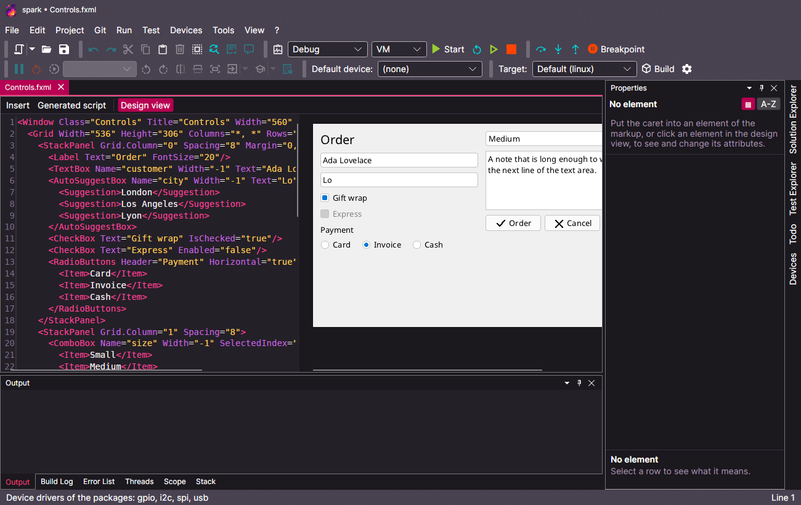
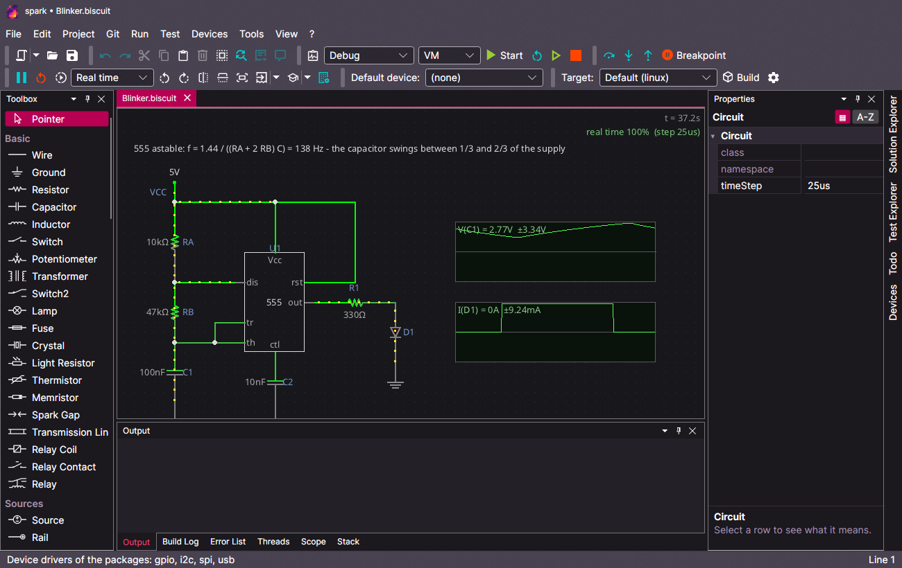
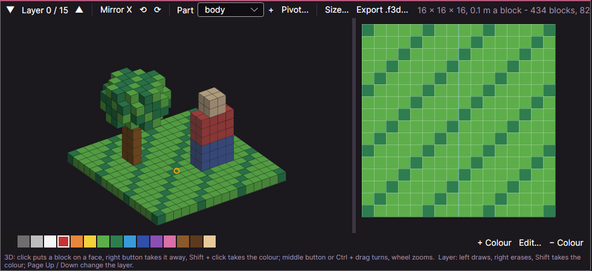
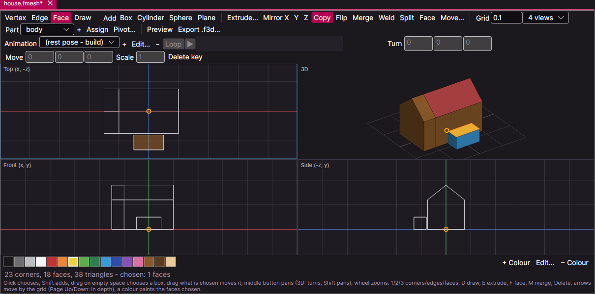

# spark, the editor

spark is the IDE of fire (C#, Avalonia - Windows, Linux, macOS). **First Steps** (*Help > First Steps*,
[source](../../src/fire.Editor/Help/First%20Steps.md)) walks through it; this page shows what is where.

- **Code editor:** completion (`Ctrl+Space`), go to definition (`F12`, also into the libraries), live errors while typing, the error list with codes
  ([error codes](errors.md)). In a lambda with an expression body (`q.Where(p => p.`) the parameter has the type the called method gives it
  (`bool lambda<T>`, `lambda expression<T>`, with `T` of the receiver); the mouse over the parameter shows its type, and for a parameter
  `lambda expression<T>` that the lambda becomes an [expression tree](../language/12-lambdas.md#expression-trees-lambda-expressiont).
  Completion offers only what the code at the cursor may use: `private` members inside their class, `protected` ones also in derived classes,
  nothing of either outside ([access](../language/08-classes.md#access-public-private-protected)); `Class.` shows the static members, an object the
  others. The type of `x.` comes from declarations, `var x = ...`, fields, return types, global variables (also in methods and lambdas) and the
  variables of the method around a lambda; the class of an `.fxml` (in the project or `#include`d) and the libraries it imports are known in the
  code-behind. The class's own members come first, then the inherited ones, the names that start with what was typed in the same case before the
  others, and the lower-case state of a library (`cw`, `styled` of `UI.Element`) last. When the type is unknown, the members of the program's own
  classes are offered (those of the libraries only after a first letter).
- **Run and debug:** `F5` starts (and continues to the next breakpoint), `Ctrl+F5` starts without debugging (breakpoints are ignored), `Ctrl+Shift+F5`
  compiles again and starts, `Shift+F5` stops; `F9` sets a breakpoint, `F10`/`F11` step; the panels *Threads*, *Scope* and *Stack* show the paused program.
  *Run > Run Engine* chooses *Virtual Machine* (the default) or *Native* (a native build that runs) - saved in the `engine` setting of the project that
  Start runs, for a single script in spark's settings; native programs are debugged the same way, an ESP32 over its serial port ([targets](../targets/README.md)).
- **The start project:** *Start* runs the **start project** of the solution from every file that belongs to the solution - a file of any of its projects
  (also of a library), a project file, the solution file, the notes; without a solution the project itself. Only a script that belongs to no project runs
  on its own. The box next to the mode in the *Run* tool strip lists the programs of the solution and chooses the start project; so does *Set as Start
  Project* in the context menu of a project (and in the *Project* menu). The start project is shown in bold in the Solution Explorer and is saved in the
  solution file as `"startup": "Name"` ([projects](projects.md#the-files); a solution without it starts its first program). *Start Debugging* in the
  context menu of a project starts that project once, without changing the start project.
- **Build, Build Solution and Clean** (*Run* menu; the context menus of the solution and of a project have them too): *Build* (also the button of the
  *Build* tool strip) is always **native**: the project of the active file for the target of the tool strip, into `bin/<target>-<mode>/` (a library is
  packed). *Build virtual* makes a program that carries the virtual machine (`bin/vm-<mode>/`). *Build Solution* (`Ctrl+Shift+B`) builds every project
  of the solution natively, each library before the projects that reference it (a project whose library failed is skipped); its log is in the
  *Build log*, its errors and warnings in the *Error list*, and *Cancel Build* (`Ctrl+Break`, `Shift+F5`) stops it. *Clean* removes the build folders
  `bin/` and `obj/` of the project of the active file, *Clean Solution* those of every project ([projects](projects.md#where-a-build-goes-and-clean)) -
  never a source: a build folder that holds a fire source or a project file is left alone and the log says why.
- **Build tool strip:** target, *Build* (native), and the *Statistics* switch: when it is on, *Build*
  writes the statistics of the native build (`forge build --stats`, [forge](forge.md)) and opens them in a tab - the size of the program and what it takes
  to load, the code by origin (the C of the packages, the runtime, the C library, the generated fire code by module), the data, how much of the generated
  functions are C numbers, the biggest functions. A `.stats.json` next to a program opens in the same viewer.
- **Runtime panel:** docked on the right, it shows itself while a program runs and hides again a few seconds after it ended (unless it was open
  before): CPU and memory of the last minute as curves, CPU now and on average, memory now and at its peak, threads, lines of output, for the VM the
  collections of the .NET heap, and the events of the run (start, pauses, errors, new threads, the end with exit code and duration). A native program is
  measured as its own process; the VM runs inside spark, so its numbers are those of spark's process.
- **Profiler:** the *Profile* switch of the run tool strip profiles runs in the VM and native debug runs: when the program has ended, the *Profile* tab
  shows where the time went (in the VM the lines with the most instructions, natively the lines that took the longest in microseconds, and how often each
  was entered) and every own file with the counts beside each line - hot lines in
  orange, lines with code that never ran in red (*Only what never ran* lists just those); a click on a line opens it in the editor.
- **Panels:** Output, Build log, Error list, Solution Explorer, Test Explorer ([testing](testing.md)), Todo ([notes](notes.md)), Devices
  ([devices](../devices/README.md)), Properties, Runtime. All of them dock, float or auto-hide; *View > Reset Layout* brings the start layout back.

## The tool bar of the solution explorer

Above the tree of the Solution Explorer ([projects](projects.md)) a row of buttons (each one explains itself in its tooltip) and a filter box:

| Button | What it does |
| --- | --- |
| *Collapse All* | closes every project and folder; the solution stays open, the selection moves up to the row that can still be seen |
| *Expand All* | opens every project and folder |
| *Sync with Active Document* | selects the file of the active document in the tree: its folders open and the tree scrolls to it (a filter that hides it is cleared) |
| *Track Active Document* | a switch: does the same whenever another document becomes active |
| *Refresh* | reads the folders of all projects again from the disk (a file added or deleted outside spark) - as *Reload* in the context menu of a project |
| *Show All Files* | a switch: also shows what the projects leave out - `bin`, `obj`, `node_modules`, files and folders whose name starts with a dot - pale (`.git` only as a folder); their context menu opens, shows and deletes them |
| *New File* | the menu *New* of the context menu (script, class, window, circuit, markdown, image, other file) for the selected folder - for a selected file its folder, else its project; with nothing selected the project of the active document |
| *New Folder...* | a new folder in the same place; on the solution or a solution folder a solution folder |
| *Properties* | for a file the *Properties* panel (brought to the front), for a project (or a row in it) its properties dialog, for the solution the solution's |

The two switches are kept in spark's settings. In a narrow panel the buttons that do not fit go into the menu of *…* at the right end.

The **filter box** shows only the rows whose name contains the text - without regard to case, several words must all occur (`main fire` finds
`main.fire`) - and the folders they are in, opened; below a matching folder everything stays (closed as it was). `Enter` or `Down` goes into the tree on
the first match, `Esc` (also in the tree) or the cross empties the box, and the tree folds back to how it was before the filter, with the selected row in
sight. While the filter is on, the tree is built again as always (a new file that matches shows up).

## The markup designer

`.fxml` files open with the **design view** next to the text - drawn by the `ui` library itself, so it looks exactly like the program. A click in the
picture puts the caret into the element; the *Properties* panel lists and edits its attributes ([markup](../ui/markup.md#the-editor)).

## The circuit editor

`.biscuit` files open in the circuit editor: a toolbox of parts on the left, the schematic simulating live in the middle, the properties of the
selected part on the right ([circuits](../circuits/README.md#the-circuit-editor-of-spark)).

## The block editor

`.fblocks` files (*File > New > Block Model*) open in the block editor: a model built from blocks of a palette, like a world of blocks
([models](../graphics/models.md#the-block-editor)). In the 3D view a click puts a block on the face under the pointer, the right button takes one away; the
layer view on the right draws one layer of the grid from above. A program uses the file as a resource - forge makes fire's model file of it.

## The CAD editor

`.fmesh` files (*File > New > Mesh Model (CAD)*) open in the CAD editor: a model of corners and faces ([models](../graphics/models.md#the-cad-editor)). Four views - from
above, from the front, from the side and in 3D - or one of them large; corners, edges or faces are chosen (1, 2, 3) and dragged on the grid. *Draw* makes a face of
points clicked in a 2D view, *Extrude* pulls faces out to a body, *Mirror* copies them to the other side, and parts and animations work as in the block editor.

## More

- [Projects and solutions](projects.md), [templates](templates.md) (*File > New*), [git](git.md), [notes](notes.md)
- *Tools > Package Manager (ember)*, *Tools > Toolchain Settings*, *Tools > Open the Standard Libraries (Source)*
- The Markdown viewer and editor (`.md`), the raster editor for pictures, the packet viewer (`.fplog`) of the device traces
