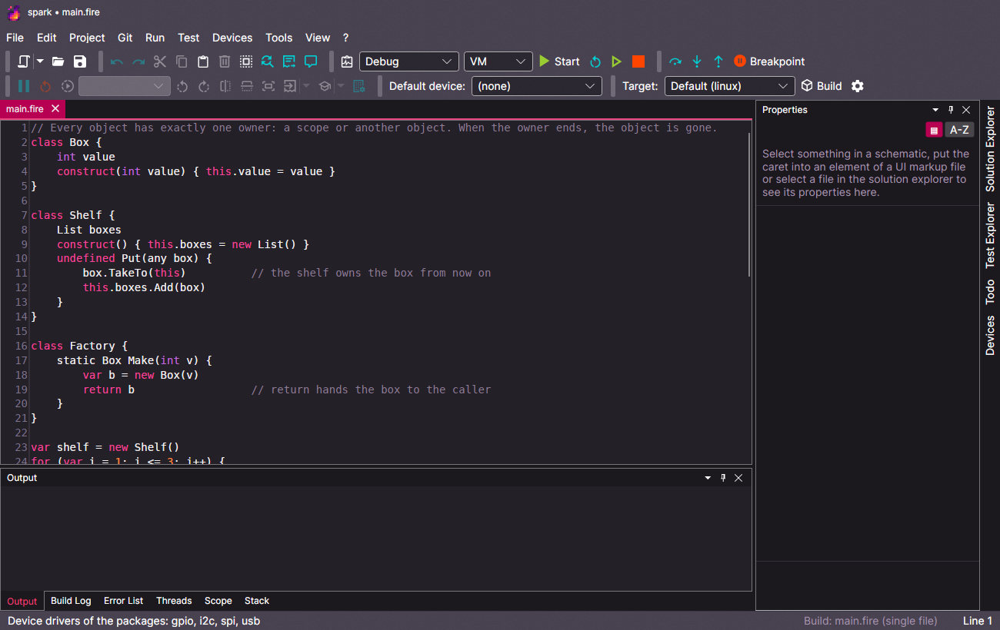
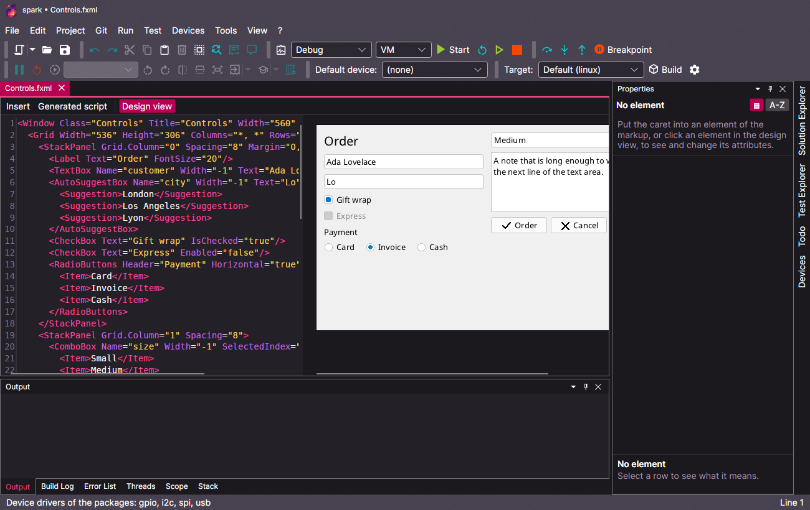
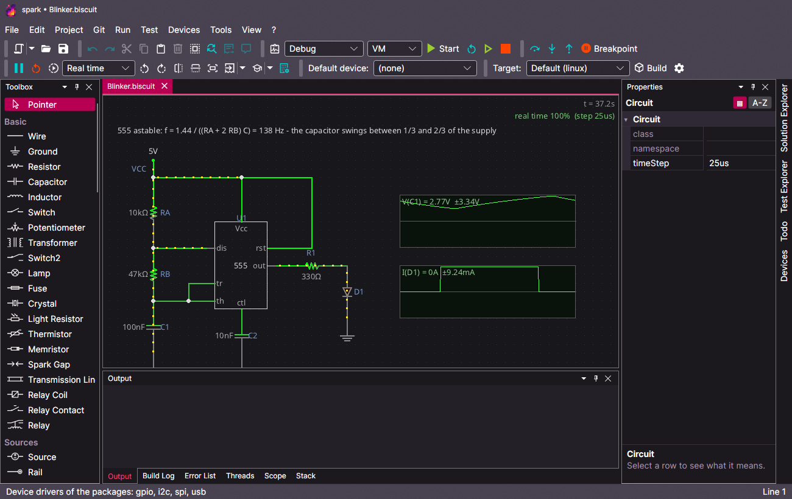
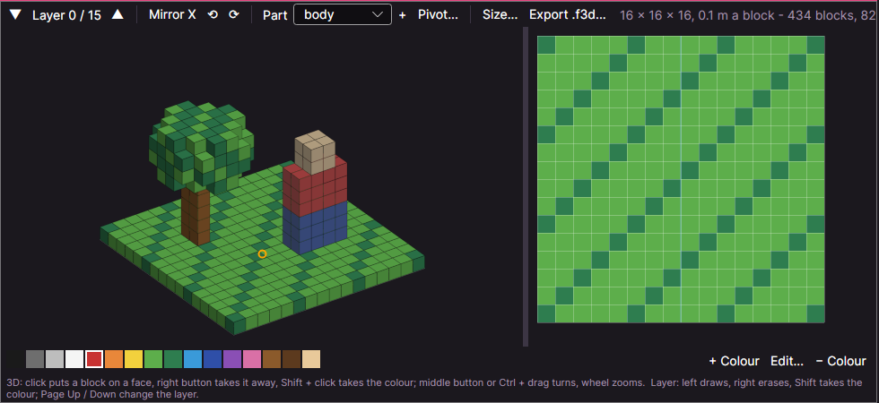
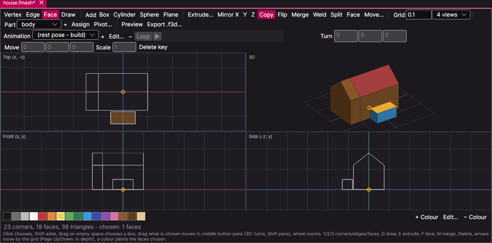

# spark, the editor

spark is the IDE of fire (C#, Avalonia - Windows, Linux, macOS). **First Steps** (*Help > First Steps*,
[source](../../src/fire.Editor/Help/First%20Steps.md)) walks through it; this page shows what is where.

- **Code editor:** completion (`Ctrl+Space`), go to definition (`F12`, also into the libraries), live errors while typing, the error list with codes
  ([error codes](errors.md)).
- **Run and debug:** `F5` starts, `F9` sets a breakpoint, `F10`/`F11` step; the panels *Threads*, *Scope* and *Stack* show the paused program. The
  engine box chooses the VM or a native build - native programs are debugged the same way, an ESP32 over its serial port ([targets](../targets/README.md)).
- **Build tool strip:** mode (Debug/Release/Performance), engine (VM/Native), target, *Build*, and the *Statistics* switch: when it is on, *Build*
  writes the statistics of the native build (`forge build --stats`, [forge](forge.md)) and opens them in a tab - the size of the program and what it takes
  to load, the code by origin (the C of the packages, the runtime, the C library, the generated fire code by module), the data, how much of the generated
  functions are C numbers, the biggest functions. A `.stats.json` next to a program opens in the same viewer.
- **Runtime panel:** docked on the right, it shows itself while a program runs and hides again a few seconds after it ended (unless it was open
  before): CPU and memory of the last minute as curves, CPU now and on average, memory now and at its peak, threads, lines of output, for the VM the
  collections of the .NET heap, and the events of the run (start, pauses, errors, new threads, the end with exit code and duration). A native program is
  measured as its own process; the VM runs inside spark, so its numbers are those of spark's process.
- **Profiler:** the *Profile* switch of the run tool strip profiles runs in the VM: when the program has ended, the *Profile* tab shows where the time
  went (the lines with the most instructions of the VM, how often each was entered) and every own file with the counts beside each line - hot lines in
  orange, lines with code that never ran in red (*Only what never ran* lists just those); a click on a line opens it in the editor.
- **Panels:** Output, Build log, Error list, Solution Explorer, Test Explorer ([testing](testing.md)), Todo ([notes](notes.md)), Devices
  ([devices](../devices/README.md)), Properties, Runtime. All of them dock, float or auto-hide; *View > Reset Layout* brings the start layout back.

## The markup designer

`.fxml` files open with the **design view** next to the text - drawn by the `ui` library itself, so it looks exactly like the program. A click in the
picture puts the caret into the element; the *Properties* panel lists and edits its attributes ([markup](../ui/markup.md#the-editor)).

## The circuit editor

`.biscuit` files open in the circuit editor: a toolbox of parts on the left, the schematic simulating live in the middle, the properties of the
selected part on the right ([circuits](../circuits/README.md#the-circuit-editor-of-spark)).

## The block editor

`.fblocks` files (*File > New > Block Model*) open in the block editor: a model built from blocks of a palette, like a world of blocks
([models](../graphics/models.md#the-block-editor)). In the 3D view a click puts a block on the face under the pointer, the right button takes one away; the
layer view on the right draws one layer of the grid from above. A program uses the file as a resource - forge makes fire's model file of it.

## The CAD editor

`.fmesh` files (*File > New > Mesh Model (CAD)*) open in the CAD editor: a model of corners and faces ([models](../graphics/models.md#the-cad-editor)). Four views - from
above, from the front, from the side and in 3D - or one of them large; corners, edges or faces are chosen (1, 2, 3) and dragged on the grid. *Draw* makes a face of
points clicked in a 2D view, *Extrude* pulls faces out to a body, *Mirror* copies them to the other side, and parts and animations work as in the block editor.

## More

- [Projects and solutions](projects.md), [templates](templates.md) (*File > New*), [git](git.md), [notes](notes.md)
- *Tools > Package Manager (ember)*, *Tools > Toolchain Settings*, *Tools > Open the Standard Libraries (Source)*
- The Markdown viewer and editor (`.md`), the raster editor for pictures, the packet viewer (`.fplog`) of the device traces
