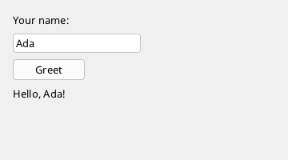

# User interfaces (`#import "ui"`)

The library `ui` (package `fire-ui`, project `packages/ui`, namespace `UI`) builds windows out of **elements**: labels, buttons, text fields, lists,
trees, menus, panels that lay out their children, shapes and drawing areas. It is written entirely in fire - there is no native code in it - and
draws into a [framebuffer](../graphics/README.md) that a window shows. Its model is close to WPF: two-pass layout, styles with triggers, control
templates, data templates and bindings.

An interface is usually **designed in markup**: a `.fxml` file (XML in the style of XAML) describes the elements, and a fire class - the
code-behind - reacts to them. spark shows the markup in a designer next to the text ([Markup](markup.md)). The same can be built in code, element
by element; both use the same classes and the same property names, so everything on these pages applies to both.



```xml
<!-- Greeter.fxml -->
<Window Class="Greeter" Title="Greeter" Width="360" Height="200">
  <StackPanel Margin="16" Spacing="8">
    <Label Text="Your name:"/>
    <TextBox Name="nameBox" OnEnter="Greet"/>
    <Button Text="Greet" OnClick="Greet"/>
    <Label Name="answer" Text="Type a name and press Greet."/>
  </StackPanel>
</Window>
```

```fire
// main.fire - the code-behind
#include "Greeter.fxml"                 // in a project the .fxml files are compiled with it, no #include needed

class GreeterWindow : GreeterBase {     // GreeterBase is generated from the markup
    override undefined Greet(any sender) { this.answer.Text = "Hello, " + this.nameBox.Text + "!" }
}

var window = new GreeterWindow()
window.Run()                            // until the window is closed
```
<!-- shot: window.nameBox.Text = "Ada";; window.Greet(undefined) -->

The markup becomes a class `GreeterBase` with a field for every named element (`nameBox`, `answer`), an empty method for every handler (`Greet`)
and a window with its framebuffer and root (`framebuffer`, `window`, `ui`). The code-behind inherits from it and overrides the handlers. In spark,
*Add > New > FXML Window* makes both files.

### The same in code

```fire
#import "ui"

var fb = new Framebuffer(360, 200)
var win = new Window(fb, "Greeter")
var ui = new UI.Root(fb, win)

var stack = new UI.StackPanel()
stack.Margin = new UI.Thickness(16)
stack.Spacing = 8
var name = new UI.TextBox("")
var greet = new UI.Button("Greet")
var answer = new UI.Label("Type a name and press Greet.")
stack.Add(new UI.Label("Your name:"))
stack.Add(name)
stack.Add(greet)
stack.Add(answer)
ui.Add(stack)

greet.OnClick = func () => { answer.Text = "Hello, " + name.Text + "!" }
name.OnEnter = func () => { greet.Click() }

ui.Run()
```

`#import "ui"` brings `graphics` (framebuffers, brushes, pens, fonts), `windows` (the window and its events) and `reflection` (styles set
properties by name) with it; a markup file imports `ui` itself.

## The pages of this chapter

| Page | Contents |
| --- | --- |
| **This page** | the root, the loop, events, ownership, drawing only what changed, fonts |
| [Layout and containers](containers.md) | measure and arrange, margins and alignment; `Panel`, `Canvas`, `StackPanel`, `DockPanel`, `WrapPanel`, `Grid`, `Border`, `ScrollViewer` |
| [Controls](controls.md) | `Label`, `Button`, `CheckBox`, `RadioButtons`, `TextBox`, `TextArea`, `AutoSuggestBox`, `ComboBox`, `Image`, `Separator` |
| [Lists and trees](lists.md) | `ListBox`, `ListView`, `TreeView`, `CollectionView`, item templates |
| [Menus, tool bars, popups](menus.md) | `MenuBar`, `MenuItem`, context menus, `ToolBar`, popups, tooltips |
| [Shapes, images, drawing](shapes.md) | `Rectangle`, `Ellipse`, `Line`, `Path`, `Geometry`, `Icons`, `DrawingCanvas` |
| [Styles, templates, binding](styling.md) | properties, `Style`, `Trigger`, `ControlTemplate`, `DataTemplate`, `Binding`, converters, resources, the theme |
| [Input](input.md) | focus and keyboard, mouse, double clicks, touch, joystick, clipboard, drag & drop |
| [Windows and appearance](windows.md) | `Run`/`Show`/`Tick`, several windows, window size, system theme (scaling, dark mode, accent, font), corners, shadows, glass, window backdrops, the display backends |
| [Common dialogs](dialogs.md) | open/save/folder dialogs, message boxes (`#import "dialogs"`) |
| [Docking](docking.md) | dock manager, tool windows, tool strips, status bar (`#import "ui.docking"`) |
| [Markup](markup.md) | designing the interface in a `.fxml` file, the designer in spark |

## The root

`new UI.Root(framebuffer, window)` is the top of every interface:

- it makes a `Renderer` for the framebuffer (`ui.renderer`), a `Theme` (`ui.theme`, the colours) and a `ResourceDictionary` (`ui.resources`);
- it switches on the event queue of the window and hooks itself into the window's cycle;
- it takes the look of the system: scaling, dark or light mode, accent colour and font ([Windows and appearance](windows.md#the-look-of-the-system));
- it lets the window resize the framebuffer (`window.AutoResize = true`) and lays the interface out anew when the user resizes the window.

`ui.Add(element)` puts an element into the root's top panel (`ui.content`, a `Panel` with absolute positions); an element that stretches (the default)
fills the window. `ui.width` and `ui.height` are the current size in logical pixels.

## The loop

Three ways to run an interface:

| Call | What happens |
| --- | --- |
| `ui.Run()` | shows the window and handles it on the calling thread until it is closed (with `ui.Run(other)` another root as well) |
| `ui.Show()` | shows the window and lets the program go on; the events are handled at the program's safe points, and the program waits at its end until the window is closed. `ui.Show(true)` is **modal**: it returns when the window is closed, the other windows take no input meanwhile |
| `while (ui.Tick()) { ... }` | one cycle per round: update and draw, show the frame, distribute the events; `false` once the window is closed |

A cycle distributes the events that came in, updates the interface (bindings, triggers, layout), paints what changed and then calls `ui.onTick` (a
lambda without parameters) - the place for work that should happen in every frame of a program that uses `Run`:

```fire
#import "ui"
#import "time"

var fb = new Framebuffer(240, 80)
var win = new Window(fb, "Clock")
var ui = new UI.Root(fb, win)
var clock = new UI.Label("")
clock.Margin = new UI.Thickness(16)
clock.FontSize = 28
ui.Add(clock)
ui.onTick = func () => { clock.Text = DateTime.Now.ToString("HH:mm:ss") }
ui.Run()
```

## Reacting: lambdas and flags

Every control that can be used reports in two ways - pick what fits the program:

| Element | Lambda field | Flag (true once, then reset) |
| --- | --- | --- |
| `Button` | `OnClick` | `TakeClicked()` |
| `CheckBox`, `RadioButtons`, `TextBox`, `TextArea` | `OnChange` | `TakeChanged()` |
| `TextBox` | `OnEnter` (Enter pressed) | `TakeEntered()` |
| `ListBox`, `ListView`, `TreeView` | `OnSelect`, `OnActivate` (Enter or double click) | `TakeChanged()`, `TakeActivated()` |
| `ComboBox` | `OnSelect` | `TakeChanged()` |
| `AutoSuggestBox` | `OnChosen` | `TakeChosen()` |

```fire
#import "ui"

var fb = new Framebuffer(300, 120)
var win = new Window(fb, "Flags")
var ui = new UI.Root(fb, win)
var check = new UI.CheckBox("Loud", 16, 16)
var ok = new UI.Button("OK", 16, 50)
ui.Add(check)
ui.Add(ok)
while (ui.Tick()) {
    if (check.TakeChanged()) { print("loud: " + check.IsChecked) }
    if (ok.TakeClicked()) { print("OK") }
}
```

The lambdas run **in the main program** with its real global variables: the root fetches the events of the window from its queue instead of
receiving them by a callback (a window callback would run on an isolated copy of the globals).

## Ownership

`Add` hands the element to its container (`child.TakeTo(this)`): an element made in a helper method lives as long as the container. The root owns
the whole tree; when the root goes, everything in it goes. `panel.Remove(child)` takes a child out without destroying it - it still belongs to the
panel until it is added elsewhere. Brushes, pens, styles and templates assigned to an element's properties belong to the element from then on.

The root does **not** own the framebuffer and the window it gets - keep them in variables of their own. `new UI.Root(fb, new Window(fb, "x"))`
fails: the window made inside the call belongs to that statement and is destroyed right after it (a `DestroyedException` at the first cycle).

## Drawing only what changed

`Update()` (and so every cycle) paints only when something changed, and only the area that changed - an idle window costs almost nothing. The
program keeps no books: the root watches the fields of every element with a [probe](../language/16-probes-and-reflection.md) (only a write that
really changes a value reports) and polls what does not live in fields: bindings, triggers, styles, templates, the number of list items and the
pointer state of the elements.

- A change inside one element (text, colour, hover) repaints that element's area. If an element moves or changes its size, everything is laid
  out and painted anew.
- Changes of the theme, the window size or a font repaint everything.
- Changes **inside** a brush, pen, geometry or picture are not seen (a `SolidBrush` whose `Color` is changed): call `element.Invalidate()` (or
  `ui.Invalidate()`), or assign a new brush. A `DrawingCanvas` with `Continuous = true` paints in every cycle.
- `ui.Draw()` paints everything. `ui.PartialPresent` (on) lets the window show only the changed area.
- Own elements start `Draw` with `if (!this.NeedsDraw(root, ax, ay)) { return }` and report changes that are not fields with `Invalidate()`.

## Fonts

Every element has `Font` (a name, `""` = the font of the element around it) and `FontSize` (pixels, `0` = inherited). A font on a panel applies to
everything in it; `ui.theme.font` and `ui.theme.fontSize` are the last fallback - the root sets them to the font of the system. Names are those of
[`Fonts.Get`](../graphics/fonts.md): `"8x14"` and `"8x8"` (the built-in bitmap fonts), a font added with `Fonts.Add(new Resource("fonts/X.ttf"))`,
or one installed on the system; an unknown name gives the console font.

```fire
#import "ui"

var fb = new Framebuffer(320, 120)
var win = new Window(fb, "Fonts")
var ui = new UI.Root(fb, win)
var title = new UI.Label("Settings", 12, 8)
title.FontSize = 24                       // the same font, larger
var hint = new UI.Label("Esc closes", 12, 50)
hint.Font = "8x8"                         // a bitmap font
ui.Add(title)
ui.Add(hint)
ui.Run()
```

Own elements measure and draw text with `element.TextWidth(root, text)`, `element.TextHeight(root)` and `element.DrawString(root, x, y, text, brush)`.

## Colours

A colour is an `int` (`r + g*256 + b*65536 + a*16777216`): `UI.Color.Rgb(r, g, b)` makes an opaque one, `UI.Color.Transparent()` the transparent
one. Elements are painted with brushes and pens: `new SolidBrush(UI.Color.Rgb(200, 60, 60))`, `new Pen(color, width)`. `undefined` in a property means:
take the colour of the theme.

## Limits

- No animations; rows built by an `ItemTemplate` are for display only (they take no input).
- Touch knows one finger (no pinch, no two-finger scrolling, no long press, no fling); the menu bar opens with mouse and finger only.
- Several roots on one framebuffer paint over each other.
- The joystick repeat counts cycles, not time.
