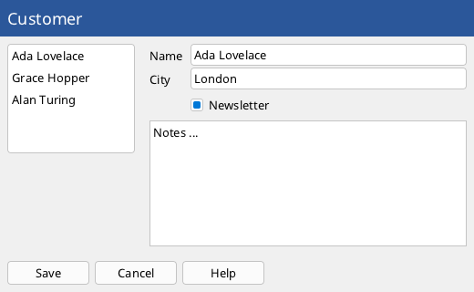
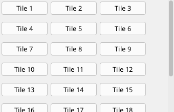

# Layout and containers

Containers hold other elements and decide where they go. Like WPF, the layout runs in two passes before every paint: **measure** asks each
element how big it wants to be (with limited or unlimited space), **arrange** gives it its place. Everything is in whole logical pixels.



```xml
<!-- Layout.fxml -->
<Window Class="Layout" Title="Layout" Width="520" Height="320">
  <DockPanel Width="520" Height="320">
    <Border DockPanel.Dock="Top" Padding="8" Thickness="0" Background="#2B579A">
      <Label Text="Customer" Color="#FFFFFF" FontSize="18"/>
    </Border>
    <WrapPanel DockPanel.Dock="Bottom" Margin="8">
      <Button Text="Save" Margin="0,0,6,0"/>
      <Button Text="Cancel" Margin="0,0,6,0"/>
      <Button Text="Help"/>
    </WrapPanel>
    <ListBox DockPanel.Dock="Left" Width="140" Margin="8">
      <Item>Ada Lovelace</Item>
      <Item>Grace Hopper</Item>
      <Item>Alan Turing</Item>
    </ListBox>
    <Grid Columns="auto, *" Rows="auto, auto, auto, *" Margin="8">
      <Label Grid.Row="0" Text="Name" Margin="0,4,8,4"/>
      <TextBox Grid.Row="0" Grid.Column="1" Width="-1" Text="Ada Lovelace"/>
      <Label Grid.Row="1" Text="City" Margin="0,4,8,4"/>
      <TextBox Grid.Row="1" Grid.Column="1" Width="-1" Text="London"/>
      <CheckBox Grid.Row="2" Grid.Column="1" Text="Newsletter" IsChecked="true" Margin="0,6,0,0"/>
      <TextArea Grid.Row="3" Grid.ColumnSpan="2" Width="-1" Height="-1" Margin="0,8,0,0" Text="Notes ..."/>
    </Grid>
  </DockPanel>
</Window>
```

```fire
#include "Layout.fxml"

class LayoutWindow : LayoutBase { }

var window = new LayoutWindow()
window.Run()
```

## Filling the window

The root places what it gets like a `Canvas`: an element at the top of a window gets the size it asks for, not the size of the window - `Stretch`
does not apply there. Give the top container the size of the window (`<DockPanel Width="520" Height="320">`, as above) or place it with `Left`/`Top`.
It does not grow when the user makes the window larger; `ui.onResize = func (int w, int h) => { panel.Width = w; panel.Height = h }` does that. (Only
the `DockManager` of [docking](docking.md) fills the window by itself. Filling the window by default is planned, see the [roadmap](../ROADMAP.md).)

## What every element has

| Property | Meaning |
| --- | --- |
| `Width`, `Height` | the size the element asks for; `-1` (the default for most): from its content or from the space it gets |
| `MinWidth`, `MinHeight`, `MaxWidth`, `MaxHeight` | limits (`-1` for the maximum: none) |
| `Margin` | space around the element: `4` (all sides), `8,4` (horizontal, vertical), `1,2,3,4` (left, top, right, bottom); in code `new UI.Thickness(...)` with the same forms |
| `HorizontalAlign` | `Stretch` (default), `Left`, `Center`, `Right` - where the element sits in the width its container gives it |
| `VerticalAlign` | `Stretch` (default), `Top`, `Center`, `Bottom` |
| `Left`, `Top` | the position - only in a `Panel` and a `Canvas` |
| `Visible` | an invisible element takes no space in a stack, dock or wrap panel and gets no input |
| `Enabled` | a disabled element is drawn greyed and takes no input |

After the layout, `actualWidth` and `actualHeight` hold the size the element got.

**One difference to WPF:** an element with `Stretch` and a fixed `Width` (or `Height`) sits at the left (top) instead of in the middle. Many
controls have a fixed default width (a `Button` 90, a `TextBox` 160, a `ListBox` 160 x 120); set `Width="-1"` to let them stretch, as the text boxes
in the grid above do.

## Panel and Canvas

A `Panel` places its children at their `Left`/`Top` and draws a background (`Filled`, `Background`; the theme's panel colour by default) and, with
`ShowBorder`, a frame (`Pen`). A `Canvas` is the same without background and frame. The root's own top element (`ui.content`) is such a panel, which
is why `ui.Add(new UI.Button("OK", 20, 40))` places the button at (20, 40).

```xml
<Canvas>
  <Label Left="20" Top="20" Text="At (20, 20)"/>
  <Button Left="20" Top="50" Text="At (20, 50)"/>
</Canvas>
```

`panel.Add(child)`, `panel.Remove(child)` (not destroyed: it still belongs to the panel), `panel.Clear()` (destroys all children), `panel.children`.

## StackPanel

Lines its children up below each other, or side by side with `Orientation="Horizontal"` (`Horizontal = true` in code). Each child gets the size it
wants in the running direction and the whole space across it.

| Property | Meaning |
| --- | --- |
| `Orientation` / `Horizontal` | `Vertical` (default) or `Horizontal` |
| `Spacing` | pixels between the children |
| `Padding` | inner margin on all sides |

`Stack` is a `StackPanel` with the defaults of earlier versions: a background, spacing and padding 4 (in markup also 100 x 100 if no size is given).

## DockPanel

Children lie at the edges in the order they were added - each says where with `DockPanel.Dock` (`Left` default, `Top`, `Right`, `Bottom`; `Dock`
in code, or `dock.AddDocked(child, UI.Dock.Top)`). The last child fills what is left, unless `LastChildFill="false"`.

## WrapPanel

Lines its children up and starts a new row when the width is used up (a new column with `Vertical="true"`). `ItemWidth`/`ItemHeight` give every child
the same size.

## Grid

Rows and columns, each `auto` (as big as its content), a number (pixels) or a star (`*`, `2*`: a share of what is left):

```xml
<Grid Columns="100, auto, *, 2*" Rows="auto, *">
  <Label Grid.Row="0" Grid.Column="0" Text="top left"/>
  <TextArea Grid.Row="1" Grid.ColumnSpan="4" Width="-1" Height="-1"/>
</Grid>
```

| Markup | Code |
| --- | --- |
| `Columns="..."`, `Rows="..."` | `grid.SetColumns("...")`, `grid.SetRows("...")` |
| `Grid.Row`, `Grid.Column`, `Grid.RowSpan`, `Grid.ColumnSpan` on the child | `GridRow`, `GridColumn`, `GridRowSpan`, `GridColumnSpan`, or `grid.AddAt(child, row, column, rowSpan, columnSpan)` |

Without rows or columns a grid has one star row and one star column.

## Border

Exactly one child with a frame (`Thickness`, pixels; `0`: none), the frame's `Pen`, a `Background` and an inner margin (`Padding`). In code:
`border.SetChild(element)`.

## ScrollViewer

Shows one child in a section and adds scroll bars when it does not fit:



```xml
<!-- Tiles.fxml -->
<Window Class="Tiles" Title="Tiles" Width="340" Height="220">
  <ScrollViewer Width="340" Height="220">
    <WrapPanel Name="tiles" ItemWidth="96" ItemHeight="40"/>
  </ScrollViewer>
</Window>
```

```fire
#include "Tiles.fxml"

class TilesWindow : TilesBase {
    construct() {
        for (var i = 1; i <= 24; i++) {
            var b = new UI.Button("Tile " + i)
            b.Margin = new UI.Thickness(3)
            this.tiles.Add(b)
        }
    }
}

var window = new TilesWindow()
window.Run()
```

| Property / method | Meaning |
| --- | --- |
| `VerticalScrollMode` | `Auto` (default: a bar when needed), `Visible` (always), `Disabled` |
| `HorizontalScrollMode` | `Disabled` (default: the child gets exactly the width of the section, so a `WrapPanel` wraps), `Auto`, `Visible` |
| `SetContent(element)` | the child, in code |
| `ScrollIntoView(x, y, w, h)` | scrolls so that this area of the child can be seen |
| `vbar`, `hbar` | the two `UI.Scroller`s (`offset`, `extent`, `viewport`, `Set(value)`, `By(delta)`) |

The mouse wheel scrolls (with the horizontal wheel or Shift sideways), the thumbs can be dragged, a click next to a thumb pages, a finger swipes.
When the focus moves into an element that is hidden (Tab, arrow keys), the viewer scrolls it into view.

## Own containers

A container derives from `UI.Panel` (or `UI.Element`) and overrides `MeasureCore(root, availableWidth, availableHeight)` - measure the children with
`child.Measure(root, w, h)` and set `this.cw`/`this.ch` to the content size - and `ArrangeCore(root, w, h)` - place each child with
`child.Arrange(root, x, y, w, h)`. `-1` as available size means unlimited. The panels in `packages/ui/20_elements.fire` are short examples.
