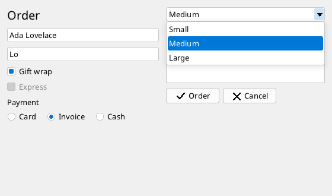

# Controls

The controls of `ui`: text, buttons, choices and input fields. Lists and trees have [a page of their own](lists.md).



```xml
<!-- Controls.fxml -->
<Window Class="Controls" Title="Controls" Width="560" Height="330">
  <Grid Width="536" Height="306" Columns="*, *" Rows="auto, *" Margin="12">
    <StackPanel Grid.Column="0" Spacing="8" Margin="0,0,12,0">
      <Label Text="Order" FontSize="20"/>
      <TextBox Name="customer" Width="-1" Text="Ada Lovelace"/>
      <AutoSuggestBox Name="city" Width="-1" Text="Lo">
        <Suggestion>London</Suggestion>
        <Suggestion>Los Angeles</Suggestion>
        <Suggestion>Lyon</Suggestion>
      </AutoSuggestBox>
      <CheckBox Text="Gift wrap" IsChecked="true"/>
      <CheckBox Text="Express" Enabled="false"/>
      <RadioButtons Header="Payment" Horizontal="true" SelectedIndex="1">
        <Item>Card</Item>
        <Item>Invoice</Item>
        <Item>Cash</Item>
      </RadioButtons>
    </StackPanel>
    <StackPanel Grid.Column="1" Spacing="8">
      <ComboBox Name="size" Width="-1" SelectedIndex="1">
        <Item>Small</Item>
        <Item>Medium</Item>
        <Item>Large</Item>
      </ComboBox>
      <TextArea Height="96" Width="-1" WordWrap="true" Text="A note that is long enough to wrap onto the next line of the text area."/>
      <StackPanel Orientation="Horizontal" Spacing="6">
        <Button Text="Order" Icon="Check"/>
        <Button Text="Cancel" Icon="Close"/>
      </StackPanel>
    </StackPanel>
  </Grid>
</Window>
```

```fire
#include "Controls.fxml"

class ControlsWindow : ControlsBase { }

var window = new ControlsWindow()
window.Run()
```
<!-- shot: window.ui.Tick();; window.size.OpenDropDown() -->

All controls have the properties of every element ([layout](containers.md#what-every-element-has), [appearance](styling.md)), a `Name` in markup
(a field of the generated class) and `ToolTip` (a short text shown when the pointer rests on the element; in code only for now).

## Label

A line of text. `Text`, `Color` (the brush of the text; else `Foreground`, else the theme).

```xml
<Label Text="Total:" FontSize="18" Color="#C00000"/>
```

## Button

| Member | Meaning |
| --- | --- |
| `Text` | the caption |
| `Icon` | a vector symbol in front of the text: a name of `UI.Icons` (`Up`, `Down`, `Back`, `Forward`, `Home`, `Folder`, `File`, `Close`, `Check`, `Add`) or path data (`M 8 1 L 15 8 L 1 8 Z`, see [shapes](shapes.md#geometry)); drawn in the text colour, greyed when disabled |
| `Image` | a picture in front of the text - in markup a file (it is embedded as a [resource](../stdlib/resources.md)), in code a `Framebuffer` |
| `IconSize` | size of icon and image in pixels (16) |
| `OnClick` / `TakeClicked()` | the click (mouse, Space or Enter while focused, a finger, joystick button 0) |
| `Click()` | clicks it from code |

A button without a fixed size (`Width="-1"`) grows with its content; by default it is 90 x 26.

## CheckBox

`Text`, `IsChecked`; `OnChange` / `TakeChanged()` when the user toggles it (click, Space); `Toggle()` from code.

## RadioButtons

One choice out of several, as one element:

| Member | Meaning |
| --- | --- |
| `<Item>text</Item>` / `Add(item)` | an option (a text, a number or an object; with `DisplayMember` the property of the object that is shown) |
| `Header` | a title above the options |
| `Horizontal`, `Spacing` | the options side by side, the gap between them |
| `SelectedIndex`, `selectedItem`, `Select(i)` | the choice (-1: none) |
| `OnChange` / `TakeChanged()` | the user chose |

The arrow keys move the choice while the element has the focus.

## TextBox

One line of text.

| Member | Meaning |
| --- | --- |
| `Text`, `SetText(text)` | the text (setting it clears the undo history) |
| `MaxLength` | 0: no limit; typed text that does not fit is refused, pasted text is cut |
| `ReadOnly` | can be selected and copied, not changed; Enter still reports |
| `OnChange` / `TakeChanged()` | the text changed by the user |
| `OnEnter` / `TakeEntered()` | Enter was pressed |
| `SelectionStart`, `SelectionLength`, `SelectedText`, `Select(start, length)`, `SelectAll()`, `ReplaceSelection(text)` | the selection |
| `Copy()`, `Cut()`, `Paste()` | the clipboard |
| `CanUndo`, `CanRedo`, `Undo()`, `Redo()`, `ClearUndo()`, `UndoLimit` (100; 0: no history) | undo |
| `caret`, `anchor` | the caret position and the other end of the selection (-1: none) |

**Keys:** arrows, Home/End, Backspace/Delete, Ctrl+Left/Right word by word (with Shift selecting), Ctrl+A, Ctrl+C / Ctrl+Insert, Ctrl+X / Shift+Delete,
Ctrl+V / Shift+Insert, Ctrl+Z, Ctrl+Y / Ctrl+Shift+Z (Cmd on the Mac). Line breaks become spaces when pasted.

**Mouse:** a click sets the caret, dragging selects, a double click selects a word (letters, digits and `_`), a triple click everything; dragging after
a double click extends word by word. Pressing on the selection and moving drags its text: into another text field it is copied, inside the same field
it is moved (copied with Ctrl), out of the window into another program as text ([drag & drop](input.md#drag--drop)). Text and files dropped onto
the field are inserted where they are dropped (`AllowDrop = false` switches that off).

**Undo:** typing is grouped into one step per word (a new step starts after a space or line break, after a pause of more than a second, or when
typing continues elsewhere); paste, cut, deleting a selection and drops are steps of their own. The caret and the selection come back with each step.
Setting `Text` from the program clears the history.

With a proportional font the field measures the text up to the caret; with the console font it counts columns.

## TextArea

Several lines with scroll bars:

```xml
<TextArea Name="notes" Width="300" Height="160" WordWrap="true" AcceptsTab="true" OnChange="NotesChanged"/>
```

Everything of the `TextBox` (selection, clipboard, undo, drag & drop, `MaxLength`, `ReadOnly`), and:

| Member | Meaning |
| --- | --- |
| `WordWrap` | wraps long lines at the last space that fits (a too long word where the line is full) instead of scrolling sideways |
| `AcceptsReturn` (true), `AcceptsTab` (false) | Enter inserts a line break; Tab inserts a tab (else Tab moves the focus) |
| `TabSize` | 4: a tab reaches to the next column that is a multiple of it |
| `LineCount`, `GetLine(i)`, `CaretLine`, `CaretColumn` | the lines (`Text` separates them with `"\n"`; `"\r\n"` and `"\r"` become `"\n"`) |
| `SetText(text)` | sets the text, the caret to the start |
| `AppendText(text)` | appends and scrolls to the end - for a log |
| `vbar`, `hbar` | the scroll bars (`UI.Scroller`) |

Up/Down keep the column across shorter lines, Ctrl+Home/End go to the start/end of the text, Page Up/Down page; a triple click selects the line.
Long texts stay fast: the area keeps an index of where each line (and each wrapped row) starts and draws only the visible rows - in the VM, a key
press in a text of 5000 lines takes about 10 ms.

## AutoSuggestBox

A `TextBox` that shows suggestions while typing:

| Member | Meaning |
| --- | --- |
| `<Suggestion>text</Suggestion>` / `AddSuggestion(item)` | a suggestion; shown are those that contain the text (ignoring case) |
| `provider` | instead of the list: a lambda `func (string text) => list` that returns the suggestions for a text |
| `DisplayMember` | the property shown for objects |
| `MaxSuggestions` | 6 |
| `OnChosen` / `TakeChosen()`, `chosenItem` | a suggestion was taken (Enter or a click) |

Up/Down move in the list, Escape closes it.

## ComboBox

A choice out of a list that drops down:

| Member | Meaning |
| --- | --- |
| `<Item>text</Item>` / `Add(item)`, `Remove(item)`, `Clear()`, `SetItems(list)` | the items |
| `ItemsSource` | a list of someone else's that the box shows without owning it |
| `DisplayMember` | the property shown for objects |
| `SelectedIndex`, `selectedItem`, `Text` (the text of the choice), `Select(i)`, `SelectText("x")` | the choice |
| `OnSelect` / `TakeChanged()` | the choice changed |
| `MaxDropDownItems` | 8 rows at most, more scroll |
| `IsDropDownOpen()`, `OpenDropDown()`, `CloseDropDown()` | the list |

A click (or Alt+Down, F4, Enter, Space) opens the list; a click on a row chooses, Escape or a click elsewhere closes it. Closed, Up/Down and
Home/End choose directly.

## Image

Shows a picture with its alpha:

```xml
<Image Source="images/logo.png" Width="64" Height="64" Stretch="Uniform"/>
```

`Source` - in markup a file next to the markup (embedded as a [resource](../stdlib/resources.md)), in code a `Framebuffer`
(`Framebuffer.FromResource(new Resource("logo.png"))`, a loaded or a painted one). `Stretch`: `None`, `Fill`, `Uniform` (default: as large as fits,
keeping the proportions), `UniformToFill`.

## Separator

A thin line between the items of a [tool bar](menus.md#toolbar) or a stack.

## In code

Every control has a constructor with its most used properties - `new UI.Button("OK", left, top, width, height)`, `new UI.Label("text", left, top)`,
`new UI.CheckBox("text", left, top, isChecked)`, `new UI.TextBox("text", left, top, width, height)`, `new UI.TextArea("text", left, top, width, height)`,
`new UI.ComboBox(left, top, width, height)`, `new UI.RadioButtons(left, top)`, `new UI.AutoSuggestBox("text", left, top, width, height)`,
`new UI.Image(framebuffer, left, top, width, height)` - and the same fields as in markup:

```fire
#import "ui"

var fb = new Framebuffer(300, 140)
var win = new Window(fb, "In code")
var ui = new UI.Root(fb, win)
var size = new UI.ComboBox(16, 16, 160, 26)
size.Add("Small")
size.Add("Medium")
size.Select(0)
var label = new UI.Label("Small", 16, 60)
size.OnSelect = func () => { label.Text = size.Text }
ui.Add(size)
ui.Add(label)
ui.Run()
```
