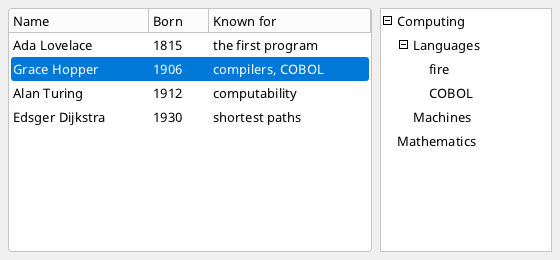

# Lists and trees

`ListBox`, `ListView` (a list with columns) and `TreeView` show many items, scroll, select with keyboard, mouse and finger, and report a double
click or Enter as *activation*. Their items can come from the element itself, from a list of the program or from a sorted and filtered view of one.



```xml
<!-- People.fxml -->
<Window Class="People" Title="People" Width="560" Height="260">
  <Grid Width="560" Height="260" Columns="*, 180">
    <ListView Name="table" Grid.Column="0" Width="-1" Height="-1" Margin="8" ItemsSource="{Binding people}" OnActivate="ShowPerson">
      <Column Header="Name" Member="name" Width="140"/>
      <Column Header="Born" Member="born" Width="60"/>
      <Column Header="Known for" Member="field" Width="-1"/>
    </ListView>
    <TreeView Grid.Column="1" Width="-1" Height="-1" Margin="0,8,8,8">
      <TreeNode Text="Computing" Expanded="true">
        <TreeNode Text="Languages" Expanded="true">
          <TreeNode Text="fire"/>
          <TreeNode Text="COBOL"/>
        </TreeNode>
        <TreeNode Text="Machines"/>
      </TreeNode>
      <TreeNode Text="Mathematics"/>
    </TreeView>
  </Grid>
</Window>
```

```fire
#include "People.fxml"

class Person {
    string name
    int born
    string field
    construct(string name, int born, string field) { this.name = name; this.born = born; this.field = field }
}

class Model {
    List people = new List()
}

class PeopleWindow : PeopleBase {
    override undefined ShowPerson(any sender) { print("open " + this.table.selectedItem.name) }
}

var model = new Model()
model.people.Add(new Person("Ada Lovelace", 1815, "the first program"))
model.people.Add(new Person("Grace Hopper", 1906, "compilers, COBOL"))
model.people.Add(new Person("Alan Turing", 1912, "computability"))
model.people.Add(new Person("Edsger Dijkstra", 1930, "shortest paths"))
var window = new PeopleWindow()
window.SetDataContext(model)
window.Run()
```
<!-- shot: window.table.Select(1) -->

## Items

| Way | Markup | Code |
| --- | --- | --- |
| items of the element | `<Item>Ada</Item>` | `list.Add(item)`, `Remove(item)`, `Clear()`, `SetItems(list)` |
| a list of the program | `ItemsSource="{Binding people}"` | `list.ItemsSource = people` |
| a sorted / filtered view | `View="ByName"` with a `<CollectionView Key="ByName" .../>` in the resources | `list.SetView(view, false)` |

- An **item** is any value: a text, a number or an object. An object given to `Add` belongs to the list from then on; `SetItems(list, own = true)`
  hands over a whole list.
- **`ItemsSource`** shows a list that belongs to someone else: changes in it (items added or removed) appear by themselves, and assigning another
  list shows that one. After a change *inside* the items (a name changed) call `list.Refresh()`.
- **`DisplayMember`** names the property shown for an object; without it the item itself is shown as text.
- **`ItemTemplate`** (a [`DataTemplate`](styling.md#data-templates)) builds an element for every row; such rows are for display only.

## Selection and activation

| Member | Meaning |
| --- | --- |
| `SelectedIndex`, `selectedItem`, `Select(i)` | the selected row (-1 / `undefined`: none); setting `SelectedIndex` from outside (also by a binding) acts like a selection |
| `OnSelect` / `TakeChanged()` | the selection changed |
| `OnActivate` / `TakeActivated()`, `Activate()` | Enter, or a double click on a row |
| `Count`, `Rows()` | the number of rows, the rows shown |
| `EnsureVisible(root, i)` | scrolls a row into view |

Keys: Up/Down, Home/End, Page Up/Down; at the first or last row Up/Down leave the list (the focus moves on). The mouse wheel scrolls, a finger
swipes.

## ListBox

The plain list. `new UI.ListBox(left, top, width, height)` (160 x 120 by default).

## ListView

A `ListBox` with columns and a header:

| Markup | Code | Meaning |
| --- | --- | --- |
| `<Column Header="Name" Member="name" Width="140"/>` | `view.AddColumn("Name", "name", 140)` | a column showing the property `name`; width `-1`: the rest |

A click on a column header sorts by it (once more: the other way round) - the list itself, or with a `CollectionView` the view (`SortBy`).
`sortedBy` and `sortDescending` tell the state.

## TreeView

Nodes with children that open and close:

| Member | Meaning |
| --- | --- |
| `<TreeNode Text="..." Expanded="true">` nested | the nodes |
| `new UI.TreeNode("text", value)`, `tree.AddNode(node)`, `node.Add(child)` | in code: a node with a value of the program |
| `node.Text`, `node.value`, `node.children`, `node.parent`, `node.Expanded`, `Expand()`, `Collapse()`, `HasChildren()`, `Depth()` | the node |
| `selected`, `SelectNode(node)` | the selected node |
| `OnSelect` / `TakeChanged()`, `OnActivate` / `TakeActivated()` | as with the lists; a double click also opens or closes the node |
| `Indent` | pixels per level (16) |
| `Clear()` | removes all nodes |

Keys: Up/Down move, Right opens a node or goes to its first child, Left closes it or goes to its parent, Enter activates. A click on the box opens or
closes, a click on the row selects.

## CollectionView

A view of a list: filtered, sorted and with a current item - without changing the list.

```xml
<Resources>
  <CollectionView Key="Adults" Source="{Binding people}" SortBy="name" Filter="{Expr func (p) on this => { return p.age &gt; 17 }}"/>
</Resources>
<ListBox View="Adults" DisplayMember="name"/>
```

| Member | Meaning |
| --- | --- |
| `new UI.CollectionView(list)`, `Source` | the list it shows (replaceable) |
| `Filter` | `func (item) => bool` - true keeps the item |
| `SortBy("member", descending)`, `Descending` | sort by a property (stable) |
| `Comparer` | `func (a, b) => int` instead of a property |
| `Count`, `view[i]`, `items` | the items of the view |
| `current`, `CurrentItem()`, `MoveCurrentTo(i)`, `MoveCurrentToFirst/Last/Next/Previous()` | the current item; a list showing the view selects it |
| `Refresh()`, `Invalidate()` | recompute now / at the next paint |

The view updates itself when the number of items in its source changes; after other changes call `Refresh()`. In markup the view is a field of
the generated class (`fxView_Adults`), so the code-behind can change it: `this.fxView_Adults.SortBy("age")`.

## In code

```fire
#import "ui"

var fb = new Framebuffer(260, 180)
var win = new Window(fb, "Fruit")
var ui = new UI.Root(fb, win)
var list = new UI.ListBox(10, 10, 160, 120)
foreach (f in ["apple", "banana", "cherry"]) { list.Add(f) }
list.Select(0)
list.OnActivate = func () => { print("chosen: " + list.selectedItem) }
ui.Add(list)
ui.Run()
```
