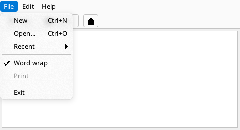

# Menus, tool bars, popups and tooltips



```xml
<!-- Editor.fxml -->
<Window Class="Editor" Title="Editor" Width="480" Height="260">
  <DockPanel Width="480" Height="260">
    <MenuBar Name="menu" DockPanel.Dock="Top">
      <Menu Header="File">
        <MenuItem Header="New" Shortcut="Ctrl+N" OnClick="NewFile"/>
        <MenuItem Header="Open..." Shortcut="Ctrl+O" OnClick="OpenFile"/>
        <MenuItem Header="Recent">
          <MenuItem Header="notes.txt"/>
          <MenuItem Header="todo.md"/>
        </MenuItem>
        <MenuSeparator/>
        <MenuItem Header="Word wrap" Checkable="true" IsChecked="true" OnClick="ToggleWrap"/>
        <MenuItem Header="Print" Enabled="false"/>
        <MenuSeparator/>
        <MenuItem Header="Exit" OnClick="Quit"/>
      </Menu>
      <Menu Header="Edit">
        <MenuItem Header="Undo" Shortcut="Ctrl+Z"/>
      </Menu>
      <Menu Header="Help">
        <MenuItem Header="About"/>
      </Menu>
    </MenuBar>
    <ToolBar DockPanel.Dock="Top">
      <Button Text="New" Icon="Add" Width="-1" OnClick="NewFile"/>
      <Button Text="Open" Icon="Folder" Width="-1" OnClick="OpenFile"/>
      <Separator/>
      <Button Icon="Home" Width="30"/>
    </ToolBar>
    <TextArea Name="text" Width="-1" Height="-1" Margin="4" WordWrap="true"/>
  </DockPanel>
</Window>
```

```fire
#include "Editor.fxml"

class EditorWindow : EditorBase {
    override undefined NewFile(any sender) { this.text.SetText("") }
    override undefined OpenFile(any sender) { print("open ...") }
    override undefined ToggleWrap(any sender) { this.text.WordWrap = !this.text.WordWrap }
    override undefined Quit(any sender) { this.window.Close() }
}

var window = new EditorWindow()
window.Run()
```
<!-- shot: window.ui.Tick();; window.menu.Open(window.ui, 0) -->

## Menu bar and menus

| Markup | Code | Meaning |
| --- | --- | --- |
| `<MenuBar>` | `new UI.MenuBar()` | the bar with the menus of the top level |
| `<Menu Header="File">` | `bar.Add(new UI.MenuItem("File"))` | a menu of the bar |
| `<MenuItem Header="Open" OnClick="Open"/>` | `menu.Add(new UI.MenuItem("Open", func () => { ... }))` | a row with an action (in markup a handler of the code-behind) |
| nested `<MenuItem>` | `item.Add(new UI.MenuItem(...))` | a submenu |
| `<MenuSeparator/>` | `menu.Add(UI.MenuItem.Separator())` | a line |
| `Shortcut="Ctrl+O"` | `item.Shortcut = "Ctrl+O"` | a text on the right - only shown; the key itself is the program's business (`ui.onKeyPreview`, [input](input.md)) |
| `Checkable`, `IsChecked` | the same | a check mark; a click toggles it before the action runs |
| `Enabled="false"` | `item.Enabled = false` | greyed, cannot be chosen |

A click on a title opens its menu; while a menu is open, moving the pointer over another title switches to it. In a menu, Up/Down move, Right opens a
submenu, Left closes it, Enter chooses, Escape closes. `bar.Open(root, index)` opens a menu from code.

Menus lie on **acrylic** - what is behind them, blurred and tinted - with a fine shadow ([appearance](windows.md#corners-shadows-glass-and-acrylic)).

## Context menus

A list of `MenuItem`s in an element's `contextMenu` appears on a right click on the element or on any element inside it:

```fire
#import "ui"

var fb = new Framebuffer(300, 160)
var win = new Window(fb, "Context menu")
var ui = new UI.Root(fb, win)
var area = new UI.TextArea("Right-click me", 10, 10, 280, 140)
var items = new List()
items.Add(new UI.MenuItem("Copy", func () => { area.Copy() }))
items.Add(new UI.MenuItem("Paste", func () => { area.Paste() }))
items.Add(UI.MenuItem.Separator())
items.Add(new UI.MenuItem("Select all", func () => { area.SelectAll() }))
area.contextMenu = items
ui.Add(area)
ui.Run()
```

`ui.ShowMenu(items, x, y)` opens such a menu anywhere (it returns the `UI.MenuPopup`). Context menus are set in code for now.

## ToolBar

A horizontal row of buttons and separators (a `StackPanel` with spacing 2 and padding 3). In markup it holds `Button`s and `Separator`s; in code
`bar.AddButton("Save", func () => { ... })` returns the button, `bar.AddSeparator()` adds a line.

Tool strips that can be dragged to the edges of the window, with an overflow menu, and a status bar come with
[`ui.docking`](docking.md#toolstrips).

## Popups

Anything can float above the interface:

| Call | Meaning |
| --- | --- |
| `ui.ShowPopup(element, x, y, transient = true, owner = undefined)` | shows the element at (x, y), drawn last and hit first; `transient`: it is destroyed when it closes |
| `ui.ClosePopup(element)`, `ui.CloseAllPopups()`, `ui.IsPopup(element)` | closing |
| `element.PopupOutside(root, x, y)` | called for a click outside; by default the popup closes (and the click is used up if it hit `owner`) |
| `element.grabsKeys = true` | the popup gets the keys first while it is on top |

Menus, the list of a `ComboBox` and the suggestions of an `AutoSuggestBox` are such popups. A popup has the rounded corners of
`theme.popupRadius` and casts a shadow.

## Tooltips

Every element can have a short hint: `button.ToolTip = "Saves everything"` (in code; markup support is planned). When the pointer rests on the element
for `ui.toolTipDelay` milliseconds (500), the text appears below the pointer; a child without a tooltip shows its parent's. It takes no input and goes
when the pointer moves to another element, a button is pressed, the wheel turns or a key is pressed. The time comes from `ui.clock` (see
[double clicks](input.md#double-clicks)), else from the cycles.
