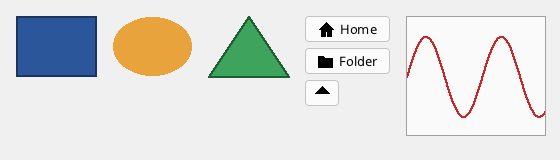

# Shapes, images and drawing

Vector shapes are elements like any other: they take part in the layout, can be styled and hit by the mouse. For free drawing there is the
`DrawingCanvas`, a surface with its own framebuffer that the program paints with a [renderer](../graphics/README.md).



```xml
<!-- Shapes.fxml -->
<Window Class="Shapes" Title="Shapes" Width="560" Height="160">
  <StackPanel Orientation="Horizontal" Spacing="16" Margin="16">
    <Rectangle Width="80" Height="60" Fill="#2B579A" Stroke="#1A365F,2"/>
    <Ellipse Width="80" Height="60" Fill="#E8A33D"/>
    <Path Data="M 0 60 L 40 0 L 80 60 Z" Fill="#3DA35D" Stroke="#1F5E33,2"/>
    <StackPanel Spacing="6">
      <Button Text="Home" Icon="Home" Width="-1"/>
      <Button Text="Folder" Icon="Folder" Width="-1"/>
      <Button Icon="M 8 1 L 15 8 L 1 8 Z" Width="34"/>
    </StackPanel>
    <DrawingCanvas Name="wave" Width="140" Height="120" OnPaint="PaintWave"/>
  </StackPanel>
</Window>
```

```fire
#include "Shapes.fxml"

class ShapesWindow : ShapesBase {
    override undefined PaintWave(any sender, any canvas) {
        var r = canvas.renderer
        r.ClearTo(UI.Color.Rgb(250, 250, 250))
        var pen = new Pen(UI.Color.Rgb(200, 40, 40), 2)
        var w = canvas.framebuffer.Width()
        var h = canvas.framebuffer.Height()
        var lastY = h / 2
        for (var x = 1; x < w; x++) {
            var y = h / 2 - Math.Round(Math.Sin(x / 12.0) * (h / 3))!int
            r.DrawLine(x - 1, lastY, x, y, pen)
            lastY = y
        }
        r.DrawRect(0, 0, w, h, new Pen(UI.Color.Rgb(160, 160, 160), 1))
    }
}

var window = new ShapesWindow()
window.Run()
```

## Rectangle, Ellipse, Line

`Rectangle` and `Ellipse` fill the size of the element; `Line` goes from (`X1`, `Y1`) to (`X2`, `Y2`). All shapes have

| Property | Markup | Code |
| --- | --- | --- |
| `Fill` | a colour `#RRGGBB` | a `Brush` (`new SolidBrush(color)`) |
| `Stroke` | a pen `#RRGGBB` or `#RRGGBB,width` | a `Pen` (`new Pen(color, width)`) |

## Path and geometry

A `Path` draws a **geometry**: figures made of lines and curves. Closed figures are filled (even-odd rule), open ones are drawn as lines.

The path data is the SVG mini language with whole numbers: `M x y` (move), `L x y` (line), `H x`, `V y` (horizontal, vertical line), `Q x1 y1 x y`
(quadratic curve), `C x1 y1 x2 y2 x y` (cubic curve), `Z` (close); lower case letters are relative to the current point.

| Markup | Code |
| --- | --- |
| `<Path Data="M 10 10 L 50 10 C 60 20 60 40 25 50 Z"/>` | `new UI.Path(UI.Geometry.Parse("M 10 10 ..."))`, `path.SetData(text)` |

In code a geometry can also be built step by step:

```fire
#import "ui"

var g = new UI.Geometry()
g.MoveTo(0, 0)
g.LineTo(40, 0)
g.QuadTo(60, 20, 40, 40)
g.Close()
g.AddEllipse(80, 20, 15, 15)          // centre and radii
g.AddRect(110, 5, 30, 30)
g.AddArc(170, 20, 15, 15, 0, 180)     // centre, radii, start angle, sweep (degrees)
print(g.Width() + " x " + g.Height())
```

`UI.Icons` has ready-made 16 x 16 symbols: `Up`, `Down`, `Back`, `Forward`, `Home`, `Folder`, `File`, `Close`, `Check`, `Add` - a button shows
them with `Icon` ([controls](controls.md#button)).

## Image

See [controls](controls.md#image): a picture from a file or a framebuffer, with `Stretch`.

## DrawingCanvas

A surface with a framebuffer of its own, as large as the element:

| Member | Meaning |
| --- | --- |
| `OnPaint` | runs when the surface is new or got another size, after `Invalidate()` and - with `Continuous` - in every cycle. In markup a handler `(sender, canvas)`, in code `func (UI.DrawingCanvas c) => { ... }` |
| `framebuffer`, `renderer` | what to paint on, and with |
| `Continuous` | paint in every cycle (an animation, a live picture) |
| `Invalidate()` | paint again at the next cycle |
| `SetSource(framebuffer)` | show another framebuffer instead (a camera picture, the output of a 3D scene) |
| `OnMouseDown(x, y, button)`, `OnMouseMove(x, y)`, `OnMouseUp(x, y, button)` | the mouse, relative to the surface |

A small paint program in code:

```fire
#import "ui"

var fb = new Framebuffer(320, 240)
var win = new Window(fb, "Paint")
var ui = new UI.Root(fb, win)
var canvas = new UI.DrawingCanvas(0, 0, 320, 240)
var down = false
var pen = new Pen(UI.Color.Rgb(30, 30, 30), 3)
var lastX = 0
var lastY = 0
canvas.OnPaint = func (UI.DrawingCanvas c) => { c.renderer.ClearTo(UI.Color.Rgb(255, 255, 255)) }
canvas.OnMouseDown = func (int x, int y, int button) => { down = true; lastX = x; lastY = y }
canvas.OnMouseMove = func (int x, int y) => {
    if (!down) { return }
    canvas.renderer.DrawLine(lastX, lastY, x, y, pen)
    lastX = x
    lastY = y
    canvas.Invalidate()
}
canvas.OnMouseUp = func (int x, int y, int button) => { down = false }
ui.Add(canvas)
ui.Run()
```

Painting with `renderer` from outside `OnPaint` stays until the next `OnPaint` (a new size, or `Invalidate()` - which also repaints: so the paint
program above clears its picture only when the window size changes). What the renderer can draw is in [graphics](../graphics/README.md).
