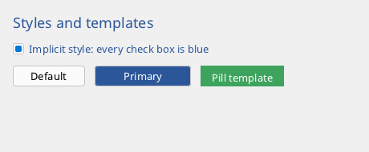

# Styles, templates and binding

The properties of the elements are their fields. Styles, triggers and bindings set them by name, so markup, code, styles and the
[designer](markup.md#the-editor) all speak of the same `Text`, `Background` and `Margin`.



```xml
<!-- Styled.fxml -->
<Window Class="Styled" Title="Styles" Width="460" Height="190">
  <Resources>
    <!-- without a key: every CheckBox of this window -->
    <Style Target="CheckBox">
      <Setter Property="Foreground" Value="#2B579A"/>
    </Style>
    <Style Key="Heading" Target="Label">
      <Setter Property="Color" Value="#2B579A"/>
      <Setter Property="FontSize" Value="18"/>
    </Style>
    <!-- with a key: for the elements that ask for it -->
    <Style Key="Primary" Target="Button">
      <Setter Property="Background" Value="#2B579A"/>
      <Setter Property="Foreground" Value="#FFFFFF"/>
      <Setter Property="Width" Value="120"/>
      <Trigger Property="Hover" Value="true">
        <Setter Property="Background" Value="#3D6FBF"/>
      </Trigger>
    </Style>
    <!-- a new look for a control: one root element made of other elements -->
    <ControlTemplate Key="Pill" Target="Button">
      <Border Name="bd" Background="#3DA35D" Padding="14,6" Thickness="0">
        <Label Name="txt" Text="{TemplateBinding Text}" Color="#FFFFFF"/>
      </Border>
      <Trigger Property="Pressed" Value="true">
        <Setter Target="bd" Property="Background" Value="#1F5E33"/>
      </Trigger>
    </ControlTemplate>
  </Resources>
  <StackPanel Margin="16" Spacing="12">
    <Label Text="Styles and templates" Style="Heading"/>
    <CheckBox Text="Implicit style: every check box is blue" IsChecked="true"/>
    <StackPanel Orientation="Horizontal" Spacing="12">
      <Button Text="Default"/>
      <Button Text="Primary" Style="Primary"/>
      <Button Text="Pill template" Template="Pill" Width="-1"/>
    </StackPanel>
  </StackPanel>
</Window>
```

```fire
#include "Styled.fxml"

class StyledWindow : StyledBase { }

var window = new StyledWindow()
window.Run()
```

## Properties

Every element has `Background`, `Foreground` (brushes), `Pen` (the pen of its frame), `Font`, `FontSize` and `Name`, plus its own properties
(`Text`, `IsChecked`, ...). `undefined` means: the control takes the colours of the [theme](#the-theme) and colours its states (hover, pressed) itself;
a `Background` that is set applies in every state until a trigger changes it. A `Label` uses `Color`, then `Foreground`.

In markup a colour is `#RRGGBB` (`#RGB`, `#AARRGGBB`, or the raw number) and becomes a `SolidBrush`; a pen is `#RRGGBB` or `#RRGGBB,width`.
`{Expr new SolidBrush(0x80FF0000)}` is any fire expression, `[SolidBrush #336699]` a new object ([values in markup](markup.md#elements-and-properties)).

## Styles

A style collects setters (and triggers) for one kind of element. Its `Target` is the **style key** of the kind: `Button`, `Label`, `CheckBox`,
`TextBox`, `TextArea`, `ListBox`, `ListView`, `TreeView`, `ComboBox`, `Panel`, `StackPanel`, `DockPanel`, `WrapPanel`, `Grid`, `Border`, `Canvas`,
`ScrollViewer`, `Image`, the shapes ... (`element.StyleKey()`), or `Element` for the properties all share. A derived class inherits the key of its
base class unless it overrides `StyleKey()`.

| | Markup | Code |
| --- | --- | --- |
| implicit (all elements of the kind below) | `<Style Target="Button">` in `<Resources>` | `ui.resources.AddStyle(style)`, `panel.Resources().AddStyle(style)` |
| named | `<Style Key="Primary" Target="Button">`, used with `Style="Primary"` | `element.Style = style` |
| a setter | `<Setter Property="Margin" Value="4"/>` | `style.Set("Margin", new UI.Thickness(4))` |
| based on another | `BasedOn="Base"` | `style.basedOn = other` |

- The nearest implicit style above an element wins, the root's last. A named style replaces the implicit one.
- A style applies at the **first layout** of the element and overrides what the constructor, the code **or an attribute in the markup** set before
  (unlike WPF, where the local value wins) - an implicit `Label` style also changes the labels inside control templates. To keep a value of your own, set
  it after the first paint, or give the element an empty style (`element.Style = new UI.Style()`).
- A property the element does not have is skipped. A property that is set by a method (`Rows`, `Data`) cannot be set by a style.

```fire
#import "ui"

var fb = new Framebuffer(300, 100)
var win = new Window(fb, "Styles in code")
var ui = new UI.Root(fb, win)
var style = new UI.Style("Button")
style.Set("Margin", new UI.Thickness(4))
style.Set("Background", new SolidBrush(UI.Color.Rgb(60, 120, 200)))
var hover = new UI.Trigger("Hover", true)
hover.Set("Background", new SolidBrush(UI.Color.Rgb(200, 60, 60)))
style.AddTrigger(hover)
ui.resources.AddStyle(style)               // every Button
var row = new UI.StackPanel(10, 10, -1, -1, true)
row.Add(new UI.Button("One"))
row.Add(new UI.Button("Two"))
ui.Add(row)
ui.Run()
```

## Triggers

A trigger sets values while a condition holds and puts the old ones back afterwards:

| | Markup | Code |
| --- | --- | --- |
| condition | `<Trigger Property="Hover" Value="true">` | `new UI.Trigger("Hover", true)` |
| more conditions | `<Condition Property="IsChecked" Value="true"/>` | `trigger.And("IsChecked", true)` |
| a value | `<Setter Property="Background" Value="#4477BB"/>` | `trigger.Set("Background", brush)` |
| on a part of a template | `<Setter Target="bd" .../>`, `<Condition Source="bd" .../>` | `trigger.Set("Background", brush, "bd")`, `trigger.And("Hover", true, "bd")` |

Besides the element's own properties a trigger can test the state the library keeps: `Hover`, `Pressed`, `Focused` (and `Enabled`, `IsChecked`, ...
which are properties anyway). Triggers are checked at every layout. `element.AddTrigger(trigger)` puts one on a single element.

## Control templates

A template replaces the look of a control with a tree of other elements. Size, clicks and focus stay with the control.

- Markup: `<ControlTemplate Key="Pill" Target="Button">` with **one** root element; the control says `Template="Pill"` (or a style sets `Template`).
- `{TemplateBinding Text}` keeps a property of a part equal to the control's; named parts can be changed by the template's triggers.
- Code: `new UI.ControlTemplate(func (UI.Element owner) => { ...; return root })`, `template.Bind("txt", "Text", "Text")` (part, property of the part,
  property of the control), `template.AddTrigger(trigger)`, `element.Template = template`. `element.FindPart("bd")` finds a part.
- `Label`, `Button` and `CheckBox` take templates. A `TextBox` always draws itself (caret and selection).
- Event handlers and `{Binding}` do not work inside a template - react to the control itself.

## Data templates

A data template builds the element that shows one data item - a row of a `ListBox` or `ListView`:

```xml
<Resources>
  <DataTemplate Key="Person">
    <StackPanel Orientation="Horizontal" Spacing="6">
      <Label Text="{Binding name}"/>
      <Label Text="{Binding address.city}"/>
    </StackPanel>
  </DataTemplate>
</Resources>
<ListBox ItemsSource="{Binding people}" ItemTemplate="Person"/>
```

In code: `list.ItemTemplate = new UI.DataTemplate(func (any item) => { return new UI.Label(item.name) })`. `{Binding}` without a path is the item
itself. Rows built by a template are for display only. More on lists: [lists and trees](lists.md).

## Binding

A binding ties a property of an element to a property of another object - the **data context** of a markup window, or any object in code:

| Markup | Meaning |
| --- | --- |
| `Text="{Binding Name}"` | follows `Name` of the data context (`window.SetDataContext(obj)`) |
| `{Binding Player.Stats.Hp}` | a path through objects; replacing an object on the way reconnects |
| `Mode=TwoWay` | the element writes back (a `TextBox` while typing, a `CheckBox` when toggled) |
| `Mode=OneTime` | read once |
| `Converter=Upper` | a converter in between |
| `ElementName=peopleList` | the source is another named element (`{Binding selectedItem.name, ElementName=peopleList}`) |

In markup bindings are built on [probes](../language/16-probes-and-reflection.md): nothing polls, a write to the source field updates the element. A
property with only a `get` follows the fields its getter reads.

In code: `element.Bind("Text", source, "name", twoWay, converter, once)` - reconciled at every layout.

```fire
#import "ui"

class Settings {
    string user = "ada"
    bool loud = false
}

var fb = new Framebuffer(300, 120)
var win = new Window(fb, "Binding in code")
var ui = new UI.Root(fb, win)
var settings = new Settings()
var box = new UI.TextBox("", 10, 10)
box.Bind("Text", settings, "user", true)          // two-way
var echo = new UI.Label("", 10, 50)
echo.Bind("Text", settings, "user")               // one-way
ui.Add(box)
ui.Add(echo)
ui.Run()
```

### Converters

A converter is a class with `any Convert(any value)` (source to element) and, for `TwoWay`, `any ConvertBack(any value)`; deriving from
`UI.Converter` gives the identity for the one you leave out.

```fire
class UpperConverter : UI.Converter {
    override any Convert(any value) { return value.ToUpper() }
}
```

In markup a converter is declared with a key - `<Converter Key="Upper" Type="UpperConverter"/>` in `<Resources>`. Four come with the library and
need no declaration: `Not` (`UI.NotConverter`, a bool turned round), `IsEmpty`, `NotEmpty` (a text or list is empty / not empty) and `Text` (any value
as text).

## Resources

Every element can hold named values, and the root holds the last ones:

| Markup | Code |
| --- | --- |
| `<Resources>` of the window | `ui.resources.Set("accent", brush)`, `element.Resources().Set(...)` |
| a style or template key | `ui.resources.AddStyle(style)` |
| | `element.FindResource("accent")` - searched upwards from the element, last in the root; `undefined` if there is none |

A `ResourceDictionary` owns its values and styles; `Merge(other)` takes over the entries of another one.

## The theme

`ui.theme` (`UI.Theme`) holds the colours every control falls back to:

| Field | Used for |
| --- | --- |
| `back`, `panel` | window background, panels |
| `face`, `faceHover`, `facePressed`, `faceDisabled` | buttons and other faces in their states |
| `inputBack` | text fields, lists |
| `accent` | focus, selection, check marks |
| `text`, `textDisabled` | text |
| `selection`, `selectionText` | selected text and rows |
| `scrollTrack`, `scrollThumb`, `scrollThumbHover` | scroll bars |
| `menuBack` | menus, tooltips, popups |
| `border`, `borderFocus`, `caret` (pens) | frames, the focus frame, the caret |
| `font`, `fontSize` | the font of everything that names none |
| `radius`, `popupRadius`, `shadowSize` | corners (4, 8) and shadows (8) - `radius = 0` gives square controls |
| `glass`, `transparency` | effects (see [appearance](windows.md#corners-shadows-glass-and-acrylic)) |

`theme.SetColors(dark, accent)` sets all colours at once for a light or dark look with an accent (`0xRRGGBB`); brushes of your own that are not a
`SolidBrush` stay. A change of the theme repaints everything. Usually you do not touch it: the root follows the system
([dark mode, accent, font](windows.md#the-look-of-the-system)).
