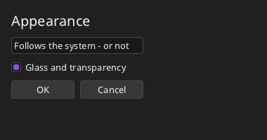

# Windows and appearance



```xml
<!-- Dark.fxml -->
<Window Class="Dark" Title="Dark" Width="380" Height="200">
  <StackPanel Margin="16" Spacing="10">
    <Label Text="Appearance" FontSize="20"/>
    <TextBox Width="-1" Text="Follows the system - or not"/>
    <CheckBox Text="Glass and transparency" IsChecked="true"/>
    <StackPanel Orientation="Horizontal" Spacing="8">
      <Button Text="OK"/>
      <Button Text="Cancel"/>
    </StackPanel>
  </StackPanel>
</Window>
```

```fire
#include "Dark.fxml"

class DarkWindow : DarkBase {
    construct() {
        this.ui.Dark = true              // whatever the system says
        this.ui.Accent = 0x8854D0
    }
}

var window = new DarkWindow()
window.Run()
```

## Run, Show and Tick

Windows run on a **window manager** (see [graphics](../graphics/README.md#windows-and-the-window-manager)): the root hooks into the cycle of its
window, and in every cycle it distributes the events, paints what changed and calls `onTick`.

| Root | Window from markup | Effect |
| --- | --- | --- |
| `ui.Run()` | `window.Run()` | the start of the program: runs the manager on this thread until the windows are closed (if it runs already, the window is only shown there) |
| `ui.Show()` | `window.Show()` | shows the window and goes on; if nobody runs the manager yet it gets a thread of its own, the events are handled at the program's safe points, and the program waits at its end until the window is closed |
| `ui.Show(true)` | `window.Show(true)` | **modal**: returns when the window is closed; the other windows take no input meanwhile - this is how a click opens a dialog |
| `while (ui.Tick()) { }` | | one cycle of this root and the attached ones, in a loop of your own |
| `ui.onTick` | override `OnTick()` | runs once per cycle |

## Several windows

Each window is a root with a framebuffer and a `Window` of its own. `ui.Attach(other)` hangs another root onto this one: `Run`, `Show` and `Tick` serve
both until the other window is closed; `ui.Run(other)` attaches and runs until both are closed; `ui.Detach(other)` takes it off again, `ui.attached`
is the list. Only the main window waits for the display's refresh (vsync), the attached ones do not.

With markup, `window.Open(other)` attaches another window (an object of another generated class, or a root); the other window's `OnTick()` runs in
every cycle. Keep it alive as long as it is open - for example as a field of the window that opened it:

```fire
#include "Main.fxml"
#include "Tools.fxml"

class MainWindow : MainBase {
    ToolsWindow tools
    override undefined ShowTools(any sender) {
        this.tools = new ToolsWindow()
        this.Open(this.tools)
    }
}
```

## Window size

The root makes the window resizable into its framebuffer (`window.AutoResize = true`): when the user resizes the window, the framebuffer gets the new
size, the interface is laid out anew and painted. `ui.width`, `ui.height` are the current size, `ui.onResize = func (int w, int h) => { ... }` is
called afterwards. Note that the top container does not stretch by itself ([filling the window](containers.md#filling-the-window)).
`window.AutoResize = false` stretches the fixed picture instead.

## The look of the system

Every root looks like the other programs of the computer. At its start it asks `SystemTheme.Current()` and takes

- the **scaling** of the display (Windows: DPI; GNOME: `scaling-factor` x `text-scaling-factor`; KDE/Qt/GDK: `QT_SCALE_FACTOR`, `GDK_SCALE`; macOS
  scales the window itself),
- **dark or light mode** (Windows: `AppsUseLightTheme`; GNOME: `color-scheme`, the GTK theme; KDE: the colour scheme; macOS: `AppleInterfaceStyle`;
  the browser: `prefers-color-scheme`),
- the **accent colour** (focus, selection, hovered buttons),
- the **font** of the interface and its size (Segoe UI, Cantarell, Noto Sans, SF Pro ... - the first that `Fonts.Has` finds; else the console font).

Three properties of the root override it:

```fire
#import "ui"

var fb = new Framebuffer(300, 120)
var win = new Window(fb, "Override")
var ui = new UI.Root(fb, win)
ui.Scaling = 1.0        // 1.0 = 100 %: no system scaling (1.5 = 150 %)
ui.Dark = true          // the dark look
ui.Accent = 0x8854D0    // the accent colour as 0xRRGGBB
ui.Add(new UI.Button("OK", 16, 16))
ui.Run()
```

The elements keep working in **logical pixels**: positions, sizes, `ui.width` and the mouse positions stay the same, the renderer converts to screen
pixels while drawing (`ui.renderer.scale`). TrueType text is drawn at the larger size and stays sharp; the bitmap fonts keep their size. Window and
framebuffer grow with the scale: a 400 x 300 framebuffer at 150 % is a 600 x 450 window.

On a **board without a desktop** (ESP32, FreeRTOS: `SystemTheme.embedded`) the look is dark with a violet accent, the fast built-in font and only
whole-number scaling. What cannot be found keeps the default (100 %, light, accent `0x0078D7`, console font); `FIRE_SYSTEM_THEME=off` in the
environment switches the query off.

## Corners, shadows, glass and acrylic

Controls have rounded corners (`theme.radius`, 4 px; menus and popups `theme.popupRadius`, 8 px), fine borders and - when focused - a 2 px frame in the
accent colour. Floating elements cast a soft shadow (`theme.shadowSize`); menus lie on **acrylic**: what is behind them, blurred and tinted, with a
hairline at the edge. `theme.radius = 0` gives square controls.

Two switches, for every new root and per root:

```fire
#import "ui"

UI.Effects.Glass = false          // before the roots are made: no glass or acrylic
UI.Effects.Transparency = false   // nothing see-through, no shadows
var fb = new Framebuffer(200, 80)
var win = new Window(fb, "Flat")
var ui = new UI.Root(fb, win)
ui.Glass = false                  // only this root (also later)
ui.Transparency = false
ui.Add(new UI.Button("Flat", 16, 16))
ui.Run()
```

Both follow the system (`SystemTheme.transparency`: Windows "transparency effects", macOS "reduce transparency", the browser
`prefers-reduced-transparency`); on a board they are off. Without them the interface is complete, only flatter and cheaper to draw.

**The window itself** can get a material of the desktop: `ui.WindowBackdrop = Backdrop.Mica` (Windows 11), `Backdrop.Acrylic`, `Backdrop.Blur`
(Windows, macOS, KDE) or `Backdrop.Transparent`. The desktop gives what it can (`window.Backdrop` tells what it gave); where it gives something, the
background of the interface becomes see-through while panels and controls stay as they are.

The effects are drawn by the C library of `graphics` (`Renderer.FillRoundRect`, `DrawRoundRect`, `DrawShadow`, `Blur`, `DrawMaterial` - usable by
any program, see [graphics](../graphics/README.md#rounded-shapes-shadows-and-materials)); with a GPU they run there.

## Where the windows come from

fire draws its windows itself, with its own display layer. The display is chosen when the first window opens:

| System | Display |
| --- | --- |
| Linux, BSD | Wayland when `WAYLAND_DISPLAY` is set (own title bar), else X11 when `DISPLAY` is set; the libraries are loaded at run time |
| Windows | Win32, presented through DirectComposition |
| macOS | Cocoa |
| Browser (wasm) | the canvas of the page |
| everywhere | headless (`FIRE_DISPLAY=headless`): windows are only sizes, for tests and servers |

`FIRE_DISPLAY=x11|wayland|win32|cocoa|web|headless` asks for one. The VM uses the same C library as native programs, so a window looks the same in
both. Details for contributors: [display layer](../spec/UI_PLATFORM.md).
